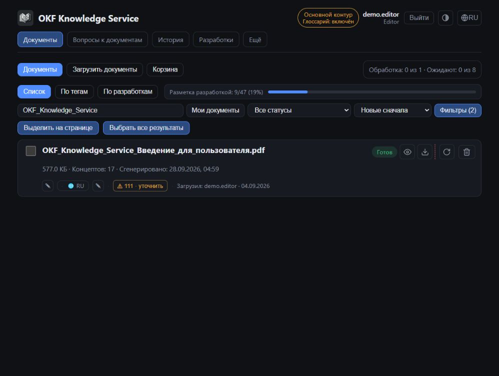
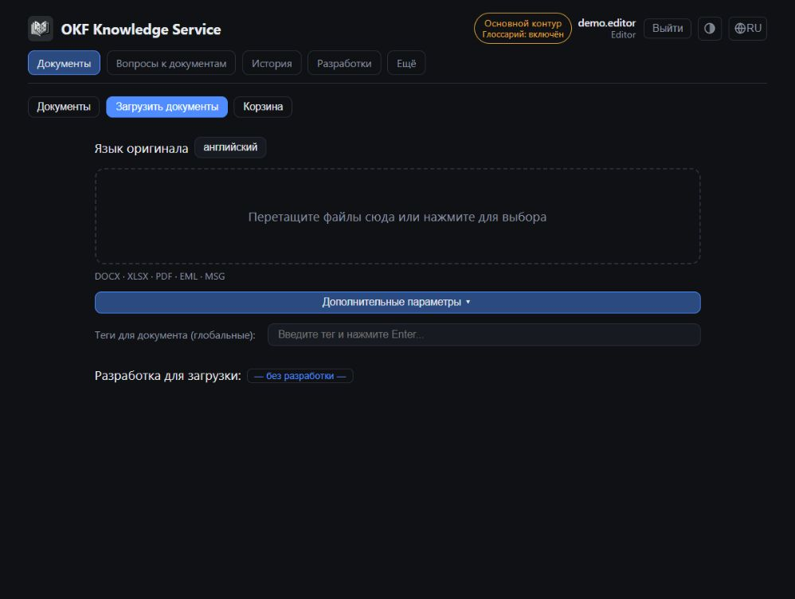
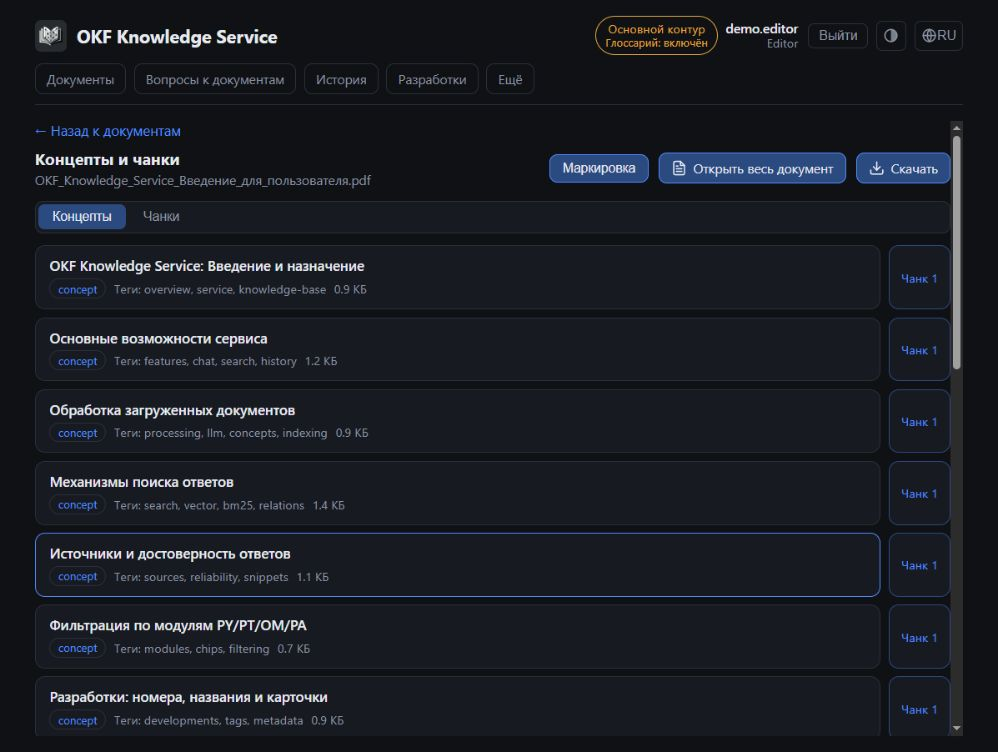
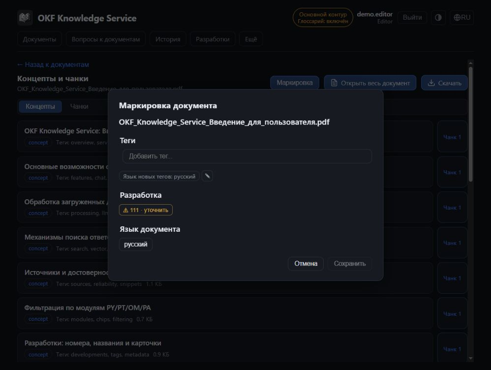
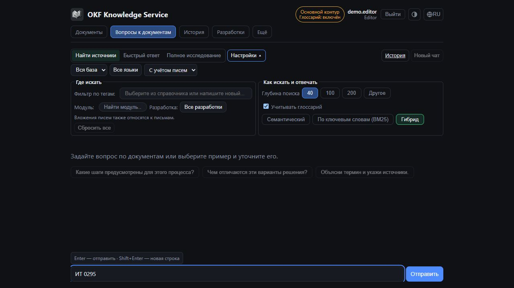
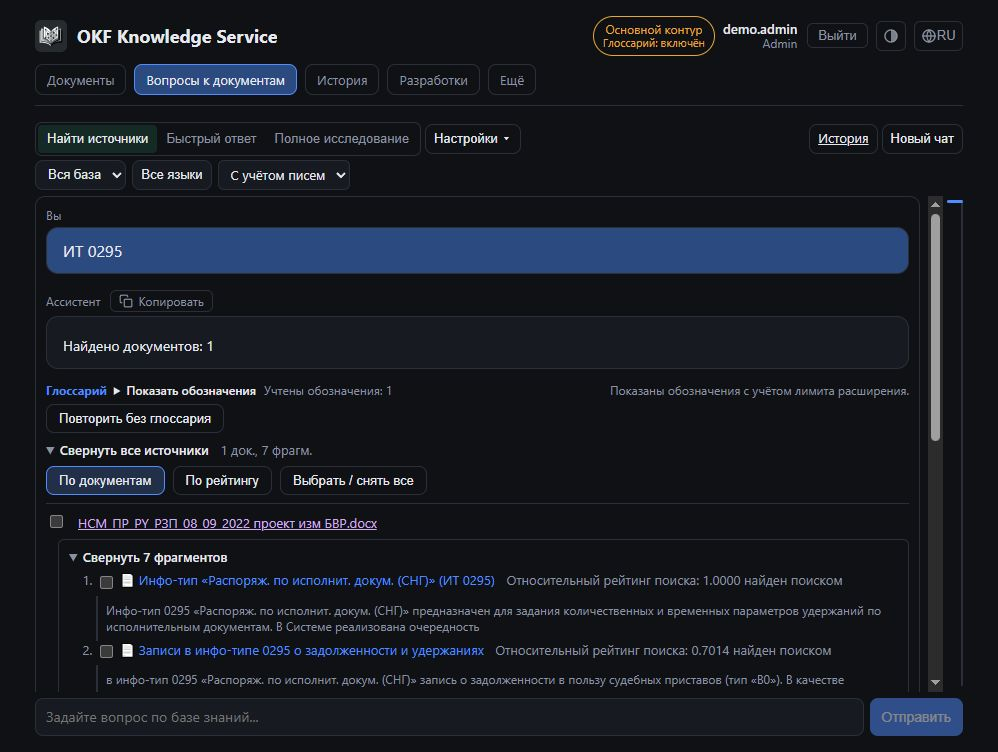
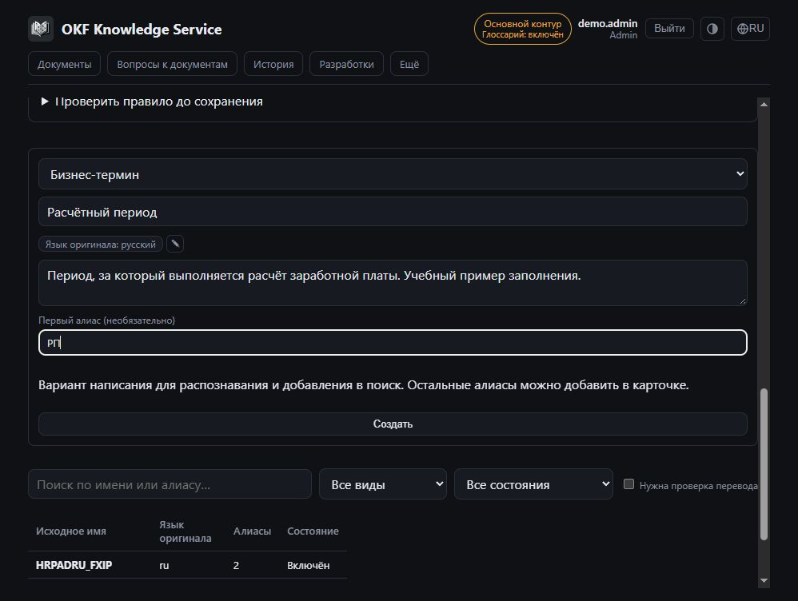
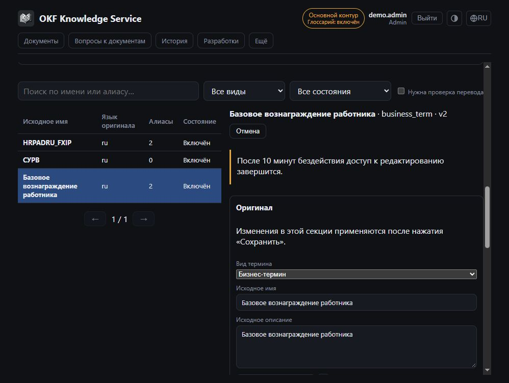
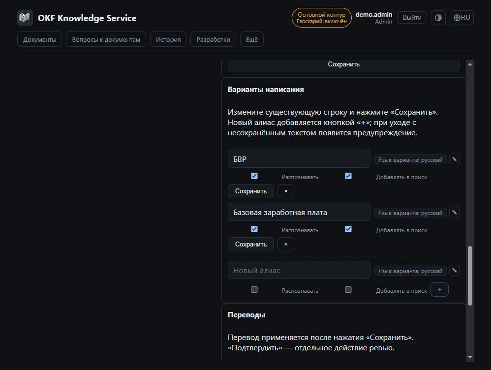
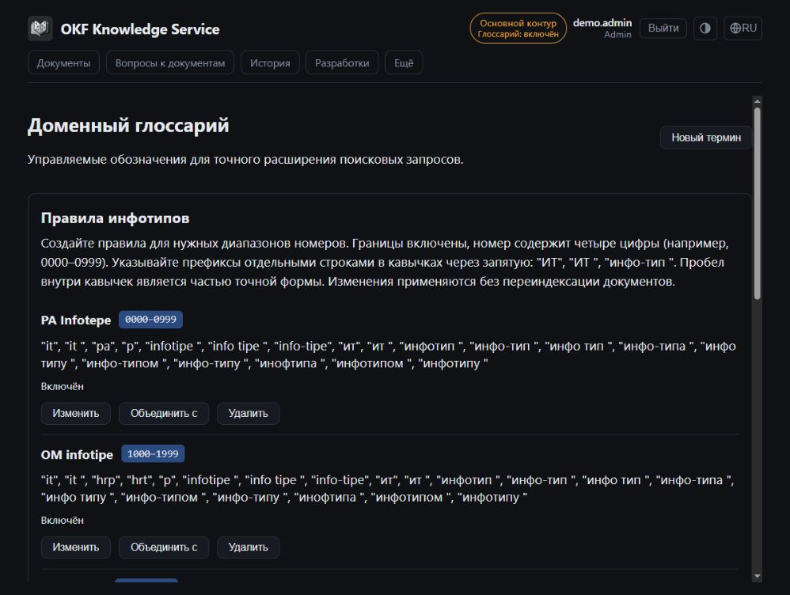

# OKF Knowledge Service

Руководство пользователя

Русская версия · Редакция от 18 октября 2026 года

Практическое руководство по поиску, документам и сопровождению базы знаний. Названия команд соответствуют русскому интерфейсу. Доступность действий зависит от роли и настроек установки. Администратор может переопределять переводы, поэтому отдельные подписи могут отличаться.

## Содержание

1. [Начало работы](#guide-01)
2. [Разделы и права доступа](#guide-02)
3. [Поиск документов в списке](#guide-03)
4. [Вопросы и режимы ответа](#guide-04)
5. [Настройки поиска](#guide-05)
6. [Проверка ответа и выбор источников](#guide-06)
7. [Поиск в выбранных документах](#guide-07)
8. [История и повторные запросы](#guide-08)
9. [Загрузка документов и писем](#guide-09)
10. [Выбор и предпросмотр вложений](#guide-10)
11. [Изменение состава обработки](#guide-11)
12. [Статусы и повторная обработка](#guide-12)
13. [Просмотр документа и таблиц](#guide-13)
14. [Маркировка, теги и разработки](#guide-14)
15. [Совместное редактирование и переводы](#guide-15)
16. [Массовые действия, выгрузка и корзина](#guide-16)
17. [Глоссарий и поддержка языков](#guide-17)
18. [Системные операции, аудит и диагностика](#guide-18)
19. [Решение типичных проблем](#guide-19)
20. [Словарь и памятка](#guide-20)
21. [Экраны интерфейса](#guide-21)

## 1. Начало работы

OKF Knowledge Service помогает находить сведения в проектной документации и письмах. Сервис извлекает текст и таблицы, создаёт смысловые выжимки - **концепты** - и ищет как по ним, так и по исходным текстовым фрагментам. Ответ можно проверить по ссылкам на источники.

### Вход и оформление

1. Откройте адрес сервиса, полученный от администратора.
2. Нажмите **«Войти через корпоративный вход»**, если требуется авторизация, и завершите корпоративный вход.
3. Проверьте учётную запись и роли в верхней части страницы. В учебной установке может быть выбор демонстрационного пользователя.
4. Выберите язык интерфейса. Кнопка темы переключает автоматическое, тёмное и светлое оформление.

Язык интерфейса, язык документа и язык оригинала записи справочника - разные настройки. Смена интерфейса не переводит загруженный документ и не меняет его язык в фильтрах.

### Первый полезный результат

1. Откройте **«Документы»**, убедитесь, что нужный материал загружен и обработан.
2. Перейдите в **«Вопросы к документам»**, выберите **«Быстрый ответ»**.
3. Задайте конкретный вопрос: «Какие условия запуска отчёта Z_EXAMPLE описаны в документации?»
4. Нажмите **«Отправить»** или Enter. Shift+Enter добавляет строку.
5. Откройте ссылки `[1]`, `[2]` в ответе. Важные числа, условия и выводы сверьте с оригиналом.

> Ссылки делают ответ проверяемым, но не гарантируют его правильность. Модель может ошибаться, а поиск - пропустить материал. Отсутствие результата не доказывает отсутствие сведений во всей базе.

| Задача | Где выполнять |
|---|---|
| Найти файл по названию, разработке или загрузчику | «Документы», поиск и фильтры списка |
| Найти факт внутри текста | «Вопросы к документам» |
| Изучить фрагменты без сводного ответа | «Найти источники» |
| Сопоставить найденные материалы | «Полное исследование» |
| Посмотреть прежний ответ | «История» |
| Добавить материалы | «Документы» → «Загрузить документы», Editor/Admin |

## 2. Разделы и права доступа

Основные разделы находятся в верхней навигации. Дополнительные открываются через **«Ещё»**. Отсутствующая команда обычно означает ограничение роли или отключённую функцию.

| Раздел | Назначение |
|---|---|
| Документы | Реестр, загрузка, фильтры, маркировка и корзина |
| Вопросы к документам | Поиск, ответы, источники и область поиска |
| История | Ваши сохранённые диалоги |
| Разработки | Справочник разработок и связанные документы |
| Ещё → Системные операции | Массовые задания и переход к диагностике |
| Ещё → Поддержка языков | Языки и переводы |
| Ещё → Глоссарий | Термины, обозначения, переводы и проверка запросов |
| Ещё → Аудит | Журнал действий, аномалии и блокировки |
| Ещё → История пользователей | Просмотр диалогов уполномоченными ролями |

### Роли

| Роль | Основные возможности |
|---|---|
| Viewer | Читать документы, скачивать доступные исходники, задавать вопросы, работать со своей историей |
| Editor | Загружать и маркировать документы, обрабатывать отдельный документ, удалять в корзину и восстанавливать; сопровождать разработки и переводы |
| Admin | Редакторские действия, массовое удаление и обработка, выгрузка при включённой функции, системные операции, языки, оригиналы глоссария и диагностика |
| Security | Аудит и история пользователей; роль сама по себе не даёт редакторских прав |

Учётная запись может иметь несколько ролей. **Admin и Security могут просматривать историю пользователей; «Аудит» требует Security.** Просмотр содержимого чужого диалога фиксируется в журнале. Свою историю нельзя считать недоступной уполномоченным администраторам.

При отключённой авторизации ограничения ролей могут отсутствовать. Такое поведение учебной установки не следует переносить на корпоративную.

## 3. Поиск документов в списке

Внутри раздела расположены **«Документы»**, **«Загрузить документы»** для редакторов и **«Корзина»** справа. Переключение разделов не равнозначно отмене передачи файлов.

### Найти файл

1. Введите часть названия, тег, разработку или загрузчика в строку поиска.
2. Откройте **«Фильтры»**: загрузчик, модуль, разработка, тег, статус, язык документа и даты загрузки.
3. Включите **«Проблемные»** для документов с предупреждениями обработки.
4. Выберите сортировку и представление: **«Список»**, **«По тегам»** или **«По разработкам»**.
5. Откройте документ через название или **«Концепты и чанки»**.

Для Editor/Admin исходный фильтр загрузчика может быть **«Мои документы»**. Если не видите файл коллеги, выберите **«Все загрузчики»**. Это фильтр, а не признак личной базы.

Фильтры комбинируются. При пустом списке уберите лишние условия через **«Сбросить все»**. Состояние списка сохраняется при навигации; параметры отражаются в адресе. Ссылку можно передать коллеге с доступом, но состав результатов со временем меняется.

### Строка документа

В ней могут быть статус, размер, число концептов, загрузчик и даты, теги, разработка, язык, прогресс, предупреждения, похожие документы и исключённые вложения. Подсказка у значка поясняет действие.

**«Черновик - требует разметки»** относится к маркировке. Это не незавершённая генерация и не черновик вложений. **«Разметка разработкой»** показывает долю документов, связанных с разработкой, а не полноту извлечения текста.

> Для полного перечня файлов по фильтру используйте реестр. Для поиска факта внутри текста - «Вопросы к документам». Ответ модели не является полным отчётом по реестру.

## 4. Вопросы и режимы ответа

Введите вопрос на странице **«Вопросы к документам»**. Можно вставить несколько строк. Enter отправляет, Shift+Enter переносит строку.

| Режим | Результат и назначение |
|---|---|
| Найти источники | Документы и фрагменты без сводного ответа; для проверки и ручного выбора |
| Быстрый ответ | Ответ по наиболее релевантным источникам; для конкретного вопроса |
| Полное исследование | Обработка найденных фрагментов частями и сводный ответ; для сравнения и обзора |

Доступные режимы задаются настройками. **«Полное исследование» работает с найденным набором в пределах глубины поиска**, а не гарантированно читает всю базу. Оно может выполняться дольше; интерфейс показывает обработку частей и объединение ответа.

### Формулировки вопросов

- «Какие входные параметры есть у отчёта Z_EXAMPLE?»
- «Сравни условия расчёта из найденных спецификаций, укажи различия со ссылками».
- «Найди описание поля status_code и допустимых значений».
- «Какие замечания рецензентов относятся к этому разделу?»

Указывайте объект, код, версию или разработку. В новом вопросе полезно повторить предмет: короткое «а ещё?» не задаёт однозначную область поиска.

### Остановка и повтор

**«Остановить»** прерывает ответ. Показанный текст может остаться с отметкой неполноты; это не завершённый результат. **«Запустить заново»** повторяет запрос. **«Изменить вопрос»** переносит его в поле ввода; если там есть черновик, потребуется подтвердить замену.

Переход со страницы чата может остановить выполняемый ответ. Дождитесь завершения, если нужен полный результат. Готовый ответ можно скопировать в Markdown.

## 5. Настройки поиска

Откройте **«Настройки»**. Параметры сгруппированы в **«Где искать»** и **«Как искать и отвечать»**. Активные ограничения показаны также краткими метками.

### Где искать

- **Модуль и разработка.** Выбор разработки заменяет общий выбор модуля. Список разработок учитывает выбранный модуль.
- **Теги.** Дополнительно ограничивают материалы; слишком узкий набор исключает нужные источники.
- **Язык документа.** Фильтрует по метаданным. «Не определён» означает отсутствие известного языка.
- **Источники:** «С учётом писем», «Без писем», «Только письма». Вложения писем тоже почтовые источники. Неопределённое происхождение доступно только с учётом писем.
- **Область поиска.** Ограничивает поиск выбранными документами; прочие фильтры продолжают действовать.

### Как искать и отвечать

| Параметр | Практическое значение |
|---|---|
| Гибрид | Сочетает смысл и точные слова; подходящий исходный вариант |
| Семантический | Для описательных формулировок и смысловой близости |
| По ключевым словам (BM25) | Для кодов, полей, точных названий и аббревиатур |
| Глубина поиска | Максимум найденных фрагментов после объединения и фильтров |
| Число результатов для ответа | Размер набора для ответа, когда параметр доступен |
| Учитывать глоссарий | Использовать настроенные обозначения, если функция включена |
| Оценивать релевантность источников | Проверить первые фрагменты; увеличивает время ответа |

Глубина и число результатов различаются. Например, найдено 40 фрагментов, а быстрый ответ использовал 10. Остальные могут быть видимыми, хотя модель не получила их для ответа.

При **«Достигнут лимит поиска»** увеличьте глубину в разрешённых пределах или уточните вопрос. Даже максимум не гарантирует полный охват базы. Пределы зависят от установки.

Глоссарий расширяет обозначения запроса, но не добавляет фактов. **«Показать обозначения»** раскрывает применённые формы. Для сравнения есть **«Повторить без глоссария»**.

## 6. Проверка ответа и выбор источников

### Проверить утверждение

1. Нажмите `[N]` в ответе или **«Показать источники»**.
2. Найдите документ и раскройте его фрагменты.
3. Проверьте заголовок, текст и происхождение; для письма - почтовые сведения.
4. Откройте концепт, чанк, целый документ или исходные ячейки по предложенной ссылке.

Источники можно сворачивать и переключать между доступными представлениями. Число документов и фрагментов различается: у одного документа может быть несколько фрагментов.

**«В контексте модели»** означает, что материал был входными данными ответа. **«Найден поиском · вне контекста модели»** означает, что он найден, но не вошёл в этот контекст. Документ в списке не доказывает, что ответ основан на нём. Релевантность не является вероятностью истинности утверждения.

### Ответ по выбранным фрагментам

1. Отметьте фрагменты или документ в блоке источников.
2. Проверьте количество выбранных фрагментов.
3. Нажмите **«Сформировать ответ по выбранным»**.
4. Проверьте новый ответ на исходный вопрос и ссылки.

Это полезно при нескольких редакциях или посторонних материалах. Если источник изменился либо недоступен, выполните новый поиск и выберите актуальные фрагменты.

### Оценка источников остановила ответ

Недостаточная релевантность означает, что проверенные фрагменты не дали опоры. Можно **«Показать похожие материалы»**, уточнить вопрос или фильтры. **«Продолжить без оценки»** отключает дополнительный контроль для повторной попытки; качество материалов не повышается.

Оценка проверяет указанное число первых фрагментов, а не всю базу. При её недоступности интерфейс сообщает, что результат получен без оценки. Она не заменяет просмотр оригинала.

## 7. Поиск в выбранных документах

**Область поиска** нужна для серии вопросов к ограниченному набору. В неё добавляются целые документы, даже если отмечен один фрагмент каждого.

1. Найдите материалы, например через **«Найти источники»**.
2. Отметьте источники, нажмите **«Добавить документы в область поиска»**.
3. В настройках проверьте список и **«Искать только в области»**.
4. Задайте новый вопрос. Поиск учтёт также теги, язык и почтовый фильтр.

Текущий интерфейс допускает до 500 документов в области. Повторное добавление документа не создаёт копию.

Через **«Просмотреть и изменить список документов»** можно проверить доступность, убрать документ или очистить область. Недоступные документы исключаются из поиска. При пустой включённой области добавьте документы либо отключите ограничение. Если недоступны все документы, измените список.

### Три разных действия

| Действие | Что меняется |
|---|---|
| Сформировать ответ по выбранным | Фрагменты для повторного ответа на исходный вопрос |
| Добавить документы в область поиска | Целые документы для следующих запросов |
| Изменить состав обработки | Вложения в опубликованной базе для всех пользователей |

Если нужный документ не находится внутри области, проверьте прочие фильтры.

## 8. История и повторные запросы

В чате есть лента недавних диалогов. **«Показать предыдущие»** подгружает ранние записи; диалоги разворачиваются и сворачиваются. Навигация по запросам помогает перемещаться в длинной ленте.

### Открыть диалог

1. Перейдите в **«История»**.
2. Выберите диалог по названию и времени.
3. Прочитайте сообщения и сохранённые источники.
4. Для нового вопроса вернитесь в **«Вопросы к документам»**. Повторные действия доступны там, где предложены у сообщения.

**«Новый чат»** начинает новую сессию; прежняя остаётся в истории. История показывает результат на момент запроса, а не новую проверку актуальности. Исходник мог измениться, попасть в корзину или стать недоступным. Старые ссылки на версию не всегда открываются после изменений.

### Удаление и доступ

**«Удалить»** требует подтверждения и удаляет диалог необратимо. Корзина документов к истории не относится. Срок хранения задаётся настройками.

Пользователь видит свою историю. Admin/Security могут читать чужие диалоги через **«История пользователей»**; просмотр содержимого фиксируется в аудите. Учитывайте это при вводе информации.

Если история не загрузилась, это не означает удаление диалогов. Повторите загрузку; возможность задать новый вопрос может оставаться доступной.

## 9. Загрузка документов и писем

**Доступ: Editor/Admin.** Прямая загрузка поддерживает **DOCX, XLSX, PDF, EML и MSG**. Архив может быть вложением, но не является форматом зоны прямой загрузки. Извлечение ограничено поддерживаемыми форматами и настройками сервера.

### Загрузить файлы

1. Откройте **«Документы» → «Загрузить документы»**.
2. Укажите **«Язык оригинала»** для создаваемых записей справочников. Отдельно проверьте язык самого документа после загрузки.
3. В **«Дополнительных параметрах»** задайте общие теги и разработку пакета, если нужны.
4. Перетащите файлы или нажмите зону загрузки и выберите их.
5. Следите за **«Результатом передачи файлов»**. Примите решения по похожим файлам и вложениям, если требуется.
6. Откройте принятый документ и проверьте обработку.

Можно переходить между разделами, но **оставьте вкладку браузера открытой**. Закрытие и перезагрузка могут прервать непереданные файлы. **«Файл принят» не означает «обработка завершена».** Принятые документы обрабатываются отдельно от передачи пакета.

| Результат | Действие |
|---|---|
| Файл принят | Проверить дальнейшую обработку |
| Ожидает вашего решения | Разобрать диалог по дублю или вложениям |
| Ошибка передачи / Не отправлен | Исправить причину и повторить доступной командой |
| Результат передачи неизвестен | Проверить список; при повторе проверяются дубли |
| Пропущен | Прочитать причину, например неподдерживаемый формат |

Новый пакет может заменить список результатов. При наличии файлов для повтора система запросит подтверждение.

### Дубли

Идентичный файл отклоняется; используйте **«Открыть существующий»**. Для похожего содержимого сравните кандидатов, отмените загрузку или выберите **«Всё равно загрузить»**. Создаётся отдельный документ с отметкой сходства; редакция автоматически не заменяется. Похожий файл в корзине не препятствует загрузке.

**«Есть похожие документы»** открывает сравнение. При удалении дублей один документ группы должен остаться. Поздняя загрузка не гарантирует новую редакцию содержания.

## 10. Выбор и предпросмотр вложений

Небольшие документы проходят автоматически. При большом, суммарно тяжёлом или не полностью оценённом составе возможен статус **«Ожидает выбора вложений»**.

### Подтвердить состав

1. Нажмите **«Выбрать вложения»** или **«Состав обработки»**.
2. Изучите дерево. Основной документ обрабатывается всегда.
3. Проверьте формат, размер, строки, ячейки и причины недоступности. «Не менее N строк» - нижняя оценка объёма.
4. Раскройте ветки. Для неоценённого контейнера используйте **«Раскрыть состав»**, если доступно.
5. Откройте **«Предпросмотр»** или скачайте оригинал.
6. Отметьте нужное и нажмите **«Начать обработку»**. Решение о похожих документах подтверждается отдельно, если запрошено.

Исключение контейнера исключает дочерние вложения. Приложения письма можно исключить, сохранив тело. Недоступные форматы и ветки за пределом вложенности нельзя включить галочкой. Скрытое содержимое такой ветки не перечисляется как полностью исследованное.

### Ограничения предпросмотра

| Формат | Что показано |
|---|---|
| XLSX | Первые 30 непустых строк, A-T, до 500 символов в ячейке; выбор листа |
| PDF | Текст первых трёх страниц, до 20 000 символов; без изображений и сканов без текста |
| DOCX и письма | Фрагмент текста без оформления; вложения отдельно |
| Архив | Первые 100 записей; список, а не чтение всех файлов |

Excel показывается без оформления: даты могут быть числами, проценты - долями, ведущие нули могут отсутствовать. Формулы не пересчитываются: сохранённый результат или текст формулы. Предпросмотр не доказывает полноту обработки файла.

**«Сохранить выбор»** сохраняет черновик, но не запускает обработку. Закрытие не сохраняет новые галочки. При бездействии окно предупреждает и может закрыться; сохраните выбор или нажмите **«Продолжить работу»**.

## 11. Изменение состава обработки

**Доступ: Editor/Admin.** Откройте **«Состав обработки» → «Редактировать вложения»**. Сначала показывается действующий состав; сохранённый черновик может отличаться.

### Для чего нужен редактор вложений

Редактор определяет, содержимое каких вложений попадёт в базу знаний и будет доступно новым поисковым запросам и ответам. Он полезен, когда письмо или документ содержит дубли, старые редакции, служебные файлы либо большие вложения, которые не нужны для поиска. Это настройка обработки документа для всех пользователей, а не личный фильтр текущего вопроса.

**Пример: файл загружен отдельно и приложен к письму.** В базе уже есть обработанный файл `Спецификация.docx`, а в письме находится его копия. Чтобы поиск не возвращал одинаковое содержимое из двух источников, оставьте отдельный документ в базе, а копию вложения внутри письма исключите. Само письмо можно оставить: его текст, обсуждение и контекст переписки продолжат участвовать в поиске.

1. Убедитесь, что отдельный файл обработан, доступен и содержит ту же редакцию. Совпадения имени недостаточно: сравните содержимое или оригиналы.
2. У письма откройте **«Состав обработки» → «Редактировать вложения»**.
3. Найдите копию файла в дереве и снимите отметку только с этого вложения. Сохраните нужные остальные вложения; исключение контейнера исключает и его дочерние файлы.
4. Нажмите **«Проверить изменения»**. Для уже обработанного документа примените **«Применить исключения без перегенерации»**, если этот способ предложен. При первой обработке подтвердите выбранный состав через **«Начать обработку»**.
5. Дождитесь применения и проверьте действующий состав. Повторите поиск: самостоятельный файл должен оставаться доступен, а исключённая копия больше не должна давать собственные фрагменты.

Исключение вложения не удаляет отдельно загруженный документ и не переписывает исходное письмо. Оно убирает из активного поиска содержимое выбранного вложения; упоминание файла или цитата из него в самом тексте письма могут остаться. Ранее сохранённые ответы не пересчитываются. **«Сохранить выбор»** сохраняет только черновик: до применения опубликованный состав поиска остаётся прежним. Если вложение содержит другую редакцию или дополнительные сведения, не исключайте его как дубль только по имени.

### Применить изменения состава

1. Измените выбор вложений.
2. При необходимости сохраните черновик через **«Сохранить выбор»**.
3. Нажмите **«Проверить изменения»**, если проверка ещё не выполнена.
4. Прочитайте результат и предлагаемый способ применения.
5. Подтвердите действие и дождитесь результата.

| Команда | Результат |
|---|---|
| Применить исключения без перегенерации | Убирает вложения из активного поиска, сохраняя результаты остальных источников |
| Восстановить из сохранённых результатов | Возвращает обработанные данные, пригодные для повторного использования |
| Обработать добавленные вложения | Выполняет недостающие этапы добавленных источников |
| Полная перегенерация документа | Заново обрабатывает весь выбранный состав; отдельное подтверждение |

При изменившемся исходнике, несовместимых поисковых данных, неполном происхождении или текущем обновлении быстрое применение может быть заблокировано. Прочитайте причину, прежде чем запускать полную обработку.

**Черновик не меняет опубликованную базу.** При обновлении текущая публикация доступна до успешной замены. Активные чанки и сохранённые вне поиска показываются отдельно. После применения исключённые вложения не участвуют в новых ответах; исходный файл при этом не обязательно удаляется.

**«Сбросить черновик»** возвращает выбор к публикации, но не откатывает опубликованные изменения. **«Закрыть»** отбрасывает новые несохранённые галочки; ранее сохранённый черновик остаётся.

У старых документов состав мог не сохраняться. Интерфейс сообщает об этом и предлагает проверку вложений. Отсутствие списка не означает, что вложений не было.

## 12. Статусы и повторная обработка

| Статус | Значение |
|---|---|
| Загружен | Файл принят, обработка ещё не закончена |
| Ожидает выбора вложений | Требуется решение по составу |
| В очереди | Ожидание обработчика, продолжение автоматическое |
| Парсинг... | Извлекается содержимое |
| Генерация OKF... | Создаются концепты, виден прогресс чанков |
| Индексация... | Данные готовятся для поиска |
| Готов | Обработка завершена; проверьте предупреждения |
| Приостановлен | Сохранены этапы; возможно возобновление |
| Ошибка | Прочитайте причину и устраните её |

Сводка очереди показывает обработчики и ожидающие документы. При заполнении новая загрузка или отдельная перегенерация может быть отклонена. Дождитесь места, не отправляйте файл многократно.

### Восстановление

- **«Возобновить»** продолжает с сохранённых этапов.
- **«Догенерировать»**, когда доступно, повторяет обработку неполных результатов.
- **«Перегенерировать концепты (LLM)»** начинает заново после подтверждения и может занять значительное время.
- **«Отменить обновление» / «Оставить предыдущую версию»** отменяет новую попытку у опубликованного документа и удаляет её промежуточные результаты, сохраняя публикацию.

При обновлении **«Показана опубликованная версия»** объясняет прежние данные в просмотре. При ошибке обновления они остаются доступны. При первой обработке резервной публикации нет.

### Предупреждения

| Предупреждение | Что проверить |
|---|---|
| Нет текстового слоя | Возможно, скан; подготовьте OCR-версию вне сервиса |
| Концепты не извлечены | Поиск может работать по текстовым чанкам |
| Неполный результат модели | Проверьте и догенерируйте, если доступно |
| Резервные правила таблиц | Сверьте таблицы и исходные ячейки |
| Частичное извлечение вложений / лимит текста | В поиске только доступная часть |
| Частичная индексация | Выдача неполная; требуется восстановление |
| Защищённое или неподдерживаемое письмо | Доступный оригинал не означает доступный текст |

«Готов» без предупреждения не заменяет проверку критичных сведений. **«Проблемные»** находит документы с обнаруженными ограничениями.

## 13. Просмотр документа и таблиц

### Концепты, чанки и весь документ

1. Откройте **«Концепты и чанки»** у документа.
2. В **«Концепты»** выберите выжимку; проверьте теги, связи и связанный чанк.
3. В **«Чанки»** откройте извлечённый фрагмент.
4. Для контекста нажмите **«Открыть весь документ»**.
5. Для оформления, формул и изображений скачайте исходник.

**«Весь документ»** - извлечённое представление, а не точная копия Word, Excel или PDF. Длинные таблицы показываются частями: раскрывайте строки и диапазоны. Переключатель позволяет показать Markdown или оформленный текст.

### Дерево источников

Дерево показывает основной файл, вложения, письма и контейнеры. Раскрывайте ветки, проверяйте статусы и предупреждения. Скачивание может вести к вложению или контейнеру; это различается подписью.

Для писем показываются доступные тема, отправитель, получатели и дата. Неизвестную дату не заменяйте временем загрузки. Комментарии рецензентов DOCX могут быть отдельными концептами с контекстом и ответами; отличайте их от основного текста.

### Исходные ячейки

1. Нажмите **«Проверить ячейки»** у табличного источника, когда доступно, либо откройте **«Таблицы и покрытие»**.
2. Проверьте источник, лист, строку и координаты.
3. Используйте **«Следующие колонки»**, **«Следующие строки»**, **«Продолжение ячейки»**, если показана часть.
4. Прочитайте сообщения о шапке, покрытии и результате формулы.

**«Покрытие ячеек проверено»** подтверждает сохранение данных, а не интерпретацию моделью. При неоднозначной шапке ориентируйтесь на координаты. Сервис не вычисляет отсутствующий результат формулы за Excel. Если версия недоступна, выполните новый поиск или обратитесь к редактору.

## 14. Маркировка, теги и разработки

**Изменения: Editor/Admin.** Маркировка помогает находить документ в правильном контексте.

### Маркировка документа

1. В просмотре нажмите **«Маркировка»**. Отдельные поля доступны также из списка.
2. Добавьте или удалите теги, проверьте язык новых тегов.
3. Выберите разработку или уберите неверную привязку.
4. Проверьте **«Язык документа»**.
5. Нажмите **«Сохранить»** и дождитесь сообщения.

При частичном сохранении окно перечисляет записанные поля; остальные правки остаются. Если результат неизвестен, используйте повторную загрузку внутри окна перед следующей записью. Фоновое обновление означает, что метаданные сохранены, но поиск ещё синхронизируется.

Предложение разработки требует проверки: номер из имени файла или титула может быть распознан неверно. Подтвердите подходящую разработку или выберите другую.

### Разработки

В **«Разработки»** доступны поиск по номеру/названию, модуль, сортировка и страницы. Номер ведёт к связанным документам.

Для добавления укажите номер, название, модуль и язык оригинала, когда поле предлагается. Для изменения откройте строку и сохраните исправления. Смена номера обновляет привязки в поиске; проверьте число затронутых документов.

Удаление разработки отвязывает документы, но не удаляет файлы. При подтверждении введите номер удаляемой записи. Модули также сопровождаются через этот справочник.

### Теги

Откройте **«Справочник тегов»** в документах. Используйте поиск, счётчики использования, переводы и проверку машинных вариантов. Перед очисткой неиспользуемых тегов проверьте состав и количество. Изменения относятся к общей базе.

## 15. Совместное редактирование и переводы

Справочники и состав вложений защищены от одновременной записи. При чужой блокировке доступен просмотр. Другая вкладка вашей учётной записи тоже может считаться отдельным редактором.

### Блокировка

1. Дождитесь получения доступа после открытия редактирования.
2. Если указано имя другого редактора, дождитесь освобождения записи.
3. При предупреждении о бездействии продолжите работу или сохраните изменения.
4. При потере доступа сохраните доступную копию черновика и используйте предложенное восстановление редактирования.

Интерфейс предупреждает об окончании доступа после 10 минут бездействия. В справочнике текст может остаться в форме; окно состава обработки закрывается с потерей несохранённого выбора. Следуйте сообщению окна. Черновик в форме не гарантированно переживает перезагрузку браузера.

### Конфликт изменений

**«Сравнение изменений»** показывает данные при открытии, ваш черновик и текущие значения сервера. Выберите итог, нажмите **«Применить сравнение к черновику»**, затем отдельно **«Сохранить»**. Сравнение само по себе ничего не записывает.

Для объединения записей и массовой проверки переводов изучайте предпросмотр. Если данные изменились, обновите его. После выполнения проверьте ошибки и пропуски, включая заблокированные записи.

### Оригинал и переводы

Оригинальная запись и переводы существуют отдельно. Машинный вариант может требовать проверки. Выберите язык, проверьте название и описание, исправьте и подтвердите перевод. Не заменяйте оригинал переводом ради смены языка отображения.

Проверка перевода термина, тега или разработки не означает проверку использующих его документов. После изменения оригинала оцените актуальность переводов.

## 16. Массовые действия, выгрузка и корзина

### Выделение

Отметьте документы флажками. Панель действий появляется при ненулевом выделении. Выбор **на странице** и **всех результатов фильтра** имеет разный охват. Снятие на странице не снимает документы других страниц. Проверяйте общий счётчик.

Лимиты различаются по операциям. Если кнопка недоступна, прочитайте подсказку и уменьшите выбор. Большие выборки разбивайте фильтрами на части.

| Действие | Доступ и результат |
|---|---|
| Изменить теги | Editor/Admin; добавить и убрать теги. Один тег нельзя одновременно добавить и удалить |
| Ещё → Возобновить выбранные | Admin; проверка и продолжение доступных документов |
| Ещё → Перегенерировать выбранные | Admin; обработка с сохранением публикаций до замены |
| Ещё → Удалить документы... | Admin; предпросмотр и перемещение в корзину |
| Выгрузить исходники | Admin при включённой функции; подготовка ZIP-частей |

Предпросмотр показывает доступные документы, пропуски и предел операции. Для крупных операций может требоваться второй администратор; ориентируйтесь на сообщение и действующий порог.

### Выгрузка

1. Выберите документы, нажмите **«Выгрузить исходники»**, подтвердите количество.
2. В **«Ещё» → «Системные операции»** найдите задание.
3. Дождитесь готовности и скачайте все нужные части.
4. Учтите срок **«Доступно до»**. Просроченную или удалённую выгрузку создайте заново.

Это исходные файлы, а не резервная копия базы. Исходник отдельного документа скачивается отдельной кнопкой.

### Корзина

Удаление отдельного документа доступно Editor/Admin. Он исключается из обычного поиска и попадает в **«Корзина»**. Срок хранения и оставшиеся дни показаны в интерфейсе. После окончательного удаления восстановление оттуда невозможно.

Нажмите **«Восстановить»** или **«Восстановить выбранные»**. При конфликте с активным похожим документом восстанавливайте файл отдельно и подтвердите **«Восстановить как отдельный»**, если нужно. Это не слияние и не замена активного файла.

## 17. Глоссарий и поддержка языков

### Глоссарий

Откройте **«Ещё» → «Глоссарий»**. Доступ: Editor/Admin. Ищите термин, фильтруйте тип, состояние и необходимость проверки. Карточка содержит оригинал, описание, обозначения и переводы.

Editor просматривает данные, проверяет запросы и сопровождает переводы. Admin управляет оригиналами, обозначениями, включением терминов, правилами и машинным заполнением. При объединении дублей изучите предпросмотр и итоговую запись.

### Проверить влияние термина

1. Найдите термин и проверьте обозначения.
2. В предпросмотре запроса введите характерный вопрос.
3. Изучите термины и расширения.
4. В чате сравните поиск с глоссарием и через **«Повторить без глоссария»**.

Наличие записей не означает включённое расширение на сервере. Статус контура и сообщение раздела помогают это определить. Правила инфотипов сопоставляют обозначения, а не добавляют факты документации.

### Поддержка языков: Admin

В **«Ещё» → «Поддержка языков»** добавляют языки, проверяют состояние и активируют подготовленные локали. Доступны стоп-слова, переводы интерфейса и справочников.

Для интерфейса скачайте образец, подготовьте изменения, выполните **«Предпросмотр»**, затем **«Применить»**. Это полностью заменяет переопределения: отсутствующие ключи берутся из встроенных словарей. Проверьте удаляемые ключи и параметры подстановки. Есть история версий и откат.

В **«Переводе справочников»** выберите язык и сущности, проверьте количество, провайдера и модель. Создаются машинные черновики; подтверждённые человеком переводы сохраняются. При отключённом переводчике запуск недоступен.

Стоп-слова влияют на поиск. Проверьте пример запроса доступной проверкой и согласуйте изменения с сопровождающим поиск специалистом.

## 18. Системные операции, аудит и диагностика

### Системные операции: Admin

В **«Ещё» → «Системные операции»** показаны задания, инициатор, состояние, результат и действия. Даже у завершённого задания проверьте ошибки и пропуски по документам.

Ожидающее одобрения задание проверяет другой администратор. **«Отменить»** доступно для подходящего состояния; отмена не откатывает уже выполненное.

Сообщение о прерванной перезапуском обработке открывается через **«Посмотреть и возобновить»**. Это выборка всех пользователей: фильтры списка не применяются, вручную приостановленные документы не включаются.

### Аудит и история пользователей

Security открывает **«Ещё» → «Аудит»**: фильтры времени, пользователя, действия; журнал, CSV, аномалии и блокировки. Перед блокировкой проверьте идентификатор и причину: меняется доступ пользователя.

**«История пользователей»** доступна Admin/Security. Найдите пользователя, откройте сессию и сообщения. Просмотр содержимого регистрируется.

### Диагностика: Admin

1. Из **«Системных операций»** перейдите в **«Диагностика»**.
2. Проверьте доступность сбора. Выберите область: система, документ, поиск и чат или интерфейс; для документа укажите ID.
3. Задайте уровень и длительность, нажмите **«Включить сбор»**.
4. Воспроизведите проблему. Для интерфейсной проблемы подключите нужный браузер.
5. Остановите сбор или дождитесь срока окончания.
6. Отберите события по периоду и коду обращения, соберите пакет, проверьте **«Состав»** и недоступные данные, скачайте ZIP.

Уровень влияет на подробность и нагрузку. Потери событий и неполный период ограничивают выводы по пакету, а не означают отсутствие ошибок.

| Код | Назначение |
|---|---|
| Код обращения | Найти серверный запрос |
| Локальный код ошибки | Сопоставить ошибку браузера; не заменяет серверный код |
| Одноразовый код администратора | Подключить другой браузер к временному сбору |

Пользователь вводит одноразовый код в панели **«Передать сведения об ошибке интерфейса»** и нажимает **«Подключить браузер»**. Это не код входа. Передавайте пакеты по согласованному каналу поддержки.

## 19. Решение типичных проблем

### Файл не виден

Проверьте «Мои документы», загрузчика, статус, язык, даты, теги и разработку. Сбросьте фильтры, проверьте корзину. Ошибка загрузки списка не означает пустую базу.

### Поиск пустой или ответ не по теме

1. Убедитесь, что документ обработан и не в корзине.
2. Проверьте область, почтовый фильтр, язык, теги и разработку.
3. Для кода попробуйте BM25 или гибрид с точным обозначением.
4. Через «Найти источники» изучите фрагменты.
5. При лимите увеличьте глубину; проверьте исключённые вложения.
6. Если источник вне контекста, выберите его вручную либо используйте полное исследование.

### Файл принят, но не готов

Очередь, выбор вложений и генерация требуют разных действий. При обрыве передачи используйте результаты пакета. При паузе обработки проверьте причину и «Возобновить». Не запускайте перегенерацию, пока выполняется нужная попытка.

### PDF или письмо не даёт текста

Для скана подготовьте текстовый слой OCR вне сервиса. Защищённое письмо откройте в совместимом клиенте и подготовьте разрешённую копию. При неподдерживаемом теле письма доступные вложения могут обработаться отдельно. Проверьте оригинал и дерево источников.

### После сохранения ничего не изменилось

Различайте черновик и применённый состав; маркировку и фоновую синхронизацию; публикацию и обновление. Прочитайте сообщение, дождитесь операции, проверьте состояние.

### Форма заблокирована или конфликтует

Дождитесь чужого редактирования. При потере доступа сохраните черновик и используйте восстановление. При конфликте сравните значения, примените выбор к черновику и отдельно сохраните. Не закрывайте важный несохранённый текст без копии.

### Обращение в поддержку

Передайте время с часовым поясом, раздел, шаги, ожидаемый и фактический результат, ID документа/задания, код обращения и отдельно локальный код. Для поиска приложите вопрос, режим и фильтры, если это допустимо. Пароли, токены и коды входа для диагностики не нужны.

## 20. Словарь и памятка

| Термин | Значение |
|---|---|
| Документ | Файл и результаты обработки |
| Источник | Основной файл, письмо, вложение или найденный материал |
| Чанк | Фрагмент извлечённого текста |
| Концепт | Смысловая выжимка, созданная при обработке |
| Разработка | Номер, название и модуль, объединяющие документацию |
| Тег | Метка для организации и фильтрации |
| Контекст модели | Материалы конкретного ответа |
| Глубина поиска | Предел найденных фрагментов после обработки выдачи |
| Область поиска | Документы для следующих запросов |
| Состав обработки | Вложения, включаемые в базу знаний |
| Публикация | Версия результатов для просмотра и поиска |
| Черновик | Ещё не применённые изменения; сохранение зависит от окна |

### Перед использованием ответа

1. Проверьте вопрос, фильтры и область.
2. Убедитесь, что ответ завершён, прочитайте ограничения.
3. Проверьте, какие источники вошли в контекст.
4. Откройте ссылки на важные утверждения.
5. Числа и таблицы сверьте с ячейками и оригиналом.
6. При противоречии редакций обозначьте его; не выбирайте автоматически позднюю загрузку.

### Перед завершением работы с документом

1. Проверьте обработку и предупреждения.
2. Проверьте язык, разработку и теги.
3. Убедитесь, что нужные вложения включены и состав применён.
4. Задайте характерный вопрос через поиск.
5. Для критичной таблицы проверьте исходные строки и ячейки.

Английская версия: `OKF_User_Guide_EN.md` и `OKF_User_Guide_EN.pdf`. Русская PDF-версия соответствует этому тексту.

## 21. Экраны интерфейса

Снимки сделаны 18 октября 2026 года в работающем интерфейсе. Для документов использовано ранее загруженное введение в сам сервис; для поиска и глоссария - текущая база. Содержимое вводного документа не является описанием актуальных возможностей. Числа и результаты на экранах относятся только к моменту снимка.

### Параметры и пример поиска

Чтобы повторить пример, откройте **«Вопросы к документам»**, выберите **«Найти источники»** и раскройте **«Настройки»**. Оставьте область **«Вся база»**, все языки и **«С учётом писем»**, не задавайте теги или разработку. Установите глубину **40**, режим **«Гибрид»**, включите **«Учитывать глоссарий»**. Введите `ИТ 0295` и отправьте запрос. Подробное назначение параметров - в разделе 5.

В текущей базе найден один документ с семью фрагментами. Раскройте документ и проверьте заголовки и выдержки; ссылка открывает источник. Это результат режима **«Найти источники»**, поэтому текстового ответа модели здесь нет. Для ответа по нужным фрагментам отметьте их и используйте **«Сформировать ответ по выбранным»**. В **«Показать обозначения»** можно увидеть распознавание `ИТ 0295` как `IT0295` по правилу инфотипов. Состав и число результатов могут измениться при обновлении базы.

### Заполнение глоссария

Для создания записи с ролью **Admin** откройте **«Ещё» → «Глоссарий» → «Новый термин»**. Форма находится ниже правил инфотипов: при необходимости прокрутите страницу. В учебном примере заполнены следующие поля:

| Поле | Пример и назначение |
|---|---|
| Вид | Бизнес-термин |
| Исходное имя | Расчётный период - полное название понятия |
| Язык оригинала | Русский - язык самой записи |
| Исходное описание | Период, за который выполняется расчёт заработной платы |
| Первый алиас | РП - вариант написания для распознавания и добавления в поиск |

Перед **«Создать»** проверьте подсказки о совпадениях: существующий термин не нужно дублировать. Краткие обозначения могут быть неоднозначными; добавляйте только варианты, принятые в вашей предметной области. После создания дополнительные алиасы и переводы настраиваются в карточке. На снимке показана **несохранённая учебная форма**; запись «Расчётный период» ради инструкции в базу не добавлялась.

### Пример справочника терминов и алиасов

В текущей базе имеются `HRPADRU_FXIP`, `СУРВ` и **«Базовое вознаграждение работника»**. Поиск по имени или алиасу и фильтры вида/состояния помогают найти запись. Нажмите строку, чтобы открыть её карточку. Счётчик **«Алиасы»** показывает число сохранённых вариантов, а не число найденных документов.

У выбранного термина сохранены два варианта: **«БВР»** и **«Базовая заработная плата»**. **«Распознавать»** разрешает узнавать вариант во введённом запросе, **«Добавлять в поиск»** - использовать его при расширении. Это разные настройки. Существующую строку сохраняют её кнопкой **«Сохранить»**; новый вариант добавляют кнопкой **«+»**. Изменения оригинала, алиасов и переводов сохраняются в соответствующих секциях отдельно. После сохранения проверьте характерный запрос через **«Проверить запрос»** и сравните реальный поиск с глоссарием и без него.

### Пример справочника правил инфотипов

Вверху глоссария находятся **«Правила инфотипов»**. Правило связывает диапазон четырёхзначных номеров с вариантами префикса; это позволяет распознавать, например, `ИТ 0295`, не создавая отдельную карточку на каждое написание номера. Отдельная запись вида **«SAP-инфотип»** нужна, когда требуется описать конкретный инфотип и его именованные варианты.

В текущей базе настроены диапазоны PA `0000-0999`, OM `1000-1999`, PT `2000-2999` и ещё один PA `3000-8999`. На снимке показаны первые два. Названия правил задаются пользователем; диапазоны и префиксы на этом экране являются примером настройки этой базы, а не обязательным набором для каждой установки.

При добавлении правила укажите название, начало и конец диапазона, затем префиксы в кавычках через запятую, например `"ИТ", "ИТ ", "инфо-тип "`. Пробел внутри кавычек значим; сохраняйте ведущие нули номера. Используйте **«Проверить правило до сохранения»**, проверьте нужные и посторонние запросы, затем **«Добавить правило»**, только если настройка действительно нужна. Изменения действуют без переиндексации документов. Для конкретной карточки **«SAP-инфотип»** дополнительно указывается номер из четырёх цифр.
