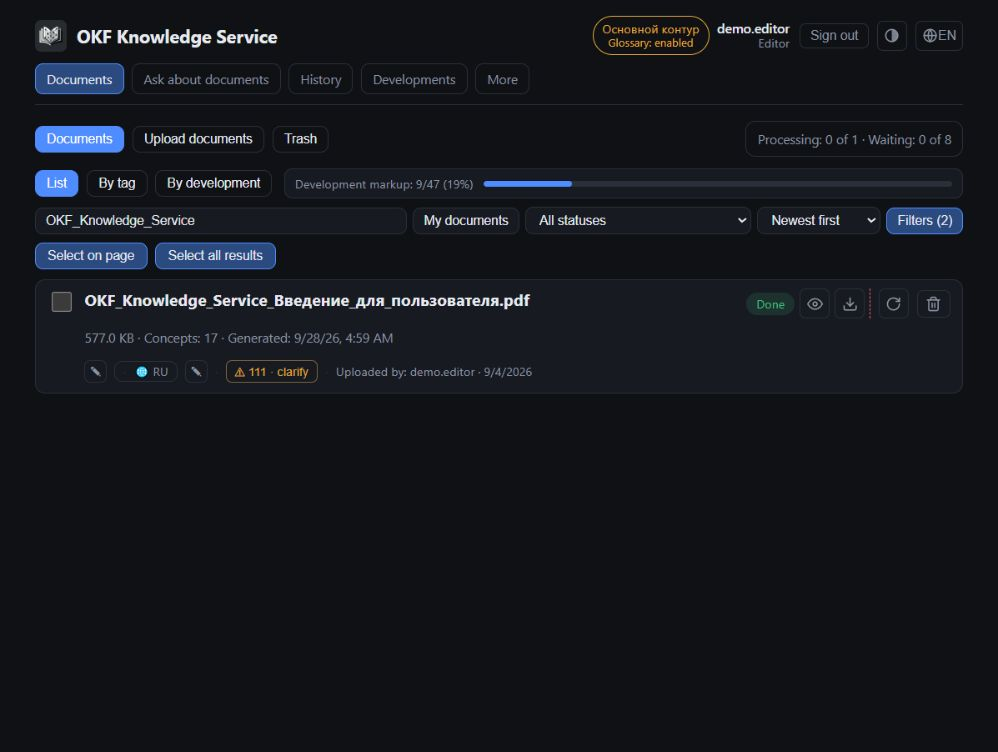
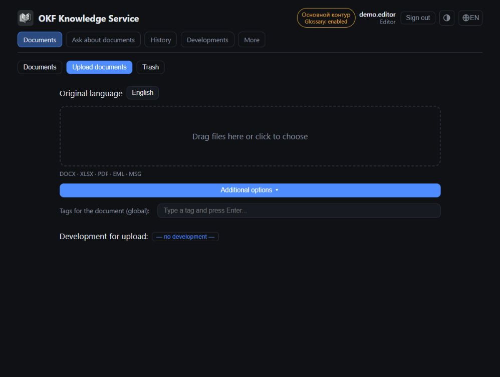
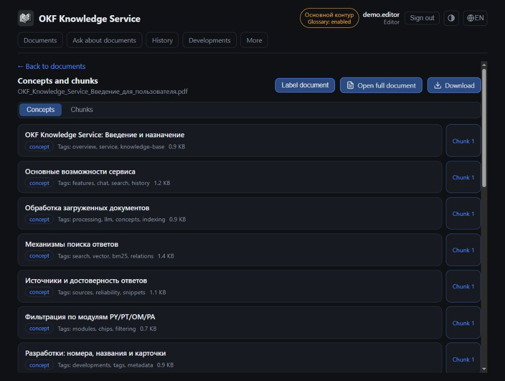
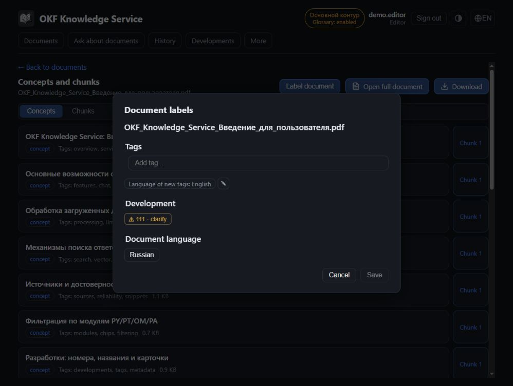
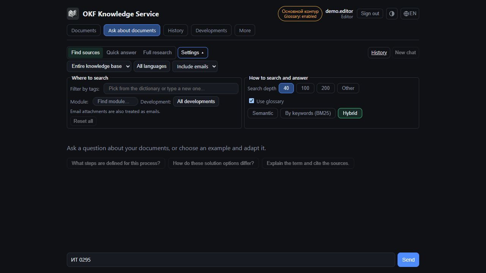
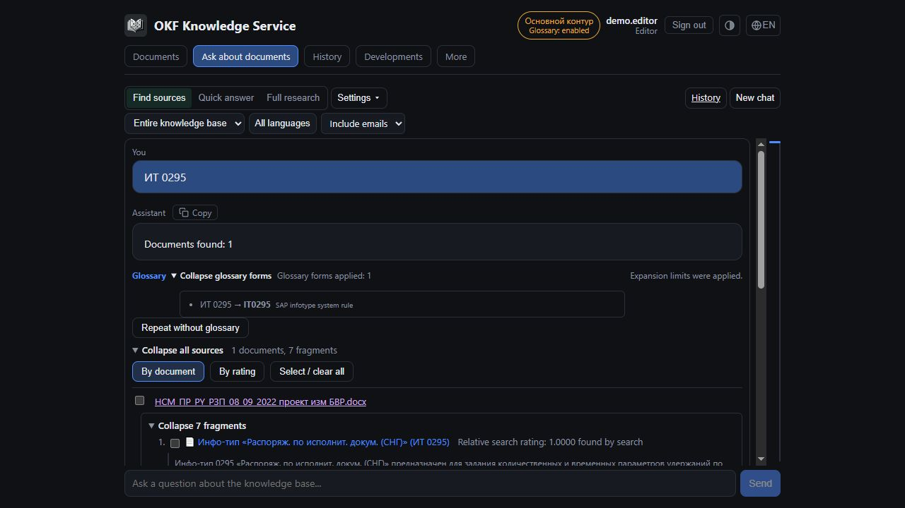
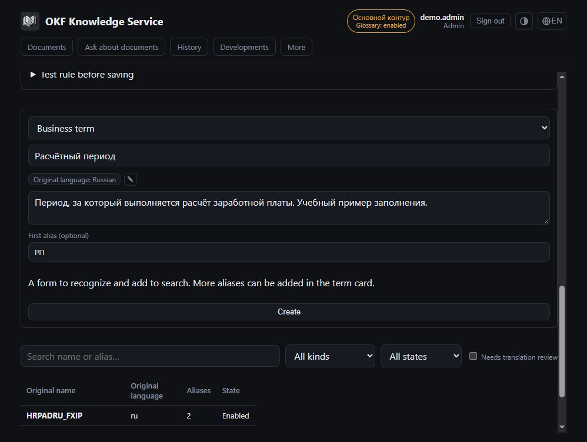
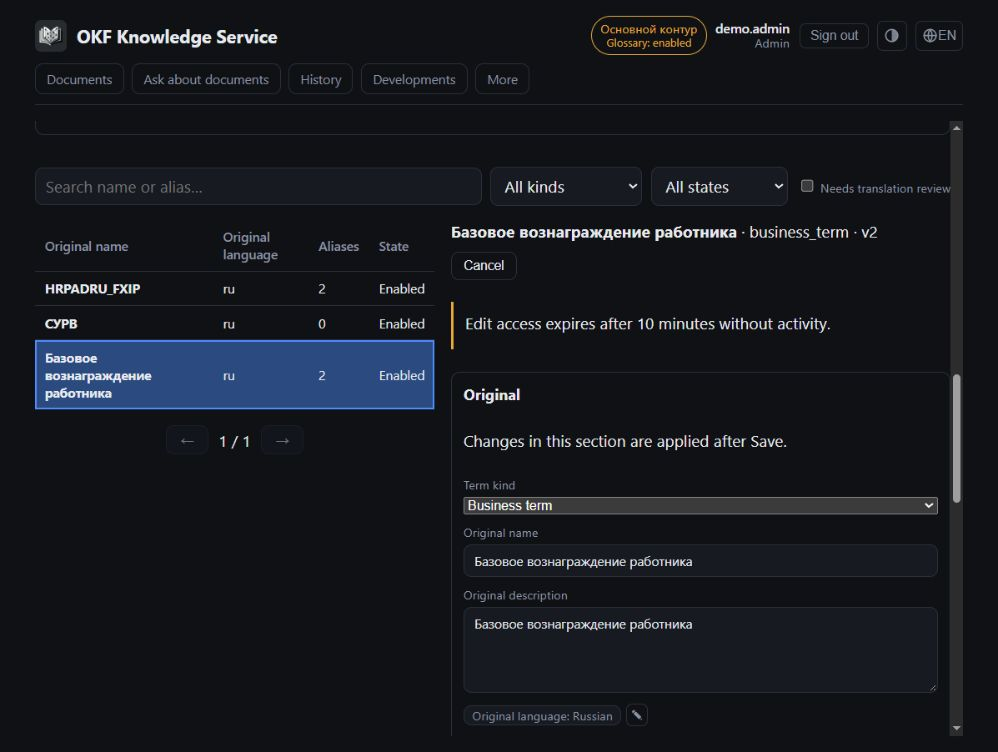
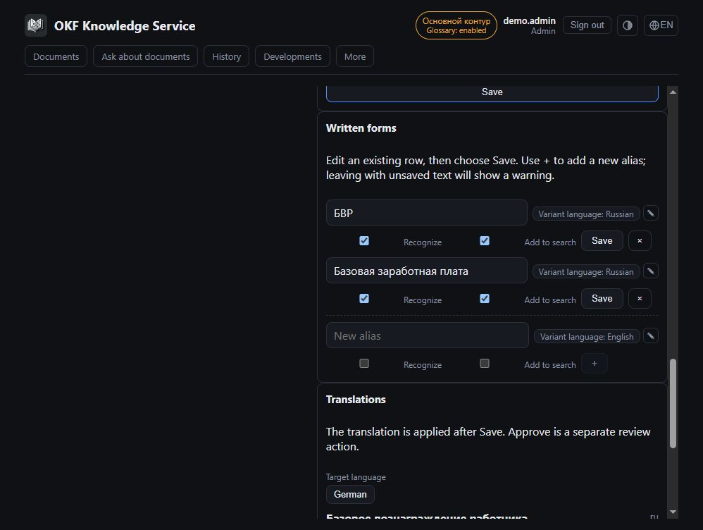
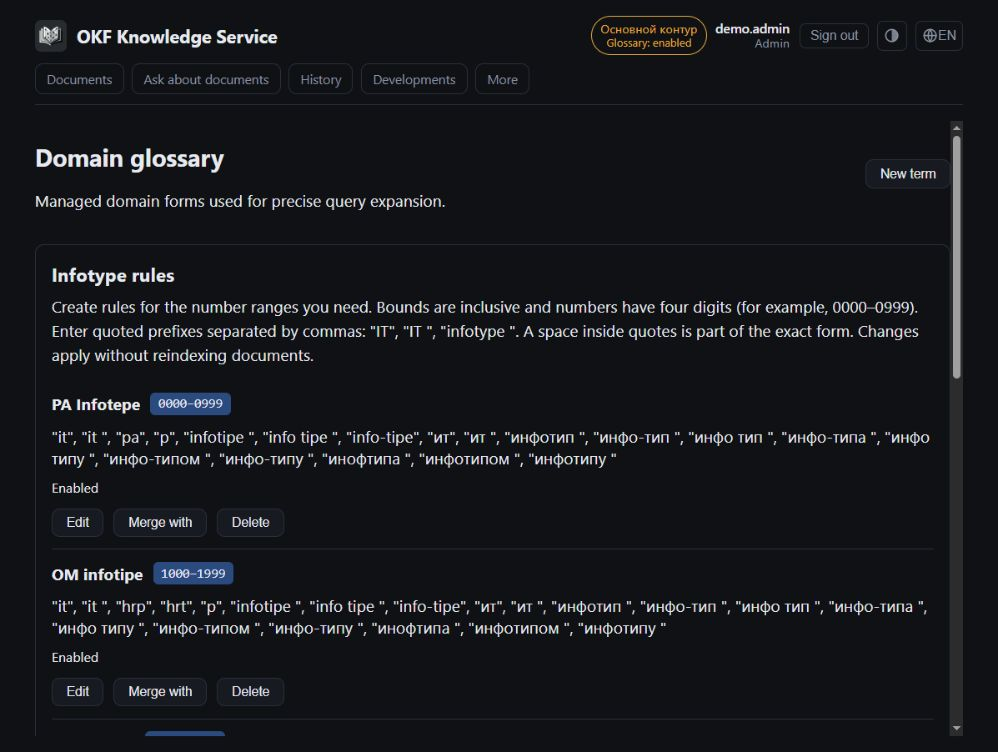

# OKF Knowledge Service

User guide

English edition · 18 October 2026

A practical guide to search, documents and knowledge-base maintenance. Commands use the English interface labels. Available actions depend on your roles and installation settings. Administrators can override translations, so some labels may differ.

## Contents

1. [Getting started](#guide-01)
2. [Navigation and access](#guide-02)
3. [Finding documents in the list](#guide-03)
4. [Questions and answer modes](#guide-04)
5. [Search settings](#guide-05)
6. [Checking answers and selecting sources](#guide-06)
7. [Searching selected documents](#guide-07)
8. [History and repeat requests](#guide-08)
9. [Uploading documents and emails](#guide-09)
10. [Selecting and previewing attachments](#guide-10)
11. [Changing the processing scope](#guide-11)
12. [Statuses and reprocessing](#guide-12)
13. [Viewing documents and tables](#guide-13)
14. [Document markup, tags and developments](#guide-14)
15. [Collaborative editing and translations](#guide-15)
16. [Bulk actions, export and Trash](#guide-16)
17. [Glossary and language support](#guide-17)
18. [System operations, audit and diagnostics](#guide-18)
19. [Troubleshooting](#guide-19)
20. [Terminology and checklists](#guide-20)
21. [Interface examples](#guide-21)

## 1. Getting started

OKF Knowledge Service helps you find information in project documents and emails. It extracts text and tables, creates summaries called **concepts**, and searches both concepts and extracted text fragments. Source links let you check an answer against the underlying material.

### Sign in and choose your display settings

1. Open the service address provided by your administrator.
2. If authentication is required, select the corporate sign-in action and complete your organization's sign-in process.
3. Check your account and roles in the header. A training installation may offer a demonstration user selector instead.
4. Choose the interface language. The theme button switches between automatic, dark and light appearance.

The interface language, document language and original language of a reference entry are different settings. Switching the interface does not translate uploaded files or change their language metadata.

### Get your first useful result

1. Open **Documents** and check that the material you need has been uploaded and processed.
2. Open **Ask about documents** and choose **Quick answer**.
3. Ask a specific question, such as: "What prerequisites for running report Z_EXAMPLE are described in the documentation?"
4. Select **Send** or press Enter. Shift+Enter inserts a new line.
5. Open the `[1]`, `[2]` links. Check important numbers, conditions and conclusions against the original.

> Citations make an answer verifiable; they do not guarantee correctness. The model can make mistakes and search can miss relevant material. No results does not prove that the entire knowledge base contains no relevant information.

| Task | Where to do it |
|---|---|
| Find a file by name, development or uploader | Documents: list search and filters |
| Find a fact inside the text | Ask about documents |
| Inspect excerpts without a synthesized answer | Find sources |
| Compare retrieved materials | Full research |
| Read an earlier answer | History |
| Add material | Documents → Upload documents; Editor/Admin |

## 2. Navigation and access

Main sections appear in the top navigation. Additional sections are under **More**. A missing command usually reflects role restrictions or a disabled feature.

| Section | Purpose |
|---|---|
| Documents | Register, upload, filters, markup and Trash |
| Ask about documents | Search, answers, sources and search scope |
| History | Your saved conversations |
| Developments | Development register and related documents |
| More → System operations | Bulk jobs and the diagnostics entry point |
| More → Language support | Languages and translations |
| More → Glossary | Terms, aliases, translations and query preview |
| More → Audit | Activity log, anomalies and blocks |
| More → User history | Conversation inspection by authorized roles |

### Roles

| Role | Main capabilities |
|---|---|
| Viewer | Read documents, download available originals, ask questions and manage personal history |
| Editor | Upload and mark up documents, process individual documents, move them to Trash and restore them; maintain developments and translations |
| Admin | Editor actions, bulk deletion and processing, bulk export when enabled, system operations, languages, glossary originals and diagnostics |
| Security | Audit and user history; this role alone does not grant editing rights |

An account may hold multiple roles. **Admin and Security can inspect user history; Audit requires Security.** Opening another user's conversation is recorded. Your history is therefore not a store inaccessible to authorized administrators.

An installation with authentication disabled may not enforce these role restrictions. Do not assume a corporate installation behaves like a training installation.

## 3. Finding documents in the list

The document area contains **Documents**, **Upload documents** for editors, and **Trash** on the right. Navigating between sections does not itself cancel a file transfer.

### Find a file

1. Enter part of a filename, tag, development or uploader in the search field.
2. Open **Filters**: uploader, module, development, tag, status, document language and upload dates.
3. Enable the problem-document filter to find processing warnings.
4. Choose sorting and a view: **List**, **By tag** or **By development**.
5. Open the document through its name or **Concepts and chunks**.

Editor/Admin accounts may initially use **My documents** as the uploader filter. Choose **All uploaders** when looking for a colleague's file. This is a filter, not a private knowledge base.

Filters combine. If the list is empty, clear unnecessary conditions using the reset action. List state survives navigation and filters are reflected in the address. You can share the link with an authorized colleague, but the results may change over time.

### Understanding a document row

A row may show status, size, concept count, uploader and dates, tags, development, language, progress, warnings, similar documents and excluded attachments. Icon tooltips explain the available actions.

The draft/markup-needed badge refers to document classification. It is different from unfinished generation or an attachment-selection draft. Development markup progress measures how many documents are linked to a development, not how completely their text was extracted.

> Use the register for a complete list of files matching filters. Use Ask about documents to find information inside them. A model answer is not a complete register report.

## 4. Questions and answer modes

Type your question in **Ask about documents**. Multiple lines are supported. Enter sends; Shift+Enter inserts a line break.

| Mode | Result and purpose |
|---|---|
| Find sources | Documents and excerpts without a synthesized answer; useful for inspection and manual selection |
| Quick answer | An answer using the most relevant sources; useful for a focused question |
| Full research | Processing of retrieved excerpts in batches and a combined answer; useful for comparisons and overviews |

Available modes depend on settings. **Full research works on the retrieved set within the search-depth limit**, not necessarily every document in the database. It can take longer; progress shows batch processing and answer synthesis.

### Example questions

- "What input parameters does report Z_EXAMPLE accept?"
- "Compare the calculation conditions in the retrieved specifications and cite the differences."
- "Find the definition and allowed values of status_code."
- "Which reviewer comments refer to this section?"

Include an object name, code, version or development when known. Restate the subject in a new question: a short "anything else?" does not define an unambiguous search target.

### Stop or repeat

**Stop** interrupts the current answer. Already displayed text may remain with an incomplete-result notice; it is not a finished answer. The restart action repeats the request. **Edit question** places it in the composer; replacing an existing draft requires confirmation.

Leaving the chat page may stop a running answer. Wait for completion when you need the full result. A completed answer can be copied as Markdown.

## 5. Search settings

Open **Settings**. Controls are grouped into **Where to search** and **How to search and answer**. Active restrictions also appear as summary labels.

### Where to search

- **Module and development.** Selecting a development replaces the general module selection. The development list accounts for the selected module.
- **Tags.** Further restrict material; an overly narrow selection may exclude a useful source.
- **Document language.** Filters language metadata. Unknown means no language is known.
- **Sources:** **Include emails**, **Exclude emails**, **Emails only**. Email attachments count as email sources. Sources of unknown origin are available only with Include emails.
- **Search scope.** Restricts search to selected documents; other filters still apply.

### How to search and answer

| Setting | Practical effect |
|---|---|
| Hybrid | Combines meaning and exact words; a useful starting point |
| Semantic | Useful for descriptive phrasing and similarity of meaning |
| By keywords (BM25) | Useful for codes, fields, exact names and abbreviations |
| Search depth | Maximum retrieved fragments after merging and filtering |
| Number of results for the answer | Size of the answer's source set where this control is available |
| Use glossary | Apply configured forms and aliases when enabled |
| Source relevance assessment | Check the first excerpts before answering; adds processing time |

Search depth and answer size differ. For example, search may find 40 excerpts while a quick answer uses 10. Other excerpts may remain visible even though the model did not receive them for that answer.

If the search limit is reached, increase depth within the allowed range or refine the question. Even the maximum does not guarantee complete coverage. Limits depend on the installation.

The glossary expands query forms; it does not add facts. **Show glossary forms** reveals applied forms. Use **Repeat without glossary** to compare results.

## 6. Checking answers and selecting sources

### Check a claim

1. Select `[N]` in the answer or expand the sources.
2. Find the document and expand its excerpts.
3. Check title, text and origin; for emails, review the available mail metadata.
4. Follow the provided link to a concept, chunk, full document or source cells.

Sources can be collapsed and switched between available views. Document counts and excerpt counts differ: one document may contribute several excerpts.

An **in model context** label means the material was supplied as input for this answer. A search-only/outside-context label means it was found but was not in that context. A document appearing in the list does not prove that the answer used it. Relevance is not the probability that a claim is true.

### Answer using selected excerpts

1. Select excerpts or a document in the sources panel.
2. Check the selected excerpt count.
3. Choose **Generate answer using selected**.
4. Check the new answer to the original question and its citations.

This helps separate revisions or remove unrelated material. If a source changed or became unavailable, search again and select current excerpts.

### When relevance assessment stops an answer

Insufficient relevance means that the assessed excerpts did not provide enough support. Inspect similar material, refine the question or change filters. Continuing without assessment removes that additional check for a repeat attempt; it does not improve the evidence.

Assessment covers the displayed number of initial excerpts, not the entire database. If assessment is unavailable, the interface indicates that the result was produced without it. Assessment does not replace checking the original.

## 7. Searching selected documents

**Search scope** supports a series of questions about a restricted set. It contains entire documents even when you select only one excerpt from each.

1. Find material, for example using **Find sources**.
2. Select sources and choose **Add documents to search scope**.
3. In settings, inspect the list and **Search only within scope**.
4. Ask a new question. Tags, language and email filtering still apply.

The current interface supports up to 500 documents in a scope. Adding the same document again does not create another entry.

Use **View and edit the document list** to check availability, remove a document or clear the scope. Unavailable documents are excluded. If the enabled scope is empty, add documents or turn off the restriction. If all are unavailable, revise the list.

### Three different actions

| Action | What changes |
|---|---|
| Generate answer using selected | Excerpts for another answer to the original question |
| Add documents to search scope | Entire documents for subsequent queries |
| Change processing scope | Attachments in the published knowledge base for all users |

If a document cannot be found within the scope, check the remaining filters.

## 8. History and repeat requests

The chat includes recent conversations. Loading previous entries retrieves older records; conversations can be expanded and collapsed. Request navigation helps you move through a long feed.

### Open a conversation

1. Open **History**.
2. Choose a conversation by title and time.
3. Read messages and saved sources.
4. Return to **Ask about documents** for a new question. Use repeat actions where they are offered on a message.

**New chat** starts a new session; the previous one remains in history. History records the result at request time, not a fresh verification. Originals may have changed, moved to Trash or become unavailable. Links to an old version may no longer open after changes.

### Deletion and access

**Delete** asks for confirmation and permanently removes the conversation. Document Trash does not apply to chat history. Retention is configured for your installation.

Users see their own history. Admin/Security can inspect other conversations through **User history**; viewing their content is audited. Consider this access model when entering information.

A history-loading error does not mean conversations were deleted. Retry loading; asking a new question may still be possible.

## 9. Uploading documents and emails

**Access: Editor/Admin.** Direct upload supports **DOCX, XLSX, PDF, EML and MSG**. Archives may appear as attachments but are not a direct-upload format in the upload area. Extraction is limited by supported formats and server settings.

### Upload files

1. Open **Documents → Upload documents**.
2. Set **Original language** for reference entries created during upload. Separately check the document's language after upload.
3. Under advanced options, optionally assign common tags and a development for the batch.
4. Drop files onto the upload area or select them through the file picker.
5. Monitor file-transfer results. Resolve similar-file and attachment decisions when requested.
6. Open an accepted document and check its processing status.

You may move between application sections, but **keep the browser tab open**. Closing or reloading can interrupt files not yet transferred. **File accepted does not mean processing completed.** Accepted files are processed separately from batch transfer.

| Transfer result | Action |
|---|---|
| File accepted | Check subsequent processing |
| Awaiting your decision | Resolve the duplicate or attachment dialog |
| Transfer failed / Not sent | Address the cause and use the available retry action |
| Transfer outcome unknown | Check the list; retry runs duplicate detection |
| Skipped | Read the reason, such as unsupported format |

A new batch can replace the result list. If files remain eligible for retry, the application asks for confirmation.

### Duplicates

Identical files are rejected; open the existing document. For similar content, compare candidates and cancel or confirm upload. Confirmation creates a separate document marked as similar; it does not automatically replace a revision. A similar file in Trash does not prevent upload.

The similar-documents badge opens a comparison. When deleting duplicates, at least one document in the group must remain. A later upload date does not guarantee a newer content revision.

## 10. Selecting and previewing attachments

Small documents normally proceed automatically. Large, collectively expensive or incompletely assessed attachment sets may require **attachment selection** before processing.

### Confirm the selection

1. Open **Select attachments** or **Document processing scope**.
2. Inspect the tree. The main document is always processed.
3. Check format, size, rows, cells and unavailability reasons. "At least N rows" is a lower-bound estimate.
4. Expand branches. Use the composition-expansion action for an unassessed container when offered.
5. Open the preview or download the original.
6. Select what you need and choose **Start processing**. Confirm similar-document decisions separately if requested.

Excluding a container excludes its descendants. An email's attachments can be excluded while retaining its body. Unsupported formats and branches beyond the global nesting limit cannot be enabled with a checkbox. Hidden contents of such a branch are not presented as fully inventoried.

### Preview limits

| Format | What is shown |
|---|---|
| XLSX | First 30 non-empty rows, columns A-T, up to 500 characters per cell; sheet selection |
| PDF | Text from the first three pages, up to 20,000 characters; no images or image-only scans |
| DOCX and email | Extracted text sample without original layout; attachments opened separately |
| Archive | First 100 entries; a listing, not the contents of every file |

Excel values are unformatted: dates may appear as numbers, percentages as fractions and leading zeros may be missing. Formulas are not recalculated: cached values or formula text are shown. A preview does not establish complete processing of the file.

**Save selection** saves a draft, not a processing run. Closing does not save new checkbox choices. An idle window warns before it may close; save the selection or continue editing.

## 11. Changing the processing scope

**Access: Editor/Admin.** Open **Document processing scope → Edit attachments**. The initial view shows the published selection; a saved draft may be different.

### What the attachment editor is for

The editor determines which attachments contribute content to the knowledge base and future searches and answers. Use it to exclude duplicate copies, superseded revisions, supporting files or large attachments that are not needed for search. This changes document processing for all users; it is not a personal filter for the current question.

**Example: a file exists both as a separate upload and inside an email.** The knowledge base already contains a processed `Specification.docx`, and an email includes a copy. To avoid retrieving the same content from two sources, keep the separate document and exclude the attachment copy inside the email. Keep the email itself so its body, discussion and correspondence context remain searchable.

1. Check that the separate file has been processed, is available and contains the same revision. A matching filename is insufficient: compare the content or originals.
2. On the email, open **Document processing scope → Edit attachments**.
3. Find the duplicate file in the tree and clear only its checkbox. Keep other useful attachments selected. Excluding a container also excludes its descendants.
4. Choose **Check changes**. For an already processed document, use **Apply exclusions without regeneration** when offered. For initial processing, confirm the chosen selection with **Start processing**.
5. Wait for completion and check the published selection. Repeat the search: the separate document should remain available, while the excluded copy should no longer contribute its own excerpts.

Excluding an attachment does not delete the separate upload or rewrite the original email. It removes the selected attachment's content from active search; a filename mention or quotation in the email body may still remain. Previously saved answers are not recalculated. **Save selection** only saves a draft: the published search content remains unchanged until application. Do not treat a different revision or an attachment containing extra information as a duplicate based only on its name.

### Apply scope changes

1. Change attachment selection.
2. Use **Save selection** if you need to keep a draft.
3. Run the change check if it has not yet been performed.
4. Review its result and the proposed application method.
5. Confirm the action and wait for the result.

| Action | Result |
|---|---|
| Apply exclusions without regeneration | Removes attachments from active search while preserving other sources' completed results |
| Restore saved results | Reuses previously processed data that remains compatible |
| Process added attachments | Runs missing stages for added sources |
| Regenerate entire document | Processes the entire selected scope again; requires separate confirmation |

Changed originals, incompatible search data, incomplete provenance or an active update may block quick application. Read the reason before starting full processing.

**A draft does not change the published knowledge base.** During an update, the existing publication remains available until successfully replaced. Active chunks and stored chunks outside search are counted separately. Once applied, excluded attachments no longer contribute to new answers; this does not necessarily delete the original file.

**Reset draft** returns selection to the published scope; it does not undo a published change. **Close** discards new unsaved checkbox choices, while a previously saved draft remains.

Older documents may not have a recorded scope. The interface explains this and offers attachment assessment. An absent inventory does not mean the document had no attachments.

## 12. Statuses and reprocessing

| Status | Meaning |
|---|---|
| Uploaded | File accepted; processing is not finished |
| Awaiting attachment selection | A scope decision is required |
| Queued | Waiting for a worker; continues automatically |
| Parsing | Extracting content |
| Generating OKF | Creating concepts; chunk progress is shown |
| Indexing | Preparing data for search |
| Done | Processing completed; check warnings separately |
| Paused | Stages were saved; resuming may be possible |
| Error | Read and address the reported cause |

The queue summary shows workers and waiting documents. When full, new uploads or individual regeneration requests may be refused. Wait for capacity instead of repeatedly submitting the same file.

### Recovery actions

- **Resume** continues from saved stages.
- The partial-generation repair action, when available, retries incomplete results.
- The concept-regeneration action starts again after confirmation and may take considerable time.
- Canceling an update or keeping the previous version cancels the new attempt for a published document, removes its intermediate results and preserves the publication.

A published-version notice explains why the viewer still shows older data during an update. If the update fails, the previous version remains available. A first-time processing attempt has no previous publication to preserve.

### Warnings

| Warning | What to check |
|---|---|
| No text layer | Possibly a scan; prepare an OCR version outside the service |
| No concepts extracted | Search may still work through text chunks |
| Partial model result | Inspect and repair incomplete generation when available |
| Table fallback rules | Check the table and its source cells |
| Partial attachment extraction / text limit | Only the available portion is searchable |
| Partial indexing | Results may be incomplete; processing needs recovery |
| Protected or unsupported email | An available original does not imply searchable text |

Done without a warning does not replace verification of critical information. The problem-document filter finds limitations already detected by the system.

## 13. Viewing documents and tables

### Concepts, chunks and full text

1. Open **Concepts and chunks** for a document.
2. Under **Concepts**, open a summary; inspect tags, links and its related chunk.
3. Under **Chunks**, open an extracted fragment.
4. Open the full document for more context.
5. Download the original to verify layout, formulas and images.

The full-document view is an extracted representation, not a pixel-perfect Word, Excel or PDF view. Long tables appear in parts; expand remaining rows and ranges. A view toggle switches between Markdown and rendered text.

### Source tree

The tree shows the main file, attachments, emails and containers. Expand branches and check extraction status and warnings. A download may refer to an attachment or its container; the label distinguishes them.

Available email metadata includes subject, sender, recipients and date. Do not substitute upload time for an unknown email date. DOCX reviewer comments may appear as separate concepts with context and replies; distinguish these from the main document's statements.

### Source cells

1. Select the source-cell inspection link for a table when available, or open the document's table-coverage section.
2. Verify source, sheet, row and coordinates.
3. Load additional columns, rows or cell text when only part is displayed.
4. Read messages about headers, coverage and formula results.

Verified cell coverage refers to retained data, not correct model interpretation. Use coordinates when headers are ambiguous. The service does not calculate a missing formula result on Excel's behalf. If a source version is unavailable, search again or contact an editor.

## 14. Document markup, tags and developments

**Changes: Editor/Admin.** Markup helps filters place a document in the right context.

### Edit document markup

1. Select **Label document** in the viewer to open **Document labels**. Individual fields are also available in the document list.
2. Add or remove tags and check the language of new tags.
3. Select a development or remove an incorrect association.
4. Check the document language.
5. Save and wait for confirmation.

If only some fields were saved, the dialog lists them and retains other edits. If the outcome is uncertain, use the dialog's reload action before another write. A background-search-update notice means metadata was saved while search is still synchronizing.

Check suggested developments: a number inferred from a filename or title page may be wrong. Confirm the appropriate development or choose another.

### Developments

**Developments** offers number/name search, module filtering, sorting and pagination. A development number opens its related documents.

To add one, provide number, name, module and original language when offered. Open a row to edit and save it. Renumbering updates document associations in search; check the affected count.

Deleting a development removes its document associations, not the files themselves. Enter the development number when confirmation requires it. Modules are also maintained through this register.

### Tags

Open the tag dictionary from Documents. Use search, usage counts, translations and machine-translation review. Before cleaning up unused tags, check the selection and count. Changes affect the shared knowledge base.

## 15. Collaborative editing and translations

Reference entries and attachment scopes are protected against simultaneous writes. When another editor holds a lock, viewing remains available. Another tab under your own account may count as a separate editor.

### Editing access

1. Wait for editing access to be acquired when opening an editor.
2. If another editor is named, wait for the record to become available.
3. When warned about inactivity, continue working or save.
4. If access is lost, retain a copy of the draft where possible and use the offered recovery action.

The current interface warns about editing access ending after 10 minutes of inactivity. Reference editors may retain text in the form; the processing-scope window closes and loses unsaved selection. Follow the specific dialog's message. An in-form draft is not guaranteed to survive browser reload.

### Conflicting changes

**Compare changes** shows the original values, your draft and current server values. Choose the result, select the action to apply the comparison to your draft, then save separately. The comparison itself does not write changes.

Review previews before merging entries or approving translations in bulk. Refresh a preview if the data changed. After applying, inspect errors and skipped records, including records locked by another editor.

### Originals and translations

Original entries and translations are separate. A machine-generated version may need review. Choose a language, check the name and description, edit and confirm the translation. Do not replace the original with a translation merely to change the display language.

Reviewing a term, tag or development translation does not review every document that uses it. Reassess translations after changing the original.

## 16. Bulk actions, export and Trash

### Selection

Select documents using checkboxes. Bulk actions appear only when the selection is non-empty. Selecting the current page and selecting all filtered results have different scope. Clearing the current page does not clear selections on other pages. Check the overall count.

Limits differ by action. If a button is unavailable, read its hint and reduce the selection. Split large sets using narrower filters.

| Action | Access and result |
|---|---|
| Edit tags | Editor/Admin; add/remove tags. The same tag cannot be added and removed in one action |
| More → resume selected | Admin; checks and resumes eligible documents |
| More → regenerate selected | Admin; reprocesses while preserving publications until replacement |
| More → delete documents | Admin; preview followed by movement to Trash |
| Export originals | Admin when enabled; prepares ZIP parts |

Processing previews show eligible documents, skips and limits. Larger operations may need a second administrator; follow the message and current threshold.

### Export

1. Select documents, request export of originals and confirm the count.
2. Find the job in **More → System operations**.
3. Wait for readiness and download all required parts.
4. Observe the availability deadline. Recreate expired or deleted exports.

This exports original files; it is not a database backup. An individual document's original has its own download action.

### Trash

Editor/Admin can delete individual documents. They leave normal search and move to **Trash**. Retention and remaining days are shown there. After permanent deletion, Trash cannot restore them.

Choose **Restore** or restore selected items. If an active similar document conflicts, restore the file individually and confirm restoration as a separate document when appropriate. This does not merge with or replace the active file.

## 17. Glossary and language support

### Glossary

Open **More → Glossary**. Access: Editor/Admin. Search terms and filter by type, state and review requirement. A term contains an original name, description, aliases and translations.

Editors inspect entries, preview queries and maintain translations. Admins manage originals, aliases, term enablement, rules and machine backfill. Review the preview and destination record when merging duplicates.

### Check a term's effect

1. Find the term and inspect its aliases.
2. Enter a representative question in query preview.
3. Inspect recognized terms and expansions.
4. Compare chat search with the glossary and **Repeat without glossary**.

Populated entries do not imply server-side expansion is enabled. The active profile and section notice indicate its status. Infotype rules match forms; they do not add documentary facts.

### Language support: Admin

In **More → Language support**, add languages, check status and activate prepared locales. Tools cover stopwords, interface translations and reference-data translations.

For interface translation, download a sample, prepare changes, preview, then apply. Applying replaces the entire override dictionary: absent keys fall back to built-in dictionaries. Check removed keys and substitution parameters. Version history and rollback are available.

For reference translation, choose language and entity types, then check count, provider and model. The process creates machine drafts while preserving human-reviewed translations. It is unavailable when the translation provider is disabled.

Stopwords affect search. Test a representative query with the available probe and coordinate changes with the person responsible for search behavior.

## 18. System operations, audit and diagnostics

### System operations: Admin

**More → System operations** shows jobs, initiators, state, results and actions. Even a completed job needs its per-document errors and skips checked.

A job awaiting approval must be reviewed by another administrator. Cancel is offered for eligible states; canceling does not roll back completed changes.

A notice about processing interrupted by a server restart opens a review-and-resume flow. This includes documents across users: current list filters do not apply, and manually paused documents are excluded.

### Audit and user history

Security opens **More → Audit**: time, user and action filters; logs, CSV, anomalies and blocks. Verify identity and reason before blocking a user because it affects access.

**User history** is available to Admin/Security. Find the user, open a session and inspect messages. Content access is logged.

### Diagnostics: Admin

1. Open Diagnostics from System operations.
2. Check collection availability. Choose system, document, search/chat or interface scope; provide a document ID for document scope.
3. Set collection level and duration, then start temporary capture.
4. Reproduce the problem. Connect the relevant browser for interface issues.
5. Stop capture or let it expire.
6. Filter events by time and request reference, build a bundle, inspect its contents and missing data, then download the ZIP.

Collection level affects detail and overhead. Lost events or incomplete time coverage limit conclusions; they do not prove there were no errors.

| Identifier | Purpose |
|---|---|
| Request reference | Locate a server request |
| Local error reference | Correlate a browser error; not a replacement for a server reference |
| Administrator's one-time code | Connect another browser to temporary capture |

The user enters the one-time code in the browser-error reporting panel and connects the browser. It is not a sign-in code. Transfer diagnostic bundles through the agreed support channel.

## 19. Troubleshooting

### A file is missing from the list

Check My documents, uploader, status, language, dates, tags and development. Clear filters and check Trash. A list-loading error does not mean the database is empty.

### Search is empty or an answer is off-topic

1. Confirm the document was processed and is not in Trash.
2. Check scope, email filter, language, tags and development.
3. Try BM25 or Hybrid with an exact code.
4. Inspect excerpts through Find sources.
5. Increase depth if the limit was reached; check excluded attachments.
6. If the source is outside context, select it manually or use Full research.

### A file was accepted but is not ready

Queueing, attachment selection and generation require different responses. Use batch results after a transfer interruption. For paused processing, check the cause and Resume. Do not regenerate while the required attempt is still running.

### A PDF or email produces no text

Prepare an OCR text layer for a scan outside the service. Open protected email in a compatible client and prepare an authorized readable copy. Supported attachments may be processed even when the mail body is unsupported. Inspect the original and source tree.

### Nothing changed after saving

Distinguish a draft from applied scope, metadata from background synchronization, and publication from an update. Read the notice, wait for completion and verify the relevant state.

### An editor is locked or conflicting

Wait for another editor to finish. If your access expired, keep the draft and use recovery. Compare conflicting values, apply the result to the draft and save separately. Do not close important unsaved text without a copy.

### Contact support

Provide time and timezone, section, steps, expected and actual results, document/job ID, request reference and local error reference separately. For search, include the question, mode and filters when permitted. Passwords, tokens and sign-in codes are not needed for diagnostics.

## 20. Terminology and checklists

| Term | Meaning |
|---|---|
| Document | Uploaded file and processing results |
| Source | Main file, email, attachment or retrieved material |
| Chunk | Extracted text fragment |
| Concept | Summary created during processing |
| Development | Number, name and module grouping related documentation |
| Tag | Label used for organization and filtering |
| Model context | Material supplied for one answer |
| Search depth | Limit on retrieved fragments after result processing |
| Search scope | Documents for subsequent queries |
| Processing scope | Attachments included in the knowledge base |
| Publication | Results version available to readers and search |
| Draft | Changes not yet applied; persistence depends on the editor |

### Before using an answer

1. Check the question, filters and scope.
2. Confirm completion and read limitations.
3. Check which sources entered the context.
4. Follow citations for important claims.
5. Verify numbers and tables against cells and originals.
6. Flag conflicting revisions instead of automatically choosing the latest upload.

### Before considering a document finished

1. Check processing and warnings.
2. Check language, development and tags.
3. Confirm required attachments are included and scope changes applied.
4. Try a representative search question.
5. Inspect original rows and cells for critical tables.

The Russian edition is available as `OKF_User_Guide.md` and `OKF_User_Guide.pdf`. The English PDF is generated from this guide.

## 21. Interface examples

Screenshots were captured on 18 October 2026 in the running interface. Document examples use a previously uploaded introduction to the service; search and glossary examples use the current knowledge base. The introductory document does not describe current capabilities. Counts and results reflect the capture time. Document content, glossary entries and the profile's configured name remain in their original language when the interface changes.

### Search settings and a worked example

To reproduce the example, open **Ask about documents**, choose **Find sources**, and expand **Settings**. Keep **Entire knowledge base**, all languages and **Include emails**, with no tag or development restriction. Select depth **40**, **Hybrid**, and **Use glossary**. Enter `ИТ 0295` and send the request. Section 5 explains each setting.

The current knowledge base returned one document with seven excerpts. Expand the document and inspect the titles and excerpts; follow a link to open its source. **Find sources** does not generate a synthesized answer. To obtain one from selected excerpts, select them and choose **Generate answer using selected**. **Show glossary forms** reveals that `ИТ 0295` was recognized as `IT0295` through an infotype rule. Results and counts can change as the knowledge base is updated.

### Filling in a glossary entry

With the **Admin** role, open **More → Glossary → New term**. The form appears below the infotype rules; scroll down if needed. This demonstration uses the following fields:

| Field | Example and purpose |
|---|---|
| Kind | Business term |
| Original name | Расчётный период (payroll period): the full term |
| Original language | Russian: the language of the entry itself |
| Original description | A period for which payroll is calculated |
| First alias | РП: a written form to recognize and add to search |

Before choosing **Create**, inspect duplicate hints and avoid recreating an existing term. Short abbreviations can be ambiguous; add only forms accepted in your domain. Additional aliases and translations are configured in the resulting card. The screenshot shows an **unsaved demonstration form**; no payroll-period entry was added to the database for this guide. Its Russian original remains Russian in the English interface.

### Existing terms and aliases

The current database contains `HRPADRU_FXIP`, `СУРВ` and **Базовое вознаграждение работника** (employee base remuneration). Search by name or alias and filter by kind or state. Select a row to open its card. **Aliases** counts saved written forms, not matching documents.

The selected entry has two saved forms: **БВР** and **Базовая заработная плата**. **Recognize** allows a form to be detected in the input query; **Add to search** allows it to be used in expansion. These settings have different purposes. Save an existing row with its **Save** button; use **+** to add a new form. The original, aliases and translations are saved in their respective sections separately. After saving, use **Check query** with a representative query and compare actual search with and without the glossary.

### Existing infotype rules

**Infotype rules** appear at the top of the glossary. A rule links a range of four-digit numbers to prefix variants, recognizing forms such as `ИТ 0295` without a separate card for every written number. Create a specific **SAP infotype** entry when you need to describe one infotype and its named variants.

This database has PA `0000-0999`, OM `1000-1999`, PT `2000-2999` and another PA range `3000-8999`. The screenshot shows the first two. Rule names are user-defined; these ranges and prefixes illustrate this database's configuration and are not a required set for every installation.

To add a rule, provide its name, start and end numbers, and quoted comma-separated prefixes, for example `"IT", "IT ", "infotype "`. Spaces inside quotes matter; preserve leading zeros in numbers. Use **Test rule before saving**, check intended and unrelated queries, and choose **Add rule** only when the configuration is needed. Changes apply without reindexing documents. A specific **SAP infotype** card also requires a four-digit infotype number.
