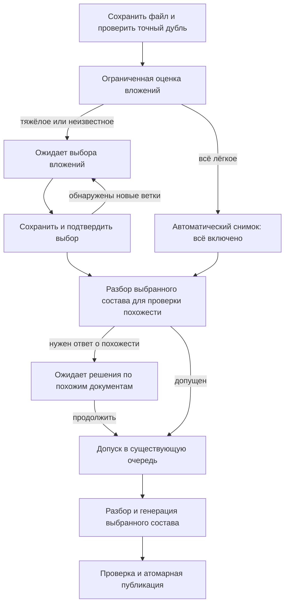

# ТЗ: гибридная обработка вложений документа

Дата: 17.10.2026. Статус: базовая функция, XLSX-предпросмотр и исправления T11–T15 работают в незакоммиченном локальном `main`; миграция `063b1c2d3e4f` применена. После команды «Продолжай» реализуется изменение состава с повторным использованием результатов по §14–15 (T16–T24). По новым требованиям добавлены блокировка редактора (§16/T25) и таймер бездействия (§16.1/T26); код и изолированные проверки есть. Рабочая миграция064 и включение нового backend ещё не выполнены. Изолированные PASS не означают приёмку рабочего документа или завершение всех требований §14–15.

Фактическое внедрение: [отчёт переноса и миграции](../../acceptance/2026-10-17-hybrid-attachments-rollout.md). Проверки разных версий: [отчёт приёмки, включая предпросмотр](../../acceptance/2026-10-17-hybrid-attachments.md). Исторические зелёные прогоны не подтверждают новые требования. Пользователь запустил пересчёт выбранного состава, затем явно попросил его отменить. Отмена завершена: `done`, candidate отсутствует, действует прежняя публикация с 2909 чанками и 4483 концептами. Исключение ещё не применено.

План реализации: [2026-10-17-hybrid-attachment-processing.md](../plans/2026-10-17-hybrid-attachment-processing.md).

## 1. Задача и согласованное направление

Проектное решение может годами содержать одновременно актуальные неизменяемые приложения и устаревшие копии Excel, которые теперь ведутся отдельно. Актуальные самостоятельные файлы и функциональные спецификации загружаются отдельными документами. Дата и размер вложения не определяют его актуальность.

Нужно сохранить автоматическую обработку обычных документов. При обнаружении тяжёлых вложений система выключает их в предлагаемом составе, показывает пользователю выбор и ждёт подтверждения до генерации. Лёгкие вложения остаются включёнными. Исключения сохраняются и явно отображаются в данных документа.

Проверка опубликованных данных 17.10.2026: root — 105 чанков/1679 концептов; исключаемый Excel — 2767/2767; два оставшихся вложения — 19/19 и 18/18. Соответствие трёх сохранённых originals текущему review подтверждено SHA-256. Для данного простого дерева ожидаемый результат исключения: 142 активных чанка, 2767 архивных чанков и 1716 прежних концептов. Индексы оставшихся чанков и привязки концептов не меняются; хранение исключённых чанков не означает участие в поиске. Это контрольный пример, не готовая реализация быстрого пути. Программные табличные концепты также занимают хранение/индекс и допускают устаревшие сведения в RAG.

Согласовано направление гибридного режима, предпросмотр и обязательный вариант быстрого исключения уже обработанных вложений без регенерации остальных источников. Требования ниже описывают целевое поведение; наличие требования не означает приёмку. A25–A35 относятся к предыдущему ревью; новые A36–A59 ещё не выполнены.

## 2. Границы первой версии

Входит:

- DOCX, XLSX, PDF, EML и MSG с поддерживаемыми вложенными файлами; одна политика для этих контейнеров, включая письма внутри других документов.
- Рекурсивное раскрытие вложенных ZIP, 7z и RAR, включая архив в письме, письмо в архиве и архив в архиве. Все три формата явно включены пользователем в первую версию.
- Предварительная ограниченная оценка объёма, индивидуальный выбор вложений и сохранение выбора.
- Ограниченный предпросмотр сохранённого XLSX перед выбором, включая исключённые файлы внутри писем и ZIP/7z/RAR, без скачивания пользователем и без запуска генерации (§11.1).
- Отсутствие содержимого исключённых источников в активных чанках, концептах, табличных проекциях и поисковом индексе. Уже созданные чанки допустимо сохранять как архивные по §14.3; первоначальная обработка исключённого вложения их не создаёт.
- Видимость состава в списке документов, деталях источников и API.
- Повторная генерация, возобновление, публикация, отмена обновления, пакетная загрузка и восстановление после рестарта.
- Быстрое исключение ранее обработанных вложений из опубликованного документа с сохранением готовых данных и векторов остальных источников (§14). Повторное включение использует сохранённые этапы; новые вложения дообрабатываются отдельно, смешанные изменения публикуются атомарно (§15).
- Аддитивная миграция, совместимость ранее опубликованных данных, тесты и инструкция эксплуатации.

Не входит:

- Автоматическое определение актуальности, связей «заменён внешним файлом» и приоритетов между проектным решением и функциональными спецификациями.
- Выбор отдельных листов/строк Excel; единица выбора — вложенный файл.
- Автоматическая перегенерация существующего корпуса или остановка текущего запуска пользователя.
- Изменение ранжирования, embedding-модели и общей производительности R2. Единственное планируемое расширение защитного лимита — ограниченная глубина нового рекурсивного обхода, явно описанная в §6.1.
- Загрузка ZIP/7z/RAR как самостоятельного корневого документа, ввод паролей к архивам, автоматическая сборка многотомных архивов и выполнение самораспаковывающихся файлов.

## 3. Термины и инварианты

**Основной документ** — корневой источник `root`. Его текст, обычные таблицы, комментарии и изображения обрабатываются существующим способом. Корневой XLSX тоже обрабатывается целиком: правило тяжести относится к вложениям.

**Вложение** — отдельный файл внутри контейнера. Лист Excel, таблица Word, изображение страницы и встроенная иллюстрация не являются переключаемыми документами. Для MIME/MSG сохраняется существующее различение inline-ресурса и самостоятельного вложения.

**Архив** — контейнер самостоятельных файлов. Само дерево каталогов архива не создаёт концептов. OOXML-пакет DOCX/XLSX распознаётся до общего ZIP: его внутренние XML-части не показываются пользователю как файлы архива.

**Тяжёлое вложение** — файл, достигший мягкого порога предполагаемого объёма обработки. Пользователь может включить его. Жёсткие лимиты безопасности включением не отменяются.

**Состав обработки** — неизменяемый снимок включений/исключений, привязанный к хэшу исходного файла и конкретному поколению обработки.

Обязательные инварианты:

1. Ожидание пользователя не занимает generation worker, parser worker или SQL-lock.
2. До подтверждения тяжёлого состава нет LLM-вызовов, таблиц кандидата, эмбеддингов и поисковых точек этого запуска.
3. При первоначальной/полной обработке исключение применяется до подробного разбора, включая upload-preview для похожести; быстрый путь читает сохранённые результаты без нового parsing.
4. Исключённые источники и их потомки не создают ни обычных, ни программных концептов, ни raw/table chunk-проекций.
5. Выбор не изменяется при resume или изменении конфигурационных порогов.
6. Состав действующей версии и ожидающего/выполняемого обновления различается в API и UI.
7. Исключение по выбору не является ошибкой извлечения и не устанавливает `documents.problem`.
8. Рестарт, bulk resume/regenerate, reindex и backfill не обходят сохранённый состав.
9. Неполная оценка не выдаётся за доказательство малого объёма; тяжесть не выдаётся за устарелость.

## 4. Пользовательские сценарии

### 4.1. Небольшой документ

После загрузки выполняется оценка вложений. Если все поддерживаемые вложения оценены, индивидуальные и суммарные пороги не достигнуты, система сохраняет автоматический состав «все включены» и продолжает существующий сценарий проверки дублей и генерации. Дополнительного обязательного диалога нет.

### 4.2. Есть тяжёлые вложения

Файл сохранён. Новый документ получает `awaiting_attachments` / «Ожидает выбора вложений». В списке есть действие «Выбрать вложения». Открывается перечень всех обнаруженных вложений с иерархией, размером, оценкой объёма и причиной рекомендации.

- Основной документ включён, отключить его нельзя.
- Лёгкие вложения включены; тяжёлые и неполностью оценённые выключены.
- Пользователь может включать тяжёлые и выключать лёгкие.
- Действия: «Выбрать все доступные», «Снять выбор», «Начать обработку», «Решить позже».
- Закрытие диалога сохраняет уже сохранённый черновик и оставляет ожидание. Само по себе закрытие не запускает генерацию.
- Можно подтвердить только основной документ. При отсутствии полезного включённого текста действуют существующие правила `no_text_layer`/`no_concepts`; наличие исключений не скрывает эту отдельную проблему.

При подтверждении всех тяжёлых файлов дополнительное второе разрешение не нужно. Под кнопкой видна краткая оценка объёма и сообщение, что обработка может занять больше времени. Минуты не вычисляются из количества табличных фрагментов.

### 4.3. Пакетная загрузка

Ожидающий выбора документ считается успешно загруженным с отдельным результатом «Требуется выбор вложений». Следующие файлы продолжают загружаться. Список ожидающих доступен после перезагрузки страницы; решение не хранится только в React state или локальном File.

Проверка существующих точных дублей сохраняет текущий ответ 409. Повторная отправка уже сохранённого ожидающего файла ведёт к его карточке, а не создаёт второй документ.

### 4.4. Изменение состава готового документа

Действие «Изменить состав обработки» открывает черновик на основе действующего состава. Сохранение галочек само по себе не меняет поиск. После сохранения сервер анализирует разницу с опубликованным составом. Для доказуемого исключения без добавлений основное действие — «Применить исключения без перегенерации» (§14). Оно создаёт новое поколение из сохранённых результатов. «Перегенерировать с выбранным составом» остаётся отдельным явным действием с предупреждением о повторной LLM-обработке всех включённых источников. Ошибка или недоступность быстрого пути никогда не переключает его в полный пересчёт автоматически.

Добавление/повторное включение предлагает восстановление из cache или дообработку только missing stages (§15). До успешной атомарной публикации выбранного изменения состава или полной генерации прежняя версия продолжает участвовать в поиске, включая ранее включённые вложения. UI сообщает: «Исключения вступят в силу после применения изменений». При ошибке/отмене остаются прежняя публикация и её отметки. Новое поколение само по себе не означает повторную генерацию концептов.

Изменять состав выполняемого кандидата запрещено. Нужно закончить или отменить доступным штатным способом существующую попытку. Для первой генерации не показывается действие возврата к прошлой версии. Добавление нового механизма остановки первой генерации не входит в этот этап.

### 4.5. Старые документы

Отсутствие снимка означает `legacy_all`: сохраняется прежнее поведение и прежний опубликованный результат. Это не доказательство, что все вложения успешно извлечены. Старые предупреждения остаются видимыми.

Resume старой попытки продолжает её исходный состав. Новая полная регенерация без сохранённого состава выполняет оценку; при тяжёлых вложениях ждёт выбора, сохраняя действующую публикацию. Документы с уже сохранённым и применимым составом используют его без повторного выключения тяжёлых файлов. Отсутствие старого scope snapshot само по себе не запрещает быстрый путь: §14 допускает доказуемое сопоставление сохранённых источников. Плоские данные без надёжной атрибуции быстро не фильтруются.

## 5. Оценка тяжести: алгоритм и стартовые пороги

Оценка выполняется без LLM и без создания `Block`, Markdown, `DocumentTableRow` или чанков вложения. Потоковый просмотр структуры допустим и сам ограничен ресурсами. XLSX сканируется по фактически заполненным строкам/ячейкам; `dimension`, форматирование пустых ячеек и номер последней строки не считаются доказательством объёма данных. Строка считается непустой, если есть значение или формула, включая формулу без cached value. Скрытые строки и листы учитываются. Заполнение merge не размножает одну ячейку в множество занятых.

Стартовые параметры v1 (мягкое срабатывание при `>=`, значения требуют калибровки в задаче 1 плана):

| Параметр конфигурации | Значение | Смысл |
|---|---:|---|
| `ATTACHMENT_REVIEW_ENABLED` | `false` до приёмки | Включение нового допуска для новых запусков |
| `ATTACHMENT_REVIEW_ROWS` | 500 | Непустые строки одного XLSX |
| `ATTACHMENT_REVIEW_CELLS` | 20000 | Занятые ячейки одного XLSX |
| `ATTACHMENT_REVIEW_TEXT_BYTES` | 524288 | UTF-8 текстовые данные одного вложения |
| `ATTACHMENT_REVIEW_EXPANDED_BYTES` | 8388608 | Сумма распакованных содержательных частей контейнера |
| `ATTACHMENT_REVIEW_FILE_BYTES` | 10485760 | Размер извлечённого файла-вложения |
| `ATTACHMENT_REVIEW_TOTAL_ROWS` | 1000 | Сумма строк включённых по умолчанию вложений |
| `ATTACHMENT_REVIEW_TOTAL_CELLS` | 40000 | Их суммарные занятые ячейки |
| `ATTACHMENT_REVIEW_TOTAL_TEXT_BYTES` | 1048576 | Их суммарный текст |
| `ATTACHMENT_REVIEW_TOTAL_FILE_BYTES` | 20971520 | Их суммарный размер файлов |
| `ATTACHMENT_PREFLIGHT_TIMEOUT_SECONDS` | 15 | Весь предварительный проход |
| `ATTACHMENT_PREFLIGHT_SCAN_BYTES` | 33554432 | Общий бюджет прочитанных распакованных данных |

Любой индивидуальный порог выключает файл в предложении и требует выбора. После этого проверяется сумма оставшихся включённых файлов. Если сумма достигает любого суммарного порога, выключаются самые затратные файлы до значения строго ниже каждого порога. Порядок детерминированный: по убыванию максимального отношения метрики к соответствующему суммарному порогу; при равенстве по `source_key`. Причина — `aggregate_budget`. Ручной подтверждённый выбор может превышать мягкие пороги.

Для разных форматов допустимы разные метрики. У нетабличного формата строки/ячейки имеют `null` как неприменимые, а не как ошибку. DOCX/XLSX оценивают XML-части текста/листов/shared strings; media и embedding-части не прибавляются к текстовому объёму родителя. Самостоятельный потомок учитывается отдельно, чтобы не удваивать один и тот же контент. EML/MSG оценивают тело и самостоятельные файлы раздельно. PDF может ограниченно извлекать текст для счётчика без построения блоков; если оценить его за бюджет нельзя, результат `unknown`.

Метрики имеют признак `exact` или `lower_bound`. После достижения индивидуального порога сканирование содержимого этого файла прекращается; UI показывает «не менее 500 строк», а не придуманную точную оценку чанков. Суммарный алгоритм применяют только к полностью оценённым лёгким источникам.

При исчерпании бюджета поддерживаемые, но неоценённые источники получают `assessment=unknown`, рекомендацию выключить и причину «Не удалось оценить объём». При невозможности перечислить оставшиеся части создаётся видимый узел непросмотренного поддерева; он выключен, `children_complete=false`. Подтверждение включает только явно известные разрешённые источники. Неизвестный хвост не подразумевается включённым.

Если пользователь включает непросмотренное поддерево, сначала выполняется его ограниченная дооценка. Новые дочерние рекомендации сохраняются, версия review меняется, возвращается `409 processing_scope_changed` с обновлённым выбором; генерация пока не запускается. Невозможность безопасного извлечения отображается отдельно и не обходится галочкой.

Изолированный preflight использует существующие parser semaphore и ограничения памяти; таймаут — минимум preflight и общего parser timeout. Ограничения ZIP/OLE/MIME, числа узлов и общего размера сохраняются; глубина нового обхода определяется §6.1. Потеря рабочего процесса трактуется как неполная оценка, а не как пустой список. Повреждённый корневой файл и отказ установки изоляции остаются ошибкой загрузки.

## 6. Идентичность и вложенные документы

`source_id=root/0/1` удобен для связей внутри одного дерева, но не является самостоятельным ключом долговременного выбора между разными версиями парсера.

Ввести `source_key`: SHA-256 от канонического JSON с `source_file_hash`, цепочкой физических локаторов контейнеров и locator текущего вхождения. Примеры locator: OOXML part + relationship/occurrence, MIME part path, OLE storage path, идентификатор file specification PDF + ordinal. Имя файла используется только для отображения. Два одинаковых имени и два вхождения одинаковых байтов сохраняют отдельные ключи.

Инвентаризация и полный parser используют один способ перечисления и назначения locator. Существующие `source_id`, `container_locator` и provenance сохраняются. Inventory/snapshot хранит `source_id` при наличии; до подробного parse он может быть null. После parse соответствие `source_key -> source_id` содержится в источниках поколения и `sources.json`, используется при проверке состава перед публикацией; наличие полного mapping до parse не обещается. Если версия парсера не может подтвердить соответствие ключей, новая генерация требует актуализации выбора; resume возвращает явный конфликт, не сбрасывает выбор на «всё».

Повторная оценка отдельной ветки сохраняет её исходные `display_name`, расширение, locator, parent и `source_key`; имя корневого документа не подставляется вместо имени вложения. То же имя используется в UI и безопасном `Content-Disposition` скачивания. Обнаруженный формат и возможность его обработки — разные свойства: `supported` определяется наличием разрешённого parser/container adapter, а не одним лишь распознаванием сигнатуры. Например, распознанный PPTX без parser остаётся `unsupported`, не считается лёгким включённым источником и не увеличивает included count. Добавление поддержки PPTX в этот этап не входит.

Выключение контейнера выключает всё его поддерево. Включение потомка при выключенном предке недопустимо. Включение родителя не включает молча ранее исключённых тяжёлых потомков. Свёрнутые/непросмотренные ветки обозначаются явно. Счётчики считают обнаруженные самостоятельные файлы, включая потомков; у неполного дерева `count_complete=false`, UI использует «найдено», а не точное «из N».

### 6.1. Письма, ZIP, 7z и RAR на любой разрешённой глубине

Обязательный пример дерева:

```text
Проектное решение.docx                         включено
└─ Переписка.msg                               включено: тело письма
   └─ Приложения.7z                            включено: контейнер
      ├─ Описание.docx                        включено
      └─ Справочник.xlsx                      выключено: большой объём
```

Тело включённого вложенного письма обрабатывается независимо от галочек его приложений. Тяжёлый Excel не выключает полезное тело письма или соседний лёгкий файл. В первой версии выключение самого письма исключает всю ветку; отдельный режим «только приложения без тела письма» не добавляется. У архива нет собственного текстового тела; включённый архив разрешает обход выбранных потомков. Его имя и служебный список файлов не становятся поисковым содержимым. Контейнер показывает индикатор «Есть исключённые вложения», не изображая себя исключённым, когда исключён только ребёнок. Галочка контейнера имеет промежуточное состояние; рядом отдельная понятная отметка об обработке тела письма.

Если перечень потомков получен, размер контейнера с детьми не выключает автоматически всю ветку и не повторно суммируется с их размерами. Мягкая тяжесть оценивается для собственного содержимого каждого источника; общие hard byte limits консервативно учитывают каждый фактический проход декодирования. Если раскрыть состав за бюджет нельзя, выключается именно непросмотренная ветка с возможностью дооценки, а не произвольно выбранный известный лёгкий файл.

Сейчас `SUPPORTED_EXTENSIONS` содержит только DOCX/XLSX/PDF/EML/MSG, общий ZIP не раскрывается. Поддержка архивов — новая функциональность, а не настройка существующего ZIP-парсера. Отдельные adapters обязательны для оценки и выбранного извлечения:

| Формат | Предлагаемый механизм | Проверка первой версии |
|---|---|---|
| ZIP | Стандартный `zipfile`, общий archive guard | Метаданные и потоковое извлечение выбранных entries |
| 7z | `py7zr`, ограниченный `WriterFactory` | Solid/non-solid, LZMA/LZMA2, Unicode, запись только в управляемый sink |
| RAR | `rarfile` для метаданных и чтения; фиксированный 7-Zip backend | RAR3/RAR5, solid/non-solid, проверка наличия RAR codec на Windows/Linux |

Предлагаемый RAR helper: `7z.exe` на Windows, `7zz`/`7z` с проверенной RAR-поддержкой в Linux; путь задаётся доверенной конфигурацией `ARCHIVE_7ZIP_PATH`. Не использовать случайный executable из каталога загруженного документа, интерактивный GUI или fallback на shell-команду. Точные версии библиотек и helper закрепляются после форматной проверки в задаче 2 плана, до включения функции; дистрибутив/образ должен содержать их явно, без runtime-download. Проверить macOS тем же smoke-набором перед заявлением поддержки этой среды.

В RAR через `rarfile` список entries берётся из структурированных метаданных. Не разбирать человекочитаемый вывод `7z l` как доверенный протокол. Для 7z streaming factory использует ограниченный файловый spool, не накапливает распакованный архив в памяти; callbacks синхронизируют общий счётчик. Исключённые entries не передаются document parser. Для solid-архивов допустимо декодирование предшествующих байтов для доступа к выбранному entry; нельзя обещать нулевую стоимость распаковки исключённых файлов. Это декодирование входит в timeout и общий бюджет.

Новый snapshot содержит `container_max_depth=6`: root имеет глубину 0, источники на глубинах 1–6 допускаются, попытка спуститься на 7 даёт видимый `skipped_depth`. Архив, документ и письмо считаются одним переходом каждый, служебный OLE-wrapper и каталог внутри архива — не отдельный уровень. Старый режим без snapshot сохраняет текущую границу `depth >= 3`. Все проверки в embedded/EML/MSG должны использовать один объект traversal limits, иначе цепочка остановится до нужного Excel. Глубину 6 требуется подтвердить отдельными ресурсными тестами, общего снятия ограничений нет.

Для обычных архивов использовать общие лимиты: не более 1000 файловых source nodes на весь корневой документ, не более 50 MiB для одного извлекаемого payload и 200 MiB суммарного фактического извлечения по всей цепочке. Дополнительно число entries одного архива не более 10000, отношение распаковки не более 1000:1; для solid применять к solid block/архиву, если per-entry compressed size неизвестен. При отсутствии надёжного размера ограничивать фактический вывод; лимиты не сбрасываются при входе в новый архив или письмо. Существующие более строгие ограничения формата также действуют.

Запрещены path traversal, абсолютные/UNC/drive-пути, Windows ADS, выход через симлинки/hardlinks/reparse points, специальные файлы и неоднозначные дубли нормализованных путей. Архивные имена не становятся путями записи: spool использует генерируемые имена. Имя с переводами строк не разбирается как команды или новые metadata records. Байты определяют формат; неверное расширение не позволяет обойти ограничения.

Encrypted, password-required, missing volume, unsupported method, broken CRC и unavailable backend — отдельные видимые статусы источника; пароли не запрашиваются и не сохраняются в первой версии. Ошибка одного вложения сохраняет возможность обработки доступных соседей и отображается в дереве. Шифрованный архив с закрытыми именами показывается одним непросмотренным узлом. Нельзя считать такое дерево полностью обработанным.

Внешний extractor работает дочерним процессом того же supervisor: Windows Job Object / process group, общий wall timeout, ограниченный stdout/stderr и гарантированное завершение всего дерева процессов. Он не получает сетевых адресов, секретов процесса backend или shell-интерполяции. Тесты должны доказывать отсутствие оставшегося helper после timeout.

Основания выбора adapters (проверены при подготовке ТЗ 17.10.2026): `py7zr` документирует streaming через WriterFactory и thread-safe sink; `rarfile` поддерживает RAR3/RAR5 и 7zip backend, отдельно предупреждает о RAR codec в Debian/Ubuntu. Источники: [py7zr advanced usage](https://py7zr.readthedocs.io/en/latest/advanced.html), [rarfile README](https://github.com/markokr/rarfile). Поставку бинарника сопровождать его notices: [7-Zip license](https://www.7-zip.org/license.txt). Это ссылки на возможности upstream, не подтверждение установки или приёмки в нашем проекте.

## 7. Состояния, допуск и проверка похожести



Для обычной загрузки сохраняется текущий протокол `409 similar_document`/повторная отправка с `allow_similar`. Для уже сохранённого ожидающего документа проверка проводится при подтверждении состава; `409 similar_document` возвращает список, `review_id`, `revision`, `selection_hash` и короткоживущий серверный token проверки. Повтор confirm с token подтверждает похожесть ровно этого исходника и выбора. Смена выбора инвалидирует token. Файл повторно загружать не требуется.

Similarity token — случайные 32 байта, срок 600 секунд, на сервере хранится SHA-256 token вместе с review/revision/selection hash; token не является разрешением доступа к чужому документу. После истечения допускается повтор проверки с сохранённым выбором. Секрет token не записывается в audit/log.

Точная SHA-256 дедупликация относится к исходному файлу независимо от галочек. Ожидающий документ регистрируется как намеренно сохранённый объект и участвует в проверке точного дубля. Его ещё не проверенная текстовая сигнатура не публикуется. Сигнатура похожести считается по выбранному содержимому; исключённый Excel не разбирается ради сигнатуры. В схему сигнатуры добавить scope hash, а при сравнении учитывать различие состава как диагностический контекст, не отменяя существующих порогов сходства. Сохранить повторную проверку под `upload_admission_lock` и существующую семантику mail fingerprint; не читать тела исключённых вложений ради неё.

Полный разбор для similarity и разбор в pipeline могут пока оставаться двумя проходами. Оба обязаны применять один snapshot. Кэширование полного результата между ними не требуется этим этапом.

Ожидание имеет durable review, но не находится в очереди генерации. Для нового документа используется `awaiting_attachments`; для ранее опубликованного его `done` сохраняется, ожидание отражается в `processing_review`. Полный worker статус меняется на `queued` только после допуска.

Bulk preview возвращает skip code `processing_scope_review_required` для незавершённого review. Старый документ без snapshot может дойти до новой оценки при regenerate и перейти в ожидание; bulk считает его `requires_action`, а не успешно сгенерированным. Ожидание не блокирует остальные элементы пакета и не переводится startup recovery в `paused`.

## 8. Хранение и контракт данных

Добавить таблицу `document_processing_reviews` с одной текущей записью на документ:

| Поле | Назначение |
|---|---|
| `doc_id VARCHAR(16)` PK/FK cascade | Точная совместимость с ключом `documents` |
| `id VARCHAR(32)` unique | Новое значение при создании нового review |
| `revision INTEGER NOT NULL` | CAS-версия; растёт при изменении выбора/инвентаризации |
| `state VARCHAR(24)` | `draft`, `validating`, `awaiting_similar`, `submitted`, `published`, `canceled` |
| `source_file_hash VARCHAR(64)` | SHA-256 оригинала, обязательно даже при выключенном dedup |
| `parser_version`, `assessor_version` | Версии контракта источников и оценки |
| `policy_json`, `inventory_json`, `selection_json` JSON | Пороги, ограниченный перечень и явные решения |
| `selection_hash VARCHAR(64)` | Хэш нормализованного состава |
| `base_generation_id`, `generation_id` nullable | Публикация при открытии и запущенный кандидат |
| `request_id VARCHAR(32)` nullable | Идемпотентный ключ подтверждения |
| `validation_token`, `validation_started_at` nullable | Ограниченная по времени блокировка параллельного confirm |
| `similarity_confirmation_json` JSON nullable | Хэш opaque token, срок действия и selection hash; найденные похожие документы передаются в ответе проверки, постоянный список в этом поле не требуется |
| `created_by`, `confirmed_by`, timestamps | Авторство и время |

В `DocumentGeneration` добавить nullable `processing_scope_json` и `scope_request_id VARCHAR(32)` с unique constraint. JSON содержит schema version 1, исходный SHA, версии, policy snapshot, полный inventory, decisions, reasons, review ID/revision, selection hash и доступные на этапе оценки IDs источников. Полное соответствие IDs после parse хранится в источниках поколения. Отдельное поле inventory digest не требуется: полный snapshot защищён publication artifact hash. При публикации snapshot становится источником истины о составе действующей версии. У старых поколений `NULL = legacy_all`.

В `Document` добавить nullable `signature_scope_hash VARCHAR(64)` для области действия существующей текстовой dedup-сигнатуры; поле обновляется вместе с сигнатурой и не подменяет SHA оригинала. В `DocumentStaging` добавить nullable `processing_scope_hash VARCHAR(64)`. До первой подтверждённой сигнатуры ожидающего документа `signature_scope_hash=NULL`. Старые signatures с NULL сохраняют текущую семантику.

Решение источника содержит `selected`, `effective_included`, `origin=automatic|user|legacy`, `reason=small|heavy|aggregate_budget|unknown|unsupported|new_source|user_excluded|ancestor_excluded`, `source_key`, `source_id` при наличии. Автоматическая рекомендация и окончательный выбор хранятся раздельно: включённый пользователем тяжёлый файл остаётся помеченным как тяжёлый, но включённым.

Рекомендации фиксируются при оценке отдельно от пользовательских decisions: причина `aggregate_budget` не исчезает после Save. `recommended_excluded_count` считает поддерживаемые источники, рекомендованные к исключению, независимо от окончательного выбора; unsupported учитывается отдельно. Рекомендации хранятся в optional `inventory.recommendations`; старые snapshots без него имеют неизвестное значение recommended count, текущие пороги не переписывают историю. Миграция SQL только ради нового JSON-поля не требуется.

`selection_hash` вычисляется по каноническому JSON исходного SHA, parser version, traversal limits и отсортированных пар source_key/effective_included. Имена, actor, timestamp и рекомендательная тяжесть в него не входят. Целостность полного snapshot с рекомендациями/авторством дополнительно защищает publication artifact hash.

Поддержка формата/ошибка извлечения остаётся отдельным свойством; unsupported-файл не входит в число «исключено пользователем». Для него доступно существующее объяснение невозможности обработки. `extraction_status=excluded_by_policy` означает осознанное исключение; оно не превращается в `attachment_partial_result`.

Добавить scope hash в staging manifest/`DocumentStaging` и `publication.json`. Обновить проверку целостности, export OKF bundle и восстановление. Бандл содержит `processing-scope.json`; экспорт оригинала остаётся исходным файлом со всеми вложениями. Snapshot и его хэш не могут расходиться между SQL, staging и опубликованным бандлом.

## 9. Предлагаемый API

Пути ниже относительно `/api/documents`. Используются существующие правила доступа к документу; чтение доступно имеющим доступ читателям, изменение — editor/admin. Новые операции используют те же проверки корзины и журнал ИБ.

| Метод и путь | Контракт |
|---|---|
| `POST /` | Существующий multipart. Лёгкий путь — как сейчас; ожидающий — 202 с `DocumentOut`, `status=awaiting_attachments`, review summary |
| `GET /{doc_id}/processing-scope` | `active` snapshot summary, `pending` review или null, ограниченное дерево; никаких изменений при GET |
| `GET /{doc_id}/processing-scope/attachments/{source_key}` | Скачать уже сохранённый original текущего review. При отсутствии отдельного файла вернуть явный статус/ссылку на контейнер; GET не запускает тяжёлую распаковку |
| `GET /{doc_id}/processing-scope/attachments/{source_key}/preview?review_id=…&sheet=0` | Ограниченная read-only выборка сохранённого XLSX текущего review, в том числе excluded. Ответ и ошибки — §11.1; GET не сохраняет выбор и не запускает generation |
| `POST /{doc_id}/processing-scope/review` | Создать review готового документа/переоценить недоступные ветки. Body: expected active generation, optional existing review ID/revision, `expand_source_keys` |
| `PUT /{doc_id}/processing-scope/review` | Body: review ID, expected revision, полный набор `selected_source_keys`. Только сохранение черновика, без очереди |
| `POST /{doc_id}/processing-scope/confirm` | Body: review ID, revision, request ID, optional similarity token. Проверка, фиксация snapshot, допуск. 202 или идемпотентный 200 |
| `DELETE /{doc_id}/processing-scope/review` | Отменить ещё не запущенный review; для готового оставить active, для нового вернуть состояние draft с сохранением текущего выбора, сбросом similarity consent и увеличением revision. Это не команда сбросить галочки к рекомендациям. Во время validating/submitted — конфликт; после submitted применяется штатный cancel-update, если доступен |

Нельзя передавать произвольные файловые пути. Выбор неизвестного ключа, выключенный предок, чужой review, несовпадение SHA и устаревшая версия отвергаются. После потерянного ответа GET возвращает актуальное состояние. Повтор того же request ID и того же состава не запускает второй worker; повтор с другим составом — 409. Уже применённый request ID находится через `DocumentGeneration.scope_request_id`.

Валидация и подробный parse идут вне долгой SQL-транзакции. Короткая lease допускает только один confirm; повтор во время проверки возвращает состояние `validating`, а не дублирует разбор. Нормальный срок lease 180 секунд при лимите parser 120 секунд; если конфигурация parser timeout выше, lease = parser timeout + 60 секунд. После рестарта/истечения lease review возвращается в draft и требует повторного confirm. Самопроизвольной генерации не происходит.

При переполнении generation queue возвращается текущий код перегрузки, review и выбор остаются. Переход `submitted`, durable snapshot/request ID и допуск привязать к существующей сериализации `_start`; сбой между записью и submit должен восстанавливаться в повторяемое состояние без двойной очереди и потери оригинала.

`DocumentOut` дополнить:

- `processing_scope`: mode `legacy_all|all|selected`, active generation ID, total/included/excluded/unsupported counts, `count_complete`, selection hash; null при отсутствии публикации.
- `processing_review`: review ID/revision/state, `requires_action`, recommended excluded count, pending selection counts; null при отсутствии текущего незавершённого выбора/обновления.

`DocumentSourceOut` дополнить `source_key`, `processing_included`, `processing_reason` и `assessment`. Списочный endpoint получает агрегаты батчем, без отдельного запроса/полного дерева на каждый документ.

У legacy-документа без достоверного дерева количества могут быть null, `count_complete=false`; отсутствие snapshot не разрешает показывать выдуманные «все N обработаны». API счётчики policy exclusions и unsupported/failed источников разделены.

## 10. Pipeline, поиск и оригиналы

ParseContext получает `processing_policy`. В каждом рекурсивном входе сначала регистрируется источник и проверяется ключ/предки; исключённый файл сохраняется как оригинал или ссылка на контейнер, но его содержимое не разбирается. Остаётся административный marker, который не попадает в LLM и поиск. Inline-изображения основного документа продолжают отображаться.

Один snapshot обязателен в upload-preview, обычном/supervised parser, `build_table_source_chunks`, source chunking, генерации, финализации и backfill. Перед публикацией проверяется отсутствие excluded source keys/IDs в активных chunks, tables, concepts и обеих разновидностях Qdrant projections; отдельно сохранённый cache не является активным содержимым. Если обнаружен такой объект, публикация блокируется с понятной внутренней ошибкой целостности; запрещено просто спрятать его в UI.

Публикация использует существующий механизм `active_generation_id`. Старые точки становятся недоступны через generation filters сразу после успешного переключения, даже если физическая очистка задержалась. Отмена кандидата не меняет active snapshot. Исторические сообщения чата не переписываются и не выдаются за результат нового поиска.

Backfill/reindex/repair используют активный snapshot. При отсутствии policy-aware режима у конкретной утилиты документ с выбранным составом пропускается с явным отчётом вместо обработки «всех». Защита проверяется тестом на повторное появление уникального термина исключённого источника.

Оригинал корневого файла хранится полностью. Извлечённые вложения доступны для скачивания в рамках действующих ограничений. Для `container_only` и файлов, которые нельзя безопасно извлечь, UI честно предлагает контейнер, не обещает отдельный файл. Выключенная ветка не требует полного распаковывания потомков ради кнопок скачивания. Перед публикацией оригиналы review выдаются через защищённый endpoint по source_key, после публикации — через существующий attachment/source путь; проверяется принадлежность текущему документу и review/generation.

Durable artifacts ожидающего review размещаются в `data/uploads/<doc_id>/processing-review/<review_id>/` через проверенные app-generated пути; inventory содержит только относительные имена и hashes. Временный preflight spool переносится туда только после успешного допуска ожидающего документа. Отмена/замена review очищает только его собственный каталог после завершения связанных worker. Нужные originals копируются в каталог поколения при старте; изменять файлы active generation запрещено.

Если исключённый файл уже был безопасно извлечён для review, его отдельный original должен пережить публикацию и последующую замену/очистку review: копировать с проверкой fingerprint в каталог кандидата и связывать по `source_key`. Содержимое при этом не парсится и не индексируется. Для никогда не извлекавшихся потомков сохраняется `container_only`, распаковка ради отдельного скачивания не требуется. При повторной генерации после очистки review источником копии служит проверенный original активного поколения. Проверка pending download сама по себе не закрывает этот lifecycle-контракт (T15/A33); он проверяется через публикацию и cleanup.

## 11. Интерфейс и тексты

Основной диалог: «Состав обработки документа». Пояснение: «Некоторые вложения могут значительно увеличить объём обработки. Выберите те, чьё содержимое нужно использовать в базе знаний».

Строка вложения: имя, путь в дереве, тип, размер, оценка (`не менее N строк`, `оценка недоступна`), галочка и причина рекомендации. Большой список сворачивается по веткам; полный текст ячеек не загружается для выбора. Имена экранируются, локальные физические пути и ошибки provider не выводятся.

Для опубликованного состава:

- В списке: «Исключено вложений: 2 из 5»; скрыто при нуле исключений.
- При неполном дереве: «Исключено вложений: 2; состав вложенной ветки не раскрыт».
- В деталях: список включённых/исключённых, причина, автор и дата подтверждения.
- Пояснение: «Содержимое исключённых вложений не участвует в поиске и ответах».
- Для кандидата: «Новый состав применится после завершения обработки. Сейчас в поиске используется предыдущая версия».
- До первой публикации: «Обработка ещё не запущена» либо текущий этап; не утверждать, что pending exclusions уже относятся к опубликованной версии.

Текущие счётчики обработки относятся только к активному выбранному составу. После быстрого исключения отдельно показывать активные, архивные и всего сохранённые чанки; архив не входит в знаменатель прогресса. В деталях результата отдельно показывать обычные текстовые чанки и табличные фрагменты, если такие счётчики доступны; это не новый расчёт ETA.

Переиспользовать дерево `SourceContentViewer`/`sourceTree.mjs`. RU/EN локализация, клавиатурное управление, focus trap/возврат фокуса, доступные подписи галочек и отсутствие горизонтального переполнения при ширине 360 px обязательны. Обновить UI-dictionary JSON до запуска backend-тестов.

Локальные изменения галочек, включая «Включить/Исключить» в предпросмотре, не теряются при дооценке другой ветки. Перед expansion грязный выбор сохраняется через CAS; только после успеха отправляется expansion с новой revision. При конфликте expansion не выполняется, UI предлагает обновить состав и сохраняет локальный выбор до явного разрешения конфликта. Рекомендации новых потомков не перезаписывают решения по прежним стабильным ключам. Автосохранение перед expansion не разрешает автоматически запускать генерацию.

### 11.1. Предпросмотр XLSX перед выбором

При смене листа карточка предпросмотра и селектор сохраняют размер и положение:
постоянная область содержимого50vh показывает загрузку, ошибку или текущую таблицу.
До ответа прежняя таблица скрыта, чтобы не выдавать её за новый лист. Загрузка
не закрывает preview, не возвращает фокус к выбору вложений и не сжимает карточку.
Вертикальное и горизонтальное переполнение остаётся внутри существующих scroll-областей.

**Доступ и отсутствие побочных эффектов.** Предпросмотр использует уже сохранённые байты вложения текущего review. Он доступен читающему пользователю и для выключенного Excel; кнопка изменения выбора доступна только editor/admin в редактируемом review. `container_only`, отсутствующий original и неподдерживаемый формат имеют явное объяснение. Просмотр не запускает распаковку неизвестной ветки, не создаёт таблицы/чанки/концепты, не вызывает LLM/embeddings и не меняет review revision, selection hash, active/candidate generation. Изменение галочки остаётся локальным до сохранения/подтверждения либо до предусмотренного выше сохранения перед expansion.

**Запрос и данные.** Клиент передаёт `doc_id`, `source_key`, `review_id`, индекс листа 0–255; пути от клиента запрещены. Проверяются обычные права, корзина, принадлежность текущему review, безопасный путь и SHA-256 `content_fingerprint`. Копия original создаётся под кратковременной блокировкой документа; worker работает с частной копией после освобождения блокировки. Ответ содержит `sheets[{index,name}]`, `sheet_index`, `columns`, `rows[{number,cells}]`, `limited`, `max_rows`, `max_columns`, `max_cell_chars`; файловые пути и содержимое ошибок библиотек не раскрываются. Ответ `Cache-Control: no-store`. Смена только выбора в том же review не требует нового original, но замена review/байтов не может обслуживаться старым результатом.

**Ограниченная выборка.** До 256 листов; имена не длиннее 255 символов. На выбранном листе до 30 фактически непустых строк, столбцы A–T, до 500 символов в ячейке; номера строк сохраняются. Строка с данными только за T может дать пустые отображаемые ячейки и `limited=true`; это не означает пустой лист. Пустой лист отличается от неполной выборки. Устаревший XLSX dimension не используется для определения заполненности. Ограничение списка листов, строк, столбцов, текста или чтения обозначается `limited=true`; это не обещание полноты книги. Неразрешённые shared strings показываются как неполные, не как пустые значения.

**Точность представления.** Минимальная версия показывает значения без Excel-оформления и всегда предупреждает об этом, даже при `limited=false`: «Значения показаны без форматирования Excel: даты могут выглядеть как числа, проценты — как доли, ведущие нули могут отсутствовать». Для boolean 0/1 дать такое же пояснение. `limited` обозначает усечение, а не точность форматирования. Формулы никогда не вычисляются: используется сохранённое значение, при его отсутствии — текст `=формула`; сохранённое значение может быть устаревшим. Внешние ссылки не открываются, макросы не исполняются, стили/картинки/объединения ячеек не воспроизводятся. Полноценное форматирование Excel не является условием этой версии; если оно добавляется позже, нужны отдельные тесты типов и систем дат 1900/1904.

**Ресурсы.** Исходный файл не больше 50 MiB; workbook metadata и relationships — каждый до 1 MiB, суммарный scan worksheet/shared strings до 16 MiB с резервом для строковых значений. Действуют ZIP guard, общий parser semaphore, OS memory limit и worker deadline `min(10 секунд, parser_timeout_seconds)`; teardown — в пределах 2 секунд. Лимит должен охватывать запуск процесса и чтение. Нельзя ускорять предпросмотр переносом разбора недоверенного XML в web-процесс или отключением изоляции. Крупная выборка не должна приводить к неограниченному response или накоплению worker.

**Жизненный цикл UI.** Открытие показывает загрузку; выбор листа, retry и возврат работают без скачивания. Ответ устаревшего запроса не подменяет выбранный лист. 401/403 следуют существующему auth flow, 404 означает недоступный original, 409 — необходимость обновить review, 422 — неподдерживаемый/повреждённый файл, лист или лимит, 429 — занятые parser slots, 503 — недоступная изоляция. Автоматические бесконечные повторы запрещены. Для 409 недостаточно повторять запрос с прежним review ID: нужен возврат и обновление состава с сохранением несохранённых решений. Закрытие возвращает фокус на кнопку предпросмотра; прокрутка широкой таблицы ограничена диалогом.

Для одного открытого диалога допускается не больше одного незавершённого server preview: смена листа объединяет ожидающие запросы, выполняется последний выбранный. Отмена fetch сама по себе не считается остановкой worker. При закрытии активный worker либо завершается под прежним deadline, либо отменяется с подтверждённым cleanup; новые запросы этого диалога не отправляются. Реальная перегрузка других пользователей может дать 429, собственные быстрые переключения не должны создавать очередь ненужных worker. Кэш не обязателен: сначала устранить стоимость bootstrap и измерить результат. Если кэш вводится, нужны границы размера/жизни, привязка к пользователю, документу, review, fingerprint и листу, очистка при замене review и выходе; persistent cache без отдельного решения не добавлять.

**Критерии скорости.** На целевом Windows запускать backend через штатный `app.diagnostic_entrypoint`, а не облегчённый тестовый main. После одного прогрева выполнить по 20 последовательных запросов для малого XLSX и первых двух листов тяжёлого примера: p95 HTTP ≤1,5 секунды, без конкурентной генерации. В аутентифицированном UI выполнить 10 открытий/смен листа: от действия до таблицы p95 ≤2 секунд. Холодный запрос после рестарта измеряется отдельно, без подмены тёплой выборкой. Тяжёлые/повреждённые книги ограничиваются deadline, гарантия 1,5 секунды на любой допустимый XLSX не даётся. Регистрировать end-to-end, bootstrap, чтение XLSX, нагрузку и окружение; старые preflight gates T9 остаются неизменными. До исправления измерены 4,89–5,37 секунды API и 4,98–5,23 секунды пустого worker; после исправления на том же примере HTTP p95 0,659–0,686 секунды, UI p95 ≤1,097 секунды, первое открытие после рестарта 1,167 секунды. Это результат данного примера, не гарантия для любого XLSX.

## 12. Миграция и развёртывание

Аддитивная Alembic-миграция создаёт review table, поля snapshot/request ID поколения и scope hash staging. Существующие строки получают nullable значения и `legacy_all` при чтении. Проверить PostgreSQL и SQLite, длину `doc_id=16`, индексы, FK и single head. Актуальный parent revision определить при реализации; проверенный в ходе подготовки файл `062b1c2d3e4f_chunk_title_text.py` не заменяет проверку heads.

`create_all` не добавит колонки в существующую dev-БД. Перед применением сверить реальную схему/Alembic version, подготовить резервную копию и отдельную инструкцию для обнаруженного drift. Это ТЗ не разрешает ручной ALTER рабочей БД или изменение её корпуса.

Сначала выпустить совместимое чтение/исполнение snapshots, затем включать `ATTACHMENT_REVIEW_ENABLED`. Выключение флага отключает только новые автоматические предложения; уже сохранённые составы и ожидающие выбор документы продолжают соблюдаться. Старый бинарь без поддержки policy не может безопасно выполнять reindex/resume новых выбранных составов: откат требует совместимой версии или остановки новых обработчиков, а не молчаливого игнорирования policy.

Изменение глубины до 6 ограничено новым snapshot и проходит приёмку §6.1; остальные защитные лимиты не повышаются. Ожидающий документ удаляется/помещается в корзину штатно; его review/artifacts участвуют в том же retention и purge, автоматического TTL удаления оригиналов нет. Добавить события audit для изменения и подтверждения состава, без содержимого файлов; одновременно обновить соответствующие разделы `SECURITY.md` и `THIRD_PARTY_NOTICES.md` для новых adapters/helper.

## 13. Приёмка

| ID | Сценарий | Ожидаемый результат |
|---|---|---|
| A01 | Нет вложений / все лёгкие | Прежний автоматический сценарий; совпадают выбранный контент и результаты stub-генерации |
| A02 | Лёгкое + тяжёлое XLSX | Тяжёлое выключено, лёгкое включено, durable ожидание, ноль LLM/embed/index вызовов |
| A03 | Подтверждён выбор | Обрабатываются root и выбранные источники; оригинал исключённого доступен |
| A04 | Уникальные термины excluded | Нет в chunks/concepts/tables и новых dense/BM25/hybrid ответах и source lists |
| A05 | Тяжёлое включено вручную | Обработка разрешена в существующих hard limits, без повторного мягкого запрета |
| A06 | Много лёгких файлов | Суммарное правило включает review и детерминированные рекомендации |
| A07 | XLSX с форматированным пустым хвостом / широкой строкой | Хвост не считается данными; ячейки/текст широкой строки учитываются |
| A08 | Два одинаковых имени / вложенные контейнеры | Выбор адресует правильные вхождения; excluded ancestor запрещает обработку потомков |
| A09 | Unknown / лимит preflight / новый потомок | Нет автозапуска неизвестного содержимого; видны неполнота и обновлённый выбор |
| A10 | Рестарт в ожидании / закрытие вкладки | Выбор восстановлен; нет worker и самозапуска |
| A11 | Двойной confirm / потерянный ответ / stale revision | Один допуск, идемпотентный ответ либо явный 409 |
| A12 | Similarity / точный дубль / mail fingerprint | Точный дубль не зависит от scope; similarity читает только выбранное; нет потери original/draft |
| A13 | Queue full / сбой submit / validation lease | Выбор сохранён, повтор безопасен, отсутствуют зависшие неповторяемые состояния |
| A14 | Новый состав готового документа | До publish старые sources и badge; после publish новый состав; cancel/error сохраняют старый |
| A15 | Resume / bulk / смена порогов | Snapshot неизменяем; незавершённый review не обходится массовыми действиями |
| A16 | Reindex/backfill/repair | Исключённые источники не возвращаются |
| A17 | Миграция / legacy / rollback flag | Старые данные доступны, сохранённые ограничения действуют и при выключенном флаге |
| A18 | UI RU/EN, 360 px, keyboard, reader/editor | Правильные тексты, доступность, разрешения и счётчики без N+1 |
| A19 | Скачивание / export / purge | Оригиналы сохранены в допустимом виде, scope включён в бандл, чужие артефакты недоступны |
| A20 | Текущий пользовательский пример | Получен read-only отчёт «источник → оценка → рекомендация»; подтверждён охват тяжёлых Excel без запуска новой генерации |
| A21 | DOCX → MSG/EML → ZIP/7z/RAR → XLSX | Тяжёлый Excel виден и выключен; тело письма и лёгкие соседи включены; проверены все три архивных формата |
| A22 | Архив → письмо → архив; глубины 6/7 | Общий рекурсивный обход; на 6 обрабатывается, на 7 видимый пропуск; нет сброса бюджета |
| A23 | Solid 7z/RAR, форматные ошибки, encryption, отсутствующий codec | Выбранное извлекается в бюджете; excluded не парсится; непрочитанное явно показано |
| A24 | Archive traversal/link/bomb и зависший helper | Нет записи вне spool, нет превышения защитного бюджета и дочерних процессов после timeout |
| A25 | XLSX preview для включённого/исключённого файла; письмо → ZIP/7z/RAR → XLSX | 30×20×500, выбор листа и границы чтения; нет download, LLM, SQL/projection изменений; проверены права и недоступный original |
| A26 | Быстрые смены листа, закрытие, retry, stale review | Не больше одного server preview на диалог; показан последний лист; 409 обновляет review, 429 объясняется; cleanup освобождает slot |
| A27 | Предпросмотр через настоящий Windows entrypoint | Зафиксированы baseline/after и холодный запуск; новые p95 gates §11.1 пройдены, изоляция и старые T9 gates сохранены |
| A28 | Несохранённая галочка → expand другой ветки | Решение сохраняется через CAS; конфликт не теряет локальный выбор, не запускает expansion/generation; новые тяжёлые дети выключены |
| A29 | Дооценка вложения с именем, отличным от root | `source_key`, имя, расширение и parent сохранены; UI и Content-Disposition соответствуют вложению |
| A30 | Распознанный PPTX без parser | `supported=false`, unsupported reason/count; не показан как лёгкий включённый источник; original остаётся доступен |
| A31 | Даты/проценты/коды/boolean/формулы и пустая выборка | Всегда виден режим сырых значений; нет ложной точности; cached/formula fallback и усечение объяснены, XSS экранирован |
| A32 | Полный suite текущего checkout при включённой функции в локальной .env | Тесты используют явные settings/временные данные; обе ветки flag проверены, рабочая БД не затронута; исторические passes не заменяют текущий прогон |
| A33 | Excluded original: review → publish → новый review → cleanup | Уже извлечённый original доступен из active generation с тем же hash/именем; никогда не извлечённый — явно container_only; cancel не повреждает active |
| A34 | Aggregate recommendation → ручной Save → publish | Исходная рекомендация и recommended count сохраняются отдельно от выбора; legacy без рекомендаций обозначен явно |
| A35 | DELETE нового и опубликованного документа; similarity/snapshot round-trip | Для нового сохранён выбор и сброшено consent, для готового сохранён active; конфликт на validating/submitted; API и JSON соответствуют §8–9 |

Для автоматических тестов используются синтетические файлы и stub LLM/embeddings. Нельзя считать тестом отсутствие слова только в UI: проверяются SQL, подготовленные payload, фактическая поисковая выдача на изолированном индексе и финальные sources. A20 не считается выполненным по цитате про 2909 фрагментов; нужен реальный исходник и идентификация документа при последующей приёмке.

Условия завершения базового этапа: A01–A19 и A21–A35 пройдены, A20 измерен на согласованном примере, пороги подтверждены или явно пересмотрены, миграция проверена на копиях БД, тесты/линтеры и UI-приёмка записаны. Это критерии, не утверждение об успешном выполнении всех проверок. ZIP, 7z и RAR обязательны. Для новой редакции дополнительно нужны A36–A59 (§14.9 и §15.5). Различать «спроектировано», «реализовано», «проверено локально», «принято на целевой среде». Обновление ТЗ не применяет исключения к рабочему документу.

## 14. Быстрое исключение из опубликованного результата — новая обязательная доработка

### 14.1. Почему требуется отдельная операция

Текущий `processing_admission.confirm_processing_scope()` вызывает `Pipeline.regenerate()` для любого опубликованного документа. Метод сбрасывает checkpoint и повторно генерирует оставшиеся чанки. Исключение исходного Excel работает, повторное использование результатов отсутствует. В текущем UI `DocumentProcessingScopeButton` также вызывается для каждой карточки без проверки доступности выбора.

Рассмотрены три подхода: удалять активные SQL/Qdrant записи на месте; скрывать их только поисковым фильтром; готовить новое поколение из сохранённых данных. Выбран третий: первые два оставляют риск несогласованности SQL, поиска, таблиц, viewer и экспорта. Уже существующий `repair_published_document()` подтверждает возможность публикации без LLM, но не подходит как готовый маршрут: он отклоняет scope-aware документы, запрещает изменение sources/attachments и заново считает эмбеддинги. Его проверки и файловые helpers можно переиспользовать после выделения общего кода; ограничения repair снимать ради новой операции нельзя.

**Гарантия быстрого пути:** ноль вызовов parser содержимого, LLM, table classifier, embedding provider, автоопределения разработки и языка. Допустимы чтение/хэширование сохранённых артефактов, проверка связности, копирование векторов и построение производных manifests/signatures из сохранённого текста. Отдельная предварительная инвентаризация неизвестного дерева остаётся bounded preflight по §5–6, запускается явно до анализа и не скрывается внутри применения исключений.

### 14.2. Допуск и сопоставление источников

База — текущая опубликованная версия со статусом `done`, без другого кандидата/обновления; файл не удалён, права пользователя проверены. Сравнивается **effective** selection с опубликованным составом, с учётом предков. Сначала проверяются добавления/повторные включения: по готовности этапов они дают `reuse_only` или `incremental_generate` (§15), в том числе вместе с исключениями. При равных effective selections — `noop`; строгое сокращение состава допускает `fast_exclude` после проверки остальных условий. Смешанное изменение не расщепляется молча на две операции. Для новой загрузки без публикации действует первоначальный ingest.

Fast path допускается только при полном доказуемом разбиении затронутых данных по источникам. Для новых данных используется стабильный `source_key` вместе с fingerprint/locator. Для `legacy_all` допускается таблица соответствия `source_key → source_id`: проверяются SHA корневого файла, путь в дереве, parent, locator физического вхождения и SHA сохранённого original. Совпадение имени, порядкового номера или SHA само по себе недостаточно. Одинаковые байты в двух ветках остаются двумя источниками; внешний самостоятельный документ с тем же файлом не затрагивается.

При старом снимке без `source_key`/fingerprint можно вычислить SHA сохранённого original, как сделано для контрольного Excel. Отсутствие самостоятельного original не запрещает работу только тогда, когда эквивалентная связь уже доказана сохранёнными snapshot/locator/fingerprint; распаковка всего документа для догадки запрещена. Отсутствие актуального parser version не требует пересчёта: используется поддерживаемая сохранённая схема без обновления её версии. Неизвестная схема — отказ. Добавление/повторное включение не является причиной регенерировать весь документ: этапный анализ §15 выбирает `reuse_only` или `incremental_generate` без скрытого пересчёта остальных источников.

Исключение контейнера охватывает всё его поддерево; исключение Excel в письме сохраняет тело письма и соседей. Неизвестная часть дерева, для которой нельзя доказать принадлежность старых записей, блокирует быстрый путь. `source_id=NULL` не означает root автоматически: требуется подтверждение происхождения. Смешанные чанки/концепты с данными оставляемого и исключаемого источников не обрезаются эвристически. Несогласованные `source_spans`, `table_refs`, provenance или ссылки на отсутствующий источник дают `mixed_provenance`/`incomplete_provenance`.

Уже исключённые источники не включаются обратно из-за `legacy_all`/новых порогов. Если исключаемое вхождение не дало контента, допустимо применить только новый snapshot и metadata с нулём удаляемых чанков/концептов. Корневой документ выключить нельзя.

### 14.3. Что сохраняется и что исключается

| Объект | Требование |
|---|---|
| Концепты остающихся источников | Текст, заголовок, slug, тип, `generated_at`, `model_id`, `prompt_version`, `source_id`, `source_spans` сохраняются. SQL surrogate ID/время INSERT не являются provenance генерации |
| Активные чанки | Текст, hash, section title, `source_id`, `chunk_index` сохраняются без перенумерации. Пробелы в номерах допустимы; счётчик равен числу записей, а не `max(index)+1`. Позиции и source spans оставшихся концептов не меняются; viewer/export не используют порядковый номер массива как chunk identity |
| Архивные результаты исключённых источников | Включают чанки, концепты, таблицы/проекции и готовые векторы в `source-cache/<cache_id>/` (§15). Канонические записи сохраняют текст/индекс и происхождение; дополнительно фиксируются причина и дата исключения. Архивные чанки не входят в активный SQL chunk store, архивные концепты — в активный concept store; архив не читается индексируемым bundle, table API, Qdrant или контекстом RAG. Источником включения остаётся generation scope snapshot, наличие cache не включает источник |
| Таблицы и строки | Копируются только таблицы оставляемых источников; значения, coordinates, descriptor и quality сохраняются. В `table_refs` меняется только generation ID, источник/таблица/диапазоны неизменны |
| Chunk projections/fragments | Сохраняется формат базового поколения (legacy NULL либо поддерживаемый versioned). Копируются только оставленные chunks/fragments, пересчитываются зависимые от generation IDs/hash/group IDs; dense/sparse текст не меняется |
| Sources и originals | Дерево не исчезает: excluded узлы остаются с причиной, автором/датой решения и доступным original/container. Нужные файлы копируются в candidate; никаких зависимостей от каталога retired generation после cleanup |
| Производные файлы | Пересобираются manifests, `sources.json`, активные chunk/concept Markdown, table exports/quality summaries, оглавления и агрегированный текст. В индексируемых и производных экспортах исключённого содержимого нет. Архив чанков имеет отдельный manifest с hash/count/schema_version=1, включён в контроль целостности файлов поколения, но не в перечень индексируемого контента; скачивание исходников явно остаётся полным |
| Связи | Убираются только однозначно разрешённые внутренние relation edges к исключённым концептам. Их исходный набор сохраняется в служебном `suspended_relations.jsonl`; повторное включение возвращает только доказуемо разрешённые edges, без правки текста концептов. Свободный текст/внешние отношения не режутся по совпадению названий. Ссылки из истории не перенумеровываются и не начинают указывать на другой контент; история не переписывается |
| Метаданные документа | Сохраняются пользовательские теги, язык и разработка. Пересчитываются counts и content/similarity signatures по оставленному каноническому тексту без parser/LLM. File SHA не меняется; mail fingerprint не переносится как актуальный, если его прежний scope больше не подходит |
| Диагностика качества | Не обнулять `problem` только из-за исключения. Пересчитать лишь доказуемо привязанные к источникам события/coverage; неизвестные старые предупреждения сохраняются |

Сохранение позиций обеспечивается неизменностью `chunk_index`, а не присутствием исключённых записей в активном массиве. Архив позволяет не терять уже разобранные результаты и не требует расширять все SQL-поисковые запросы флагом удаления. Архив переносится в следующий candidate вместе с новыми исключениями, без зависимости от retired каталога. Для повторных включений действует поэтапный reuse §15. Совместимый cache выключенных источников переносится также при полной регенерации выбранного состава; явная полная регенерация включённых источников обновляет их результаты. Purge удаляет cache вместе с документом. Проверка и перенос потоковые, без загрузки всех строк/векторов в память. Безопасно сохранить cache не удалось — кандидат не публикуется, прежний результат остаётся доступен.

Прямой переход к исключённому chunk из старой ссылки показывает «Источник исключён из обработки» с доступом к исходнику по прежним правам. Он не перенаправляется на соседний активный chunk. Новый просмотр архивного текста через отдельный UI в этот этап не входит. Авторизованный preview/download оригинала остаётся доступен. Активный агрегированный viewer и экспорт знаний архив не читают.

Счётчики API: `total_chunks`/`processed_chunks` остаются числами активной обработки; дополнительно `processing_scope.chunk_counts={active, archived, stored}`. `stored=active+archived`; значения берутся из проверенного manifest, а не `max(chunk_index)+1`. Для старой версии без архива `archived=0`. В счётчики опубликованного результата не входят незавершённый candidate и staging cache; одна версия источника не учитывается дважды как активная и архивная. Preview показывает изменение **участия** чанков, а не обещает физическое удаление. Дословное упоминание исключённого файла в авторском тексте root не удаляется: исключается принадлежащее вложению содержимое. Критерий canary использует термин, встречающийся только в исключённом источнике. Нельзя фильтровать по названию, attachment-тегу или глобально по fingerprint.

### 14.4. Поиск и атомарная публикация

Для каждой оставляемой concept/chunk/fragment точки строится соответствие старого и нового deterministic point ID. Dense и sparse vectors копируются из **активного** поколения той же коллекции; batch не больше 256, без загрузки всех векторов корпуса. Payload проверяется по doc/generation/source/slug или chunk identity, меняются generation/group IDs и согласованные metadata. Копирование не вызывает embedder и не обновляет формат проекций. Недостающие/чужие/несогласованные точки, неподдерживаемый формат, несовместимая конфигурация коллекции — явная ошибка, не скрытая переиндексация с эмбеддингами.

Кандидат невидим в поиске до publish. Проверяются точные множества активных SQL/chunks/concepts/tables/fragments/point IDs, файлы и хэши; отсутствие excluded descendants в активном контенте, а не только совпадение общего количества. Архивные чанки проверяются отдельно: точный состав, неизменность текста/индексов и отсутствие в индексируемом manifest. `clone_generation_tables()` сейчас копирует все таблицы: требуется отдельный фильтрующий helper без изменения поведения существующих callers. Аналогично нужен scope-aware путь для chunk projections и table quality exports.

Применение использует `begin_generation → mark_generation_ready → publish_prepared_document`; канонические SQL записи и active pointer переключаются одной транзакцией. Сохраняются проверки base generation, canonical digest и publication manifest. Контроль base включает chunks/concepts/sources/attachments **и** versioned tables/projections, а не только текущий `canonical_rows_digest()`. Проверяются root file hash, review revision и selection hash. Ручные изменения данных во время подготовки дают409 с предложением повторного анализа, не перетираются.

Старые Qdrant точки удаляются только после успешного переключения; generation filter и проверка active при hydration защищают гонку поиска. SQL/cache/FTS/BM25/dense/hybrid, viewer, table API, bundle и повторный reindex должны видеть один состав. Сбой cleanup означает отложенную очистку retired данных, а не отмену уже успешного publish. Старые in-flight ответы и история не изменяются задним числом; запрос после подтверждённого publish не должен возвращать excluded источник.

### 14.5. API, режимы и сообщения

Существующий `/processing-scope/confirm` остаётся для первоначальной генерации и **явно выбранной** полной регенерации. Вызов из быстрого действия запрещён. Перед анализом dirty selection сохраняется существующим PUT/CAS; ошибка сохранения не теряет локальный выбор и не запускает анализ другого состава.

| Новый endpoint | Контракт |
|---|---|
| `POST /{doc_id}/processing-scope/change-preview` | `{review_id, revision, expected_active_generation_id}`. Анализ сохранённого выбора; не создаёт candidate и не меняет канонические данные |
| `POST /{doc_id}/processing-scope/apply-exclusions` | `{plan_id, request_id, expected_active_generation_id}`. Принимает только `fast_exclude` или `noop` из актуального анализа |
| `GET /{doc_id}/processing-scope/changes/{plan_id}` | Состояние операции, candidate ID, counts, безопасный error code и возможность повторного анализа |

Ответ preview: `plan_id`, `mode=fast_exclude|reuse_only|incremental_generate|noop|blocked`, `base_generation_id`, `review_id/revision`, `selection_hash`, `expires_at`, `mapping_status`, `counts.before/removed/retained` по активным `sources/chunks/concepts/tables/table_rows/search_points`, `chunk_counts_after={active, archived, stored}`, `reasons[]`, поэтапный `workset` (§15). `removed.chunks` означает исключение из активного состава и перенос в архив, не физическое уничтожение. Counts уникальных источников и expanded descendants различаются в деталях. Недоказуемые counts — null, не ноль. Причины: `active_update`, `no_published_base`, `source_changed`, `incomplete_provenance`, `ambiguous_source_mapping`, `mixed_provenance`, `incomplete_index`, `unsupported_schema`, `added_sources`.

`GET /{doc_id}/processing-scope` дополнительно возвращает `capabilities={fast_exclusion: boolean, full_regeneration: boolean}` с учётом прав. Отсутствие capability трактуется как отсутствие поддержки действия. Preview может сохранять только control-plane строку плана; он не изменяет опубликованные результаты, review selection, active/candidate и не вызывает providers.

Анализ годен 15 минут и привязан к документу, base, review revision, selection и digest. Перед apply они проверяются снова. 202 — принята новая операция; 200 — noop или повтор уже принятого того же request. Повтор `request_id` с другим plan/doc/body —409; потерянный ответ не создаёт второго кандидата, включая повтор после удаления retired generation. 401/403 — штатный auth/ACL; 404 — недоступный документ/plan; 409 — stale/busy/недопустимый режим; 429 — занято место быстрого обработчика. Нет автоматического вызова confirm/regenerate ни на одном отказе.

UI до применения сообщает: «Будут исключены N вложений и Y концептов. X чанков сохранятся в архиве и перестанут участвовать в поиске. Оставшиеся концепты и их привязки сохранятся. Повторная генерация не требуется». Во время: «Применяем исключения» с этапами проверки, копирования данных, подготовки индекса и публикации; счётчик «Генерация чанка…» не используется. Primary — «Применить исключения без перегенерации». Full regeneration — отдельное действие и подтверждение стоимости; при additions объясняется, какие источники требуют обработки. Reader видит состав, но не меняет/не применяет его.

### 14.6. Durable операция, конкуренция и отмена

Планируется аддитивная таблица `document_scope_changes`: `id VARCHAR(32)` (plan ID, PK), `doc_id VARCHAR(16)` (FK cascade), `request_id VARCHAR(32)` nullable unique, `state`, `plan_json`, `candidate_generation_id` nullable, `owner_token VARCHAR(32)` nullable, `lease_expires_at` nullable, `result_json`, `error_code`, `created_by`, `created_at`, `expires_at`, `started_at`, `finished_at`. Временные поля — UTC с timezone. `plan_json` хранит immutable input guards, snapshot выбора, mapping и счётчики, без текста документов. Digest/схема плана версионируются внутри JSON (`schema_version=1`). Candidate ID не имеет каскадного FK на поколение: receipt сохраняется после cleanup. Состояния: `preview`, `admitted`, `copying`, `ready`, `published`, `failed`, `canceled`.

Один незавершённый update на документ обеспечивается прежним document lock/candidate pointer и транзакционным claim операции. Резервирование receipt, `DocumentUpdateAttempt`, candidate и перевод review в submitted согласованы. Результат фиксируется вместе с publish; повтор опубликованного request возвращает receipt даже после последующих обновлений документа. Для noop фиксируется published receipt с result.mode=noop и candidate_generation_id=NULL; новый generation не создаётся. Неиспользованные expired previews можно чистить; принятые receipts сохраняются до purge документа.

Копирование выполняется отдельным ограниченным worker, не в LLM-очереди и не в HTTP handler. В первой версии максимум один fast worker на процесс, без внутренней очереди; занятость даёт 429 **до** создания кандидата. Claim в БД исключает запуск одной операции двумя процессами. Lease 60с, renewal каждые 20с и между этапами; время сравнивается по БД. Каждая запись файлов/SQL/Qdrant выполняется ограниченной порцией под существующим document write lock, с повторной проверкой owner token, состояния и cancel. Cleanup получает тот же lock; истёкшая lease не разрешает удалять файлы одновременно с ещё выполняющейся порцией. После отзыва владельца поздний worker не пишет и не публикует. Renewal не может оживить terminal operation. Не держать транзакцию на весь job; сетевые вызовы имеют конечный timeout. `scope_changed` после длительной подготовки не разрешает повторно использовать прежний анализ. Другие документы/LLM jobs не отменяются.

Отмена использует тот же пользовательский сценарий «Оставить предыдущую версию», но должна учитывать владельца worker. Нельзя без изменений вызвать текущий `Pipeline.cancel_update()`: при отсутствии Future в его `_threads` он начнёт cleanup, хотя отдельный fast worker ещё пишет. Нужен общий координатор отмены/владения обновлением. Сначала durable cancel flag запрещает publish; worker проверяет его между batches и перед ready/publish; cleanup происходит только после выхода владельца. Если publish уже победил гонку, ответ отражает опубликованный результат, а не заявляет отмену.

После cancel/failure быстрого пути active не меняется, выбор возвращается в draft с новой revision, если review всё ещё принадлежит этой операции; чужой новый review не перезаписывается. После рестарта: если кандидат уже active — восстановить `published` receipt; иначе только операции `admitted/copying/ready` с истёкшей lease переводятся под document lock в прерванные, владелец отзывается до abandon/cleanup и возврата draft. Живая lease другого процесса не затрагивается. Повтор требует нового анализа/request; ни полная генерация, ни скрытый автоматический пересчёт не запускаются. Граница применения — атомарный publish; отдельная команда «undo» не требуется: повторное включение оформляется новым выбором и использует cache по §15.

### 14.7. Когда показывать «Состав обработки»

Добавить в `DocumentOut` `processing_scope_availability=available|none|unknown` и `processing_update_kind=regenerate|exclude_only|reuse_only|incremental_generate|null`. Summary active/pending остаются раздельными. Доступность определяется батчем по сохранённому inventory/дереву источников, без preflight и N+1 в списке.

`available`: есть выбираемое или допускающее bounded дооценку вложение, pending выбор либо действующие policy exclusions. `none`: достоверно нет таких вложений и нет exclusions/pending; root-only DOCX/PDF/XLSX и письмо без вложений не получают кнопку. Inline images/служебные body sources не считаются выбором; таблица корневого XLSX не является вложением. Одни unsupported файлы показываются существующими предупреждениями/источниками, а не пустым диалогом выбора.

`unknown` нельзя выдавать за `none`: для старого документа без дерева в деталях доступно отдельное действие «Проверить вложения» с явным preflight. В основной карточке пустая кнопка состава не показывается. После проверки состояние обновляется; источники с уже действующими исключениями остаются видны даже при удалении всех их поисковых записей. Нельзя определять доступность только по расширению корневого файла или наличию новых review rows.

### 14.8. Миграция и границы поставки

Новая таблица и enum-like state checks требуют отдельной аддитивной миграции после текущего head; существующую063 не редактировать. Путь реализации — `064b1c2d3e4f_document_scope_changes.py`, если перед исполнением head остаётся063; при изменении head скорректировать новую revision/parent до создания миграции. Проверить SQLite/PG, unique request, FK/purge, restart и совместимость JSON. Это план миграции, разрешение на изменение рабочей БД в этой задаче не даётся.

До включения нового UI server capability должен подтверждать поддержку preview/apply. Старый backend не получает скрытый fallback на confirm: UI сообщает недоступность быстрого режима. Выключение `ATTACHMENT_REVIEW_ENABLED` по-прежнему не отменяет сохранённые policy; поддержка применения уже существующего review не зависит от автоматического создания новых review. Развёртывание backend согласуется с текущими jobs, без их остановки ради проверки этой доработки.

### 14.9. Новые критерии приёмки — пока не выполнены

| ID | Сценарий | Ожидаемый результат |
|---|---|---|
| A36 | Exclude-only на опубликованном документе | Ноль parser/LLM/classifier/embedder/detection calls; retained контент, provenance и logical IDs совпадают; новый active после publish |
| A37 | Пользовательский контрольный пример | Preview исключения2767 chunks/2767 concepts; после отдельно подтверждённого применения142 активных/2767 архивных/2909 сохранённых чанков и1716 прежних concepts; прежние индексы сохранены, остальные документы неизменны |
| A38 | Legacy, одинаковые имена/байты, разные родители | Проверенная occurrence mapping; SHA-only/ordinal-only неоднозначность блокирует fast path; standalone дубль не изменяется |
| A39 | NULL/mixed provenance, повреждённые файлы, неполное дерево/индекс | Явный blocked reason; active неизменен, full regeneration не вызывается |
| A40 | ZIP/7z/RAR → письмо → Excel; исключение контейнера/ребёнка | Closure потомков исключён; тело письма/соседи сохранены; оригиналы доступны после review и retired cleanup |
| A41 | Tables, refs, quality, legacy/v1 fragments, архив и дырки индексов | Все активные проекции согласованы с retained sources, точный point set; table/viewer/export работают без перенумерации; старый excluded chunk link показывает причину, архив переживает successive exclusions и cleanup |
| A42 | Dense/sparse reuse и ошибки Qdrant | Векторы сохранены; batch≤256; missing/foreign points и частичный upsert не публикуются; нет implicit embedding |
| A43 | Noop, additions, re-enable, смешанное изменение | Noop не создаёт generation; additions/re-enable проходят stage reuse §15, готовое не генерируется заново; нет автоматического fallback на regenerate |
| A44 | Двойной apply, потерянный ответ, stale plan/base/review, ручные edits | Один candidate/receipt; конфликт не затирает edits; повтор после cleanup возвращает прежний receipt |
| A45 | Cancel/failure/restart во всех фазах, гонка cancel/publish | До commit старый active; после commit честный published; никаких удалённых файлов живого worker или повторного запуска LLM |
| A46 | Поиск одновременно с publish; cache/backfill/reindex/export | После ack нет excluded canary в новых ответах; старые snapshots не смешаны с новыми; исключение не возвращается при обслуживании |
| A47 | UI доступности/права/RU/EN/360px | Нет пустой кнопки для root-only; available/pending/excluded доступны; unknown проверяется явно; reader не меняет данные; отсутствие backend capability не вызывает confirm |
| A48 | Counts, signatures, предупреждения, отношения и цитаты | Active/archived/stored counts согласованы с manifest, архив не входит в progress; dedup scope обновлён; необъяснённые warnings не исчезают; старые ссылки не указывают на другой контент |
| A49 | SQLite/PG migration, receipts/purge и rollout | Аддитивная схема, unique/FK/retention корректны; рабочие jobs и корпус не затронуты тестами |
| A50 | Скорость и ресурсы | На изолированной копии контрольного размера10 запусков после прогрева: p95 preview≤5с, apply≤30с от admission до publish, без ожидания LLM-очереди; ограниченные batches/RSS, без новых provider calls |

Пороги A50 — новые цели, а не измеренный результат; зафиксировать время хэширования/копирования/SQL/Qdrant отдельно, peak RSS и среду. Отказанный gate не закрывать повышением порога без пересмотра ТЗ. Основное обязательство быстрого режима — сохранение результатов и отсутствие повторной генерации; при ресурсном отказе работающий результат остаётся прежним. Приёмка выполняется на синтетических данных/изолированной копии; реальное применение к пользовательскому документу — отдельный подтверждённый шаг после preview.

## 15. Добавление и повторное включение: дообрабатывать только недостающее

Уточнения пользователя: после включения вложения нужно добавить его концепты/чанки в правильном порядке; при нескольких изменениях решения учитывать уже выполненную обработку. Это обязательная часть новой редакции, задачи T22–T24. Реализация reuse/delta и её фактическая приёмка описаны в итоговом статусе ниже и acceptance report. §15 дополняет быстрый exclude-only путь и заменяет прежнее предложение направлять любое добавление на полную регенерацию.

### 15.1. Режимы и этапный workset

Анализ сравнивает желаемый effective scope с активным составом и проверенным cache по каждому **физическому вхождению** источника. Для добавления или повторного включения строится `workset.sources[]`: `source_key`, `source_id`, `fingerprint`, `cache_id`, `parse=reuse|run`, `concepts=reuse|run`, `embeddings=reuse|run`, `reasons[]`. Это план требуемой работы, не обещание точного количества ещё не созданных концептов. Часть этапов может требоваться только для отдельных chunks; `chunk_actions[]` содержит chunk identity, content hash и недостающие этапы, если разбиение уже известно.

| Ситуация | Режим и работа |
|---|---|
| Выбор не изменился | `noop`, без поколения/worker |
| Только исключения | `fast_exclude`, сохранить исключаемые результаты в cache, переиспользовать оставшиеся |
| Добавляется источник с полным совместимым cache | `reuse_only`, восстановить результаты и векторы без parser/LLM/embeddings |
| Есть готовые чанки/таблицы, но нет всех концептов | `incremental_generate`, не парсить повторно; генерировать только missing chunks, существующие концепты не перезаписывать |
| Концепты и чанки готовы, не хватает векторов | `incremental_generate`, только нужные embeddings, без parser/LLM |
| Вложение ещё не обработано | `incremental_generate`, разобрать и обработать только этот источник/выбранных потомков |
| Одновременно добавление и исключение | Один candidate: reuse оставшихся, cache исключаемых, обработка недостающего; одна атомарная публикация |
| Не доказана идентичность или результат mixed-source | `blocked` с объяснением; без молчаливого пересчёта документа |

Этап `concepts=reuse` требует подтверждённого завершения чанка, а не только наличия одной записи. Завершённый чанк с нулём концептов — валидный cache hit; частичная генерация не объявляется завершённой. Завершённость хранится по этапам с quality/degradation, format version и content hashes. Незавершённый chunk не дописывается наугад к неизвестно полному набору: его uncommitted staging повторяется как единица, без изменения завершённых chunk results. Сохранённые результаты завершённых этапов переживают cancel/restart delta-операции в durable staging cache, не становятся активными до publish. Cache из отменённого job допускается только после проверки hashes, completion marker и provenance.

Первый сценарий — выбор уже находящегося внутри неизменённого документа вложения, включая ранее выключенную ветку письма/архива. Новый источник, появившийся после раскрытия неизвестной ветки, получает стабильную occurrence identity. Замена корневого файла новой редакцией не считается автоматически добавлением одного вложения: до доказанного сравнения редакций даёт `source_changed`; новый upload/merge версий документов этим ТЗ не вводится. Для недоступного/зашифрованного оригинала без достаточного cache — явный blocked reason; не публиковать неполный результат как успешный.

### 15.2. Что хранить для повторных переключений

Архив `source-cache/<cache_id>/` входит в файловые artifacts поколения, **не** в индексируемый manifest. `cache_id` — hash doc_id, occurrence key, fingerprint и версии формата; внутри `manifest.json` schema_version=1 описывает hashes, completion и provenance каждого этапа. Состав: `chunks.jsonl`, `concepts.jsonl`, tables/rows, projection descriptors/fragments, source metadata, quality events и при наличии `vectors.jsonl` (point identity, content hash, dense/sparse values, embedding/collection compatibility). Последние сериализуются без потери числовой точности и проверяются round-trip. Credentials/токены в cache не сохраняются.

Cache принадлежит документу; совпадение SHA другого документа не даёт права на reuse его данных. При include готовые записи копируются в активные данные candidate, при exclude — из активных в cache. Двойного хранения одной и той же версии активного источника внутри cache этого же поколения не требуется. Переходы `включено → выключено → включено → выключено` сохраняют все готовые этапы, source identity и привязки; не создают дубли концептов/чанков/таблиц. Cache выключенных источников переносится при каждой публикации и переживает retired cleanup/review replacement. Pending завершённые этапы сначала записываются в отдельный durable каталог документа `scope-stage-cache/<cache_id>/`, атомарно через temporary file + completion manifest; cleanup cancelled candidate не удаляет эти записи. При следующем анализе они валидируются так же, как published cache, и затем переносятся в candidate. Одновременные записи защищены существующим document lock; purged doc не допускает поздней записи worker.

Совместимость проверяется поэтапно: байты/occurrence и поддерживаемая parser/schema для chunks; content hash, полный completion marker и поддерживаемая схема концептов для generation; точный индексируемый текст, размерность и embedding space/model fingerprint для vectors. Простое изменение настроек LLM или новой версии prompt не заставляет пересчитывать уже готовые результаты: provenance остаётся прежним; пользователь может явно выбрать полную регенерацию. Несовместимость схемы/векторов отражается в preview; для добавляемого источника пересчитываются только зависимые этапы. Неизвестный embedding space нельзя выдавать за совместимый. Для retained active sources невозможность безопасного копирования блокирует весь apply, а не пересчитывает их молча.

Уточнение происхождения векторов: `processing_scope.vector_space` хранит `proven/fingerprint` после полной генерации либо `legacy/origin_generation_id` для старого индекса с неизвестной моделью. Фактическое поле legacy — `origin`; оно наследуется неизменным при каждом scope publish. Для чистого копирования/возврата сравниваются lineage или proven fingerprint активной base и cache. Текущие настройки нельзя приписывать старым векторам задним числом. Fingerprint включает модель, размерность, адрес провайдера/коллекцию и версию/лимиты индексируемого текста. Добавления с новыми embeddings блокируются, если происхождение base неизвестно либо отличается от текущих настроек; интерфейс объясняет отдельную необходимость полной генерации без автоматического запуска.

Для старой публикации с `llm_partial_result` или `table_content_omitted`, где повреждённый source/chunk не установлен, архивируемые concepts сохраняются как partial, без выдуманного completion и готового embeddings stage. Перенос cache сохраняет этот статус. Частичный новый ответ также не публикуется: completed sibling chunks остаются в durable cache, следующая попытка заменяет только незавершённый chunk, включая его partial concepts и diagnostics.

Обновлённые bytes того же источника инвалидируют его старый cache и зависимые этапы; cache с прежним fingerprint не восстанавливается как новый. Не происходит фоновой обработки выключенных источников. Cache хранится, пока источник принадлежит документу; purge удаляет всё, явное удаление/замена источника инвалидирует его записи. Не вводить скрытый TTL, нарушающий ожидание повторного включения. Дисковый reserve/лимит проверяется до записи и по ходу работы: нехватка места оставляет старую публикацию и честный отказ, не молчаливое удаление cache. Интерфейс очистки cache и история всех старых редакций не входят в этот этап.

### 15.3. Идентификаторы и порядок

Идентификатор и позиция отображения — разные свойства. Существующие `chunk_index`, source_id, concept slug, source spans не меняются при изменении состава. Восстановленный chunk получает прежний индекс, а восстановленный концепт — прежний slug и время генерации. Новые chunks получают индексы выше максимального когда-либо зарезервированного индекса документа; durable high-water mark резервируется транзакционно и не уменьшается после cancel/cleanup. Коллизии slug у разных новых источников разрешаются детерминированным source-key suffix, старые slug не переименовываются. Не использовать ordinal массива как внешний идентификатор.

Для активного порядка добавить `DocumentChunk.display_order INTEGER NULL` и включить `display_order` в canonical digest/publication; fallback старых данных — `chunk_index`. Candidate вычисляет порядок по дереву источников: root, затем дети в физическом `ordinal`, рекурсивно; внутри источника — исходный локальный порядок chunks. Источники группируются так же, как в дереве состава; для одинаковых ordinal применяется стабильный occurrence key. Это порядок источников, а не обещание вставки между абзацами root, если точный якорь вложения не сохранён. Концепты следуют порядку связанного chunk, внутри него сохраняют исходный порядок результата; его закрепляет `OkfConcept.display_order INTEGER NULL`. Для нового/восстановленного источника этот порядок воспроизводится из сохранённого manifest. Legacy concept без надёжного chunk order получает сохранённый базовый порядок в своей source-группе, без угадывания по заголовку.

High-water mark хранится в `DocumentGenerationState.next_chunk_index INTEGER NOT NULL DEFAULT 0`; при первом резервировании устанавливается не ниже `max(index)` всех активных/архивных/staging chunks +1. Диапазон для новых chunks резервируется под document lock после определения их количества; следующий указатель сохраняется вне транзакции последующего publish и не откатывается при отмене. Новая миграция добавляет обе nullable order-колонки и high-water вместе с receipt-таблицей (§14.8), без переиндексации или регенерации старых документов.

Viewer, список концептов, оглавление и экспорт используют `display_order`; ссылки и API идентичности используют прежние indices/slugs. Ранжирование RAG не сортируется по display_order: только объединение/навигация соседей учитывает порядок источников. Summary активных chunks остаётся count, не максимальный индекс. Проверить все consumers, где сейчас `enumerate`, offset, range(total_chunks) или сортировка index ошибочно используется как identity/порядок. Пробелы индексов и отсутствие исключённого источника допустимы.

### 15.4. API, выполнение, публикация

`change-preview` из §14 возвращает итоговый режим и workset; для новых концептов counts до обработки могут быть null. Дополнить capabilities полями `incremental_generation` и `cached_restore`. Новый `POST /{doc_id}/processing-scope/apply-changes` принимает тот же `{plan_id, request_id, expected_active_generation_id}` для `reuse_only|incremental_generate`; exclude-only остаётся на `apply-exclusions`. Общие receipt, CAS, ACL, отмена и атомарный publish обязательны. `request_id` уникален между обоими endpoint; повтор не создаёт второй job.

`reuse_only` использует быстрый executor §14; `incremental_generate` идёт через существующий лимит LLM/admission и durable checkpoint, с immutable workset. На pipeline boundary передаётся список разрешённых источников/недостающих этапов; передать общий snapshot в полный `regenerate` недостаточно. При раскрытии нового вложенного контейнера можно читать его directory и извлечь нужные байты под прежними лимитами, но нельзя генерировать тело уже готового родительского письма/соседей. Повторная проверка сохранённых artifacts не считается parsing содержимого.

Для delta states дополнительно `queued`, `processing`; worker claim/lease применяется после admission, очередь не становится «прерванной» из-за отсутствия lease до старта. `resume` продолжает только workset текущей операции и завершённые stages; не собирает заново полный документ. При cancel/failure прежняя публикация остаётся; полностью завершённые и проверенные stages сохраняются в staging cache (§15.2). Отмена прекращает следующий запуск этапа; текущий bounded parser/LLM call завершается по штатной отмене/timeout без публикации. Векторная/SQL/файловая сборка и publish применяют все проверки §14 одновременно к retained, restored и newly generated данным. Новые результаты наследуют актуальные теги/locale metadata по существующим правилам публикации; автоопределение документа не перезаписывает ручные значения из-за одного вложения.

UI: `reuse_only` — «Восстановить из сохранённых результатов»; delta — «Обработать добавленные вложения». Перед подтверждением показать по источникам: «готово, используем повторно», «нужно разобрать», «нужно создать концепты», «нужно обновить поисковый индекс». Если нужны только embeddings, подпись этапа не утверждает повторную генерацию концептов. В mixed change отдельно перечислить исключения. Прогресс относится только к workset; общая полная регенерация остаётся отдельным явным действием. A50 относится к exclude/reuse, длительность delta зависит от новых данных и провайдера; ETA всего документа не выдаётся за ETA добавлений.

### 15.5. Дополнительная приёмка — пока не выполнена

| ID | Сценарий | Ожидаемый результат |
|---|---|---|
| A51 | Новое выбранное вложение среди готовых источников | Parser/LLM/embeddings вызваны только для разрешённых missing stages; retained результаты и время генерации прежние |
| A52 | Include→exclude→include→exclude→include | При полном cache ни одного повторного parser/LLM/embedder вызова; прежние IDs, без дублей; cache переживает cleanup и restart |
| A53 | Только chunks, chunks+часть completed concepts, всё кроме vectors, zero-concepts | Поэтапное reuse; ноль-концептный completed chunk не генерируется повторно; partial не объявляется complete |
| A54 | Source fingerprint/schema/embedding space изменились | Старые данные не выданы за новые; preview показывает затронутые этапы; retained sources не регенерируются молча |
| A55 | Новое вложение между прежними, вложенные siblings и одинаковые имена | display_order по дереву; прежние indices/slugs/source spans; новые indices не пересекаются с архивными/отменёнными; viewer/export/links согласованы |
| A56 | Одновременное добавить/исключить; failure/cancel/restart | Одна публикация после всех проверок; старая версия до commit; завершённые stages доступны следующему подтверждённому запросу |
| A57 | Двойной apply через два endpoint, правка review в очереди | Один request/job; immutable workset не меняется от новых галочек; stale операция не публикуется; cancel не трогает соседние jobs |
| A58 | Cache archive доступен на диске, backfill/reindex/export/поиск | Включено только effective scope; excluded canary не возвращается; cache не имеет отдельного обхода ACL |
| A59 | Миграция display_order/high-water, старые записи, очистка, UI | SQLite/PG совместимы, fallback корректен; резерв не уменьшается после cancel; purge удаляет staging+published cache; counts/progress не вводят в заблуждение |

Приёмка полного нового сценария требует A36–A59. Наличие сохранённых chunks само по себе не доказывает готовность concepts/vectors. Неизменность результатов подтверждается hashes/IDs/provenance и spies на providers, а не только одинаковым числом концептов.

## 16. Одновременная работа пользователей и вкладок

Состав вложений редактирует один редактор на документ. Ключ блокировки — `doc_id`, независимо от review, пользователя, backend-процесса и вкладки. Отдельные вкладки одного пользователя получают разные случайные 256-битные `edit_token`; БД хранит только SHA-256 токена и стабильный SSO user_id, имя редактора и expires_at. GET никогда не возвращает токен или его хэш. Право editor/admin проверяется отдельно от владения блокировкой; администратор не перехватывает действующую блокировку автоматически.

Это прикладная аренда, а не открытая SQL-транзакция на время работы человека. TTL — 180 секунд, heartbeat — раз в 60 секунд. Каждая мутация проверяет токен, user_id и срок аренды под той же транзакционной блокировкой документа, что и изменение review/admission. Создание и раскрытие inventory повторно проверяют владение после supervised parsing до записи файлов и review. Сервер не считает истёкший heartbeat разрешением продолжить запрос старой вкладки. Renew продлевает только действующую аренду; повторный acquire после истечения начинается с текущего состава и revision. Release проверяет владельца и токен, поэтому поздний запрос закрытой вкладки не освобождает новую аренду другого редактора. После закрытия/разрыва соединения неподтверждённые изменения не применяются автоматически; сохранённый draft остаётся.

API: POST `/processing-scope/edit-lock` — получить аренду, PUT — продлить, DELETE — освободить. Тело: `{edit_token}`. Все публичные изменения review, preview и apply передают `edit_token`. Ответ GET содержит `edit_lock: {state: available|editing|applying, owner, expires_at}`. Конфликты: HTTP 409 `scope_edit_locked`, `scope_edit_lock_lost`, `scope_change_in_progress`. Revision/CAS и immutable preview остаются дополнительной защитой, независимо от аренды редактора.

Второй редактор видит имя владельца и доступный для чтения состав, может просматривать Excel; сохранение, раскрытие веток и запуск операции недоступны. После потери аренды UI закрывает изменяющий предпросмотр, блокирует изменения и предлагает явное «Начать редактирование с актуальным составом». Устаревший локальный выбор не отправляется после перехвата аренды другим пользователем.

После admission начинается независимая блокировка применения: durable operation и candidate запрещают любое изменение состава до terminal receipt и восстановления/публикации. Истечение edit lease или worker lease само по себе не снимает её. До старта worker очередь имеет отдельного зарегистрированного владельца с lease60с/heartbeat20с; отсутствие worker не является разрешением на cleanup. То же ограждение действует для validation/submitted полной обработки. Только завершение, подтверждённая отмена или recovery с отзывом старого worker token возвращают редактирование. Чтение, поиск и действующая публикация доступны всё это время. Двойной запрос с тем же request_id возвращает существующий receipt, включая повтор после закрытия редактора; новая операция требует новой действующей аренды.

| ID | Сценарий | Ожидаемый результат |
|---|---|---|
| A60 | Два пользователя одновременно acquire/save/apply | Один редактор и одна операция; проигравший получает 409, без частичных изменений |
| A61 | Две вкладки одной учётной записи | Разные токены; нет взаимного перезаписывания и снятия чужой аренды |
| A62 | Закрытие, сетевой сбой, истечение TTL, поздний release/renew | Аренду можно получить после TTL; устаревший редактор ничего не меняет; новая аренда сохраняется |
| A63 | Очередь/применение/полная validation при истёкшей edit lease | Новый редактор не допускается до корректного terminal/recovery; поиск читает прежнюю публикацию |
| A64 | Reader, другой editor, admin и несколько backend-процессов | Общая блокировка БД, проверка роли и владельца, без раскрытия токена; админ не обходит владение |

Актуальный полный набор приёмки: A36–A64. Реализация аренды проверяется отдельно от финальной рабочей миграции и проверки в браузере.

### 16.1. Забытое окно: таймер бездействия

Дополнение пользователя: открытое окно нельзя удерживать бесконечно только потому, что работает heartbeat. После 9 минут бездействия показать предупреждение и обратный отсчёт последних 60 секунд с кнопкой «Продолжить работу». Через 10 минут закрыть окно состава вместе с вложенным предпросмотром и освободить edit lease. Сохранённый draft остаётся; несохранённый выбор не применяется и не сохраняется автоматически. Уже подтверждённая операция продолжает работу: закрытие окна не является её отменой.

Активность — клик/нажатие клавиши/прокрутка в окне состава или Excel preview. Движение мыши, polling, heartbeat и сам рендер не считаются активностью. В фоне таймер сравнивает прошедшее время, а не количество ticks: после замедления таймеров браузером просроченное окно закрывается при следующем выполнении JavaScript. После закрытия или потери владения таймеры очищаются; поздний callback старого окна не закрывает новое.

Независимые сроки: transport lease180с (сеть/закрытый браузер), idle lease600с (забытый открытый редактор). В `document_scope_edit_locks` добавить `idle_expires_at` и `activity_sequence` bigint. PUT edit-lock передаёт монотонный `activity_sequence`, увеличивающийся только при пользовательской активности этого открытия. Сервер продлевает idle deadline только при новом sequence; повтор heartbeat/retry со старым номером его не продлевает. Мутация review также является активностью. Срок transport lease ограничен idle deadline. Renew истёкшего idle lease запрещён; нужен acquire с актуальным review. Повтор acquire с действующим тем же token возвращает текущую аренду и не сбрасывает бездействие. Это защита от забытой вкладки, не детектор человека для враждебного клиента, который может подделывать действия.

Обычно активность передаётся с heartbeat и объединяется для прокрутки/ввода; в последние две минуты серверного срока отправлять её сразу. Возможная задержка отчёта до60с не даёт фоновой вкладке бесконечную аренду. UI закрывает своё окно через600с от фактического последнего действия. Idle timeout применяется только к владельцу edit lease; режим чтения других пользователей не удерживает блокировку.

| ID | Сценарий | Ожидаемый результат |
|---|---|---|
| A65 | Открыть редактор и забыть при работающем heartbeat | Предупреждение через9мин, закрытие через10мин, аренда доступна другому пользователю |
| A66 | Кнопка продолжения, ввод, клик и прокрутка внутри Excel | Отсчёт сбрасывается; server activity sequence увеличивается, heartbeat без действий не продлевает idle lease |
| A67 | Фоновая/закрытая вкладка, задержанные ticks и повтор renew | Проверка по времени, серверное истечение без обхода старым sequence; нет позднего закрытия нового окна |
| A68 | Несохранённый выбор и уже принятая операция при autoclose | Нет автосохранения/применения; сохранённый draft доступен; принятую операцию таймер не отменяет |

## 17. Уточнения реализации и рабочая проверка 18.10.2026

- Отмена состава отменяет только draft. Действующая публикация не меняется. Окно снова открывается действием «Выбрать вложения»/«Состав обработки». Для legacy документа без сведений о наличии выбора допустимо «Проверить вложения»; при доказанном отсутствии вариантов кнопка скрыта. Старый backend без availability не должен делать legacy draft недоступным после отмены.
- Полная регенерация не может молча потерять inactive cache или использовать архивные chunk_index заново. В текущей версии выбран контролируемый отказ `scope_cache_preservation_required` ДО reset/admission, если требуется сохранить исключённые результаты. Это касается и первого полного пересчёта с исключением ранее активного источника. Быстрое исключение и поэтапное восстановление остаются доступны. Автоматический перенос cache через полный rebuild со сменой пространства индексов не реализован; это явно ограниченная возможность §14.3, а не успешный carry.
- Внутренние relations при исключении приостанавливаются только для точного известного slug. Восстановление требует прежней идентичности owner и target; произвольный текст отношений не переписывается. Suspended записи переносятся между версиями.
- Восстановление из cache сверяет текущие global tags/development/source_locale. Прежние глобальные теги не возвращаются как локальные; локальные теги сохраняются. Векторы остаются прежними, актуализируется metadata.
- SQL snapshot preview/admission загружается после document write lock в той же транзакции. Хэш canonical/versioned данных вычисляется один раз; публикация независимо повторяет guard. Writer hashes могут ускорять подготовку файлового manifest, но финальная публикация всегда читает реальные файлы заново. Изменённый/отсутствующий файл блокирует публикацию.
- Миграция064 и backend включены локально по прямой команде пользователя; fast_exclude на контрольном документе опубликован за28.87с. Исторический диагностический прогон1690MiB/выше30с сохранён как failed evidence. A50 закрыт18.10 отдельной изолированной серией:10 warm exclude +10 warm reuse, p95 admission→publish18.43с/29.08с, preview4.15с/0.68с, peak953.20MiB, providers0. Пороги5с/30с не менялись; cold reuse36.57с отдельно. Подробности и SHA кода — `docs/acceptance/2026-10-18-scope-performance-metrics.json`. Это приёмка контрольного размера в DB-only режиме, не произвольного размера/материализованного bundle.

### Ограничения и ускорение быстрого применения — 18.10.2026

- Scope candidate соблюдает существующий `okf_write_bundles`. В DB-only режиме не строятся Markdown/YAML-копии всех концептов и чанков. Канонические SQL-записи, portable tables, hashes и provenance обязательны; явный экспорт продолжает создавать полноценный комплект. Режим с записью bundles также поддерживается и проверяется отдельно.
- Dedup signature допускает повторное использование только для точного текста в `display_order`, прежних параметров/tokenizer/version и mail fingerprint. Cache принадлежит immutable generation и ограничен8 записями; неверный hash/формат означает пересчёт каноническим алгоритмом. Первое вычисление для нового состава входит в cold time и может превышать warm target A50.
- Строки таблиц и сохранённые векторы читаются/пишутся потоком с обязательной проверкой SHA и количества записей. Restore вставляет derived rows группами не более256; числовые точки Qdrant передаются группами не более256. Штатная финальная ORM-публикация canonical rows использует страницы SQLAlchemy до1000. Конфликтующие дубли не игнорируются.
- Portable tables экспортируются один раз на candidate. Публикация за один проход проверяет checksum/count SQL-строк и независимо полное покрытие ячеек концептами и чанками. Сохранённый формат row checksum не изменяется.
- Qdrant получает готовые dense/sparse vectors на прежний адрес. Клиент не ищет в каждом числовом элементе запросы к локальной inference-модели. Новые обращения к parser/LLM/embedder в `fast_exclude`/`reuse_only` запрещены.
- A50 измеряется по receipt `started_at`→`finished_at`; предварительный admission validation и последующая cleanup входят в отдельно публикуемое полное время вызова. Один прогрев каждого режима, затем10 измерений каждого; nearest-rank p95 для10 измерений равен максимуму. Cold результаты, все warm результаты и peak RSS сохраняются. Потоковость больших cache records не означает постоянной памяти для произвольного числа canonical chunks/concepts; ресурсный вывод ограничен проверенным размером корпуса.

### Доступность действий редактора — уточнение18.10

«Редактировать вложения» открывает draft и доступна до изменения галочек. «Сохранить выбор» доступна только при отличии текущего effective selection от сохранённого draft. Проверка/применение доступны только при отличии от опубликованного состава; при возврате к нему показывать disabled «Состав не изменился». Опубликованный baseline нормализуется по **собственному** immutable inventory, а не по новой eligibility черновика. Ранее сохранённый изменённый draft остаётся применимым без нового клика по галочкам. Если legacy publication не содержит достоверного inventory, authoritative анализ сервера разрешён; полученный noop нельзя применять из UI, хотя durable noop API сохраняется для совместимости.

«Выбрать все доступные»/«Снять выбор» disabled, если не меняют effective selection; bulk и одиночные изменения сбрасывают старые preview/request/full-regeneration warning. Предпросмотр, скачивание и выход из редактора остаются доступны по своим role/busy/lease ограничениям. Отдельной кнопки обновления состава нет; актуализация выполняется при открытии окна, восстановлении lease и явно запрошенном повторном входе после таймаута. Явная полная регенерация независима от изменения состава и сохраняет отдельное предупреждение/подтверждение. Для нового документа первоначальный запуск разрешён и без изменения рекомендованных галочек. Состояние disabled дублируется проверкой в save/submit handlers, чтобы не отправлять лишние запросы.

Закрытие и сброс различаются: «Закрыть» не отправляет save/cancel/apply, несохранённые локальные галочки теряются, ранее сохранённый draft остаётся. «Сбросить черновик» явно отменяет review и возвращает отображение к опубликованному составу, не меняя публикацию. Кнопка сброса показывается только при наличии локального или сохранённого отличия; при неизменённом составе она не дублирует закрытие. Подсказки о будущей публикации показываются только при наличии изменения состава. Full regeneration подписана «Полная перегенерация документа», чтобы отличать её от применения исключений.

В списке документов вход в состав находится в одном постоянном месте — под названием документа. При исключениях/ожидающем выборе этот же элемент отображается интерактивным жёлтым бейджем, иначе — обычной кнопкой при наличии доступного выбора. Дублирующая кнопка в строке действий отсутствует. Смена вида элемента не закрывает уже открытый редактор. Самостоятельные входы на странице просмотра и в результатах загрузки сохраняются.

### Просмотр перед редактированием и возврат после таймаута — 18.10

Первый клик по входу в состав всегда показывает режим просмотра. Для опубликованного документа отображаются действующие inventory/decisions, даже если существует другой сохранённый draft. Галочки недоступны для изменения; явное «Редактировать вложения» возобновляет сохранённый draft либо создаёт его при отсутствии. Для документа без публикации просмотр показывает сохранённый выбор. Ошибка создания draft оставляет окно в просмотре без автоматического повтора. Сброс черновика возвращает в тот же режим просмотра; закрытие не сохраняет локальные изменения и не удаляет уже сохранённый draft.

При API timeout (`code=timeout`, либо HTTP408/504 без другого стабильного кода) и потере edit lease окно возвращается в просмотр: действующий состав становится read-only, изменяющий предпросмотр/план/предупреждение полной регенерации и локальный request ID сбрасываются. Потеря lease дополнительно блокирует редактирование до явного получения нового lease. Таймаут ответа не отменяет серверную операцию. Перед повторным редактированием обязательно прочитать серверный состав; возобновлять фактическую revision, а `submitted`/`validating` оставлять в просмотре. Сохранение, применение и полная генерация автоматически не повторяются. Обычная ошибка валидации/сети без timeout сохраняет локальный выбор для исправления. Внутреннее чтение после устаревшего Excel-preview сохраняет изменения по стабильным source keys; отдельная пользовательская кнопка обновления для этого не нужна.

Выход из редактора после потери lease инвалидирует текущую цепочку запросов. Ответ уже отправленного сохранения не должен заменить просмотр либо запустить confirm/preview/expand; после каждого await проверять актуальность сессии. Автоматическое закрытие по 10 минутам бездействия также инвалидирует продолжение цепочки, сохраняя ранее согласованный autoclose. Уже принятая сервером операция может завершиться независимо от окна.

При ошибке первоначального чтения состав не показывается как загруженный: оставить сообщение и закрытие; повторное открытие заново читает сервер. После завершения операции в другом окне закрытие и повторное открытие также получает актуальный состав и lease.
