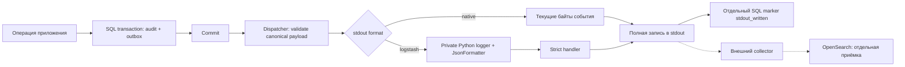

# ТЗ: аудит в формате Logstash JSON для внешнего сборщика OpenSearch

Дата: 20.10.2026. Редакция 2: актуальный main → выборочный перенос аудита → Logstash.
Пользователь выбрал этот путь и исключил продолжение старой Kubernetes-разработки.
Реализация находится в отдельной ветке `codex/audit-logstash` от main.
Фактические проверки и OPEN среды: [отчёт](../reports/2026-10-20-audit-logstash-acceptance.md).

Связанный [план реализации](../plans/2026-10-20-audit-logstash.md).

## 1. Цель и границы

На основе актуального main добавить необходимое ядро durable-аудита, используя
проверенные части старой работы как материал для выборочного переноса, затем
подключить формат stdout с основными полями Logback `LogstashEncoder`.
Платформенный сборщик должен иметь возможность
разобрать строку как JSON, выделить приложение и искать события по их полям.
Выбор библиотеки сам по себе не подтверждает работу конкретного сборщика.

Результат приложения: committed событие аудита выводится через стандартную
инфраструктуру Python logging с JSON-форматтером, сохраняет исходные ID,
время, содержание и семантику повторов. Результат интеграции: контрольное
событие найдено в целевом индексе, его поля и время разобраны правильно.
Эти два результата принимаются раздельно.

В объём входят модель и миграция outbox, транзакционная запись, каталог безопасных
событий, один dispatcher, подключение к текущему приложению, необходимые
auth/domain события, formatter, выделенный logging handler, выбор формата,
узкие изменения уже существующей Helm-конфигурации, зависимости, тесты,
пример события и инструкция оператора.
Расширение каталога сверх раздела 3.1, перевод обычных application/access/error logs в JSON,
изменение UI, прямой OpenSearch SDK, создание индексов, установка сборщика,
новый мониторинг, trusted-IP relay и изменение retention в объём не входят.
Старая Kubernetes-разработка не продолжается: lifecycle/restore framework,
PostgreSQL TLS operator, private candidates, source/admission/activation
framework, репликация и завершение их исторических gates исключены.

## 2. Основания и достоверность

| Основание | Что установлено | Чего оно не устанавливает |
|---|---|---|
| Переданный пользователем `OPENSEARCH_INTEGRATION.md`, раздел «Преобразование логов в JSON» | В примере ConsoleAppender использует LogstashEncoder и добавляет строковое поле `application` | Это пример другого приложения, не нормативный контракт платформы |
| Тот же файл, раздел об инфраструктурном потоке | Доставка предполагается через внешний сборщик | Вид сборщика, parser, mapping, права, ACK, retention и реальная доставка не проверены |
| [LogstashEncoder: Standard Fields](https://github.com/logfellow/logstash-logback-encoder#standard-fields) | Описаны стандартные поля JSON и возможности настройки кодировщика | Совпадение конфигурации конкретного заказчика не гарантируется |
| [Python JSON Logger](https://nhairs.github.io/python-json-logger/latest/quickstart/) | JsonFormatter подключается к Python logging, поддерживает настройку полей | Стандартные настройки не дают наш контракт автоматически |
| [Python logging](https://docs.python.org/3/library/logging.html#logging.Handler.handleError) | Ошибки handler могут обрабатываться без передачи вызывающему коду | Успешный возврат обычного logging-вызова не является доказательством записи |
| Код и [AUDIT_DELIVERY.md](../../AUDIT_DELIVERY.md) | Существует отдельная реализация audit/outbox с проверкой payload и повтором | Исторический runbook не задаёт новые поручения; наличие документации в main не означает наличия реализации |

В публичные документы переносится только обезличенный технический контракт.
Имена чужих приложений, корпоративные пакеты, адреса и содержимое примера с
персональными данными/токенами не копируются. Приложение называется `ai-knowledge`.

## 3. Проверенное исходное состояние

Проверка выполнена 20.10.2026; сведения о доноре ниже описывают источник идей
и кода, а не выбранную базу исполнения:

- Основной checkout: `main`, короткий HEAD `17d94c6`; в нём аудит пишет в БД,
  файлов `audit_event.py` и `audit_outbox.py` в runtime нет.
  Полный локальный HEAD: `17d94c6a0724b809309e4fc48de4b1ae1059b4c6`.
  Это проверенный локальный main; свежесть относительно origin не утверждается.
  Уже есть AuthSession и `record_in_session()`, общий hashed dependency lock.
  Статически найденный Alembic head — `065b1c2d3e4f_reference_editing.py`.
- Реализация прочитана в worktree `codex/kubernetes-rollout`,
  HEAD `f551f5f1457de1a0c073c3df09f9929375c14802`.
  `audit_event.py` и `audit_outbox.py` имеют статус untracked,
  `backend/requirements.txt` изменён. Поэтому этот SHA **не является**
  воспроизводимым снимком прочитанной реализации.
- В указанном worktree отсутствует `backend/requirements.lock.txt`;
  в main уже действует общий hashed lock и описан процесс его обновления.
- `build_event()` создаёт schema 1, `encode_event()` ограничивает канонический
  UTF-8 payload 16 KiB. Outbox хранит сериализованное событие.
- `_validate_payload()` проверяет точный набор полей, каталог, типы и
  каноническое представление; `AuditDispatcher.tick()` пишет событие после commit.
- `stdout_line()` использует полный цикл `os.write(1, ...)`, включая short writes,
  и обрамляет запись `LF + payload + LF` для восстановления границы после сбоя.
- Ошибка stdout оставляет `pending`; ошибка marker допускает повтор.
  `held` и `stdout_written` автоматически не переигрываются.
- `AUDIT_STDOUT_MODE=disabled|durable`, default `disabled`;
  Helm управляет им через `runtime.auditStdoutMode`.

При начале реализации сверить main с origin read-only/fetch, записать выбранный
SHA и работать в отдельной ветке `codex/` от согласованного актуального main.
Чужие dirty изменения в локальном main сохраняются. Если локальный main отстаёт,
использовать актуальный main ref в новом checkout без reset общего каталога.
Недоступность remote фиксируется, а не маскируется заявлением «последний main».
Перенос аудита является частью этой задачи, не внешним условием её начала.
Готовность старого worktree, его release и dependency workflow ждать не требуется.

### 3.1. Граница выборочного переноса

| Область | Решение |
|---|---|
| `audit_event.py`, `audit_catalog.py`, `audit_outbox.py` | Перенести с ревью и адаптацией к main; сохранить валидацию, пределы, framing, retry и lock |
| `AuditLog`, новый `AuditOutbox`, `services/audit.py` | Добавить только необходимые поля/класс/вызовы; общие файлы main не заменять |
| `audit_schema.py`, `audit_runtime.py`, `audit_metrics.py`, `audit_hold.py` | Перенести только нужные проверки schema/прав, status, счётчики и hold восстановленных pending |
| `audit_security.py` и его DB timeout helpers | Перенести только прямые зависимости требуемых auth-событий; сохранить ограниченное время отказа |
| `audit_denial_transport.py`, `audit_dns_probe.py`, `audit_file_materials.py`, `audit_file_probe.py` | Допустимы как прямые application-зависимости bounded denial при необходимости; не заменять их новым универсальным executor |
| Текущие auth/service/api, user blocklist, middleware, main/entrypoint | Точечная интеграция с текущими AuthSession, RBAC, CSRF и диагностикой |
| Migration/operator scripts | Новая миграция от head main и узкие standalone status/hold/schema-repair команды |
| Тесты | Переносить только относящиеся к выбранному пакету; проверять заново на main |
| Requirements и lock | Сохранить workflow main; добавлять только доказанно необходимые зависимости, не переносить старые pins wholesale |
| OIDC providers/flow/session maintenance | Текущая реализация main; старую OIDC-подсистему и recovery-ротацию целиком не переносить |
| `scripts/kubernetes/lifecycle.py`, `postgres_tls.py`, `.superpowers/sdd/**` | Не менять и не переносить; не запускать их очереди, матрицы и private candidates |

Список переноса конечный: исполнитель фиксирует выбранные файлы/участки,
их назначение и прямые зависимости один раз перед изменениями. Только новая
воспроизводимая ошибка текущего сценария может потребовать уточнения списка.
Не нужно обследовать или приводить в порядок все 418 файлов старой работы.

Каталог включает **все action_type актуального main**, а не старый фиксированный
список донора, и четыре auth-события: `auth_login_success`, `auth_login_denied`,
`auth_access_denied`, `auth_logout`. Для каждого действия задаётся явный allowlist;
неизвестное действие не проходит в durable. Для действий без безопасных деталей
old/new передаются null; существующий DB audit и его API не теряют свои поля.

Login/logout и user block/unblock в durable объединяются с audit/outbox в одной
транзакции. Ошибка обязательного audit откатывает security mutation, новая cookie
не выдаётся. Для остальных domain операций сохраняются существующие границы main:
атомарность audit+outbox не означает автоматическую атомарность всей бизнес-операции.
Переработка всех domain транзакций не входит в этот пакет.
Auth/CSRF denial фиксируется не более одного раза на запрос, сохраняет исходный
401/403/redirect и остаётся отказом при недоступной БД. Bounded denial использует
не более 4 s DB work + 0.5 s cleanup; HTTP <5 s проверяется на изолированных
supported-profile faults. Непроверенные NFS/CSI/OS/crypto-профили не объявляются
поддержанными и не становятся очередью новой разработки.
Существующая защита и auth-поведение disabled сохраняются.

### 3.2. Миграция и совместимость с main

Перенос outbox в main требует additive migration. Добавить nullable audit metadata
к `audit_log` (event_id, schema_version, actor_type, method, reason, outcome,
request_id, ip_source) и таблицу outbox с FK к audit_log, состояниями
pending/held/stdout_written, attempt_count, next_attempt_at, last_error_code,
stdout_written_at, immutable payload и индексом выборки очереди.
Legacy rows сохраняют ID, время, значения и NULL metadata; backfill/replay нет.
Новый event_id уникален; старые NULL допустимы.

Создать новую Alembic revision от фактического head выбранного main; не копировать
старую revision донора с её down_revision. На текущем snapshot родитель
`065b1c2d3e4f`; при изменении main перепроверить. Не менять историю миграций,
не выполнять stamp и не создавать вторую голову без причины.

Проверить fresh DB, upgrade непустой DB и повторный запуск приложения на SQLite
и PostgreSQL. Все новые поля нужны binary и при mode=disabled. Для локальной
create_all DB с drift использовать узкий schema-repair: backup, остановленные
writers, точная проверка исходной audit schema, только additive audit изменения.
Unknown drift должен давать отказ; основную пользовательскую БД в разработке
не мигрировать. Существующие reference editing, generation, AuthSession и другие
таблицы main должны сохраняться.

Для rollback binary остановить writer, сохранить backup, удержать pending с
фиксированной причиной и вернуть disabled; additive schema не удалять.
Очистка audit_log не должна удалять строки с pending/held или неподтверждённой
доставкой. Автоматический новый retention/GC в этот пакет не добавляется.
Для restore достаточно standalone hold и инструкции «после восстановления,
до первого старта»; завершать Kubernetes restore framework не требуется.

### 3.3. Конечные результаты вместо продолжения старой очереди

1. Main + migration + native audit: штатная synthetic операция на изолированной
   БД → committed audit/outbox → stdout; rollback и retry проверены.
2. Тот же пакет + Logstash: одна разобранная JSON-строка с сохранными ID/временем.
3. Проверенный локальный пакет и отдельно целевая видимость в OpenSearch.

После каждого шага предъявляется этот результат либо конкретная воспроизводимая
ошибка. Исторические TLS/restore PASS/FAIL не являются gates нового пакета.
Не повторять полный разбор зацикливания, source sealing и неизменные матрицы.

## 4. Архитектура



Каноническое событие и JSON-оболочка доставки разделяются. Перенос добавляет
schema в main; последующее форматирование не меняет UUID, `schema_version=1`,
`encode_event()` и содержание уже созданных outbox rows.
Форматтер работает только с уже проверенными байтами outbox.

Новый модуль `backend/app/services/audit_logstash.py` отвечает за оболочку и
выделенный logger/handler; `audit_outbox.py` сохраняет ответственность за
валидацию, очередь, backoff, marker, блокировку writer и framing.
Обработчики HTTP не вызывают stdout logger напрямую.

## 5. Требования к JSON

### 5.1. Дополнительные поля оболочки

| Поле | Тип | Значение/правило |
|---|---|---|
| `@timestamp` | string | Точная копия канонического `timestamp`, UTC ISO 8601; не время доставки |
| `@version` | string | `"1"` — версия формата Logstash, отдельная от audit schema |
| `message` | string | Точное значение `action`, без свободного текста |
| `logger_name` | string | `"ai_knowledge.audit"` |
| `thread_name` | string | `"audit-outbox"` — стабильное имя логического writer |
| `level` | string | `INFO` для success, `WARN` для denied, `ERROR` для failure |
| `level_value` | integer | Соответственно `20000`, `30000`, `40000`, не Python levelno |
| `application` | string | `"ai-knowledge"` |
| `audit_transport_version` | integer | `1` — версия нашей детерминированной оболочки |

Все существующие поля события остаются на верхнем уровне со своими типами:
`schema_version`, `event_id`, `timestamp`, `action`, `actor`, `target`,
`outcome`, `method`, `reason`, `request_id`, `client_ip`, `ip_source`,
`old_value`, `new_value`, `meta`.
Это JSON-объекты и значения, а не JSON-строка внутри `message`.
Нулевые значения сохраняются как `null`. Искусственное определение client IP
из заголовков в этот пакет не входит.

Логгер не добавляет `pathname`, `process`, текущий timestamp, traceback,
произвольные `extra` и другие поля LogRecord. Итоговый набор ключей фиксирован:
канонические ключи плюс девять полей таблицы. Конфликт ключей отвергается.
Никакой автоматической сериализации неизвестных объектов через `str()`.

Синтетический пример; для чтения показан с отступами, stdout компактный:

```json
{
  "@timestamp": "2026-10-20T09:00:00+00:00",
  "@version": "1",
  "message": "auth_login_success",
  "logger_name": "ai_knowledge.audit",
  "thread_name": "audit-outbox",
  "level": "INFO",
  "level_value": 20000,
  "application": "ai-knowledge",
  "audit_transport_version": 1,
  "schema_version": 1,
  "event_id": "00000000-0000-4000-8000-000000000001",
  "timestamp": "2026-10-20T09:00:00+00:00",
  "action": "auth_login_success",
  "actor": {"type": "user", "id": "test-user", "name": "Test User"},
  "target": {"type": null, "id": null},
  "outcome": "success",
  "method": "simulation",
  "reason": null,
  "request_id": "00000000-0000-4000-8000-000000000002",
  "client_ip": null,
  "ip_source": "unknown",
  "old_value": null,
  "new_value": null,
  "meta": null
}
```

### 5.2. Байты и пределы

- UTF-8 без BOM, компактный JSON, `ensure_ascii=False`, `allow_nan=False`.
- Внутренние CR/LF/tab в строках экранируются JSON-сериализатором.
  Физические разделители записей — только framing LF.
- Канонический payload: максимум `16384` байта, существующий предел не менять.
- Logstash payload: максимум `18432` байта без framing.
  Дополнительные 2048 байт предназначены только для фиксированной оболочки.
  Тест должен подтвердить верхнюю границу накладных расходов для всего каталога.
- Для данного canonical payload результат форматирования повторяем байт-в-байт,
  в том числе после рестарта процесса на той же версии formatter.
  Зафиксировать порядок ключей: оболочка в порядке таблицы, затем канонические
  поля в порядке `build_event()`.
- Сохраняется `LF + JSON + LF`. Пустой frame не является событием;
  collector должен пропускать его и собирать частичные CRI-записи.
- Нельзя молча обрезать событие, разбивать его на несколько JSON-событий
  или переходить на другой формат после ошибки.

## 6. Logging и обработка отказов

Использовать `pythonjsonlogger.json.JsonFormatter` с узким адаптером, который
задаёт точный allowlist и детерминированную сериализацию.
Предлагаемая зависимость: `python-json-logger>=3,<5`; конкретный релиз фиксируется
в hashed lock после проверки совместимости и аудита.

Выделенный экземпляр `logging.Logger` принадлежит dispatcher, не регистрируется
как общий root logger, не распространяет записи наверх и имеет один strict
handler. `LogRecord` создаётся явно из проверенного события; dispatch через
`Logger.handle()` не должен зависеть от глобального уровня `logging.disable()`.
Не подключать глобальную LogRecordFactory, фильтры или пользовательские extra.
Logger имеет `disabled=False`, handler без подавляющих filters.

Handler синхронно форматирует запись и вызывает существующую полную запись байтов.
`emit()` передаёт исключение вызывающему dispatcher. Не использовать поведение
StreamHandler, скрывающее ошибку через `handleError()`. Возврат без записи,
sampling, очереди logging и fire-and-forget запрещены в этой цепочке.
Счётчик `stdout_written` и SQL marker обновляются только после полной записи.

| Событие | Обязательное поведение |
|---|---|
| Rollback основного SQL commit/savepoint | Нет записи события в stdout |
| Некорректный canonical payload | Существующий `held / invalid_payload`, другие строки продолжаются |
| Ошибка formatter, превышение wire-предела или ошибка записи | `pending / stdout_failure`, существующий ограниченный backoff, без вывода payload/exception text |
| Short write | Дописывание остатка; ошибка в середине оставляет pending |
| Успешная запись, ошибка marker | `pending / marker_failure`; повтор с тем же ID и временем |
| Зависший stdout | Зависает только один writer; сохраняются существующие stalled/stop/lock semantics |
| Перезапуск | Pending повторяется; held/stdout_written не переигрываются |

Для ошибки formatter используется существующий код `stdout_failure`, чтобы
не менять каталог delivery status в этом пакете. Повторяемая такая ошибка —
дефект реализации/конфигурации, выявляемый тестами и проверкой pending; её нельзя
маскировать успешной записью. Python `raiseExceptions=True/False` не меняет исход.

## 7. Конфигурация и совместимость

Добавить `AUDIT_STDOUT_FORMAT=native|logstash`, default `native`.
В Settings: `audit_stdout_format: Literal["native", "logstash"] = "native"`.
Неизвестное значение отклоняется при загрузке конфигурации.

| Mode | Format | Результат |
|---|---|---|
| disabled | native или logstash | Существующий DB audit; новые outbox не создаются, stdout writer не запускается |
| durable | native | Текущие байты канонического события |
| durable | logstash | Каноническое событие в описанной оболочке |

Helm: `runtime.auditStdoutFormat: native`, enum в values schema, env из
template. `AUDIT_STDOUT_FORMAT` запрещается в произвольном `runtime.config`,
аналогично `AUDIT_STDOUT_MODE`, чтобы исключить два источника значения.
Для целевого окружения выбрать durable + logstash отдельными values.
Изменение формата применяется после штатного restart, hot reload не добавляется.

Сам формат Logstash не требует дополнительной SQL migration после переноса
audit runtime. Миграция из раздела 3.2 входит в эту задачу; переписывание outbox,
backfill и смена версии канонического события не требуются.

При переключении формата pending выводится в формате нового процесса.
Если предыдущая попытка успела выйти до marker, повтор может иметь другую
оболочку. Канонические поля и `event_id` совпадают. Дедупликация потребителя
должна опираться на `event_id`, а не на хеш всей строки. Exactly-once и
глобальный порядок событий не заявляются.

## 8. Безопасность и данные

Сохраняется существующий каталог разрешённых полей и агрегатов.
Содержимое документов, заголовки, cookies, OAuth state/code/tokens, credentials,
тела запросов, свободный текст ошибок и traceback в оболочку не добавляются.
Существующие разрешённые actor ID/name сохраняются: «без секретов» не означает
«без персональных данных». Права и retention audit-индекса подтверждает платформа.

Тесты используют только синтетические имена, ID и canary-строки.
Formatter не может ослаблять `_validate_payload()` для удобства вывода.
Обычные application/access/error logs сохраняют текущий stderr-путь.

## 9. Критерии приёмки

| ID | Проверка | Критерий |
|---|---|---|
| AC-01 | JSON contract | Точный набор/типы ключей; все три outcome; example соответствует fixture |
| AC-02 | Identity/time | Canonical projection равна outbox; `@timestamp == timestamp`; повтор детерминирован |
| AC-03 | Безопасность | Нет неразрешённых extra/traceback/secrets; Unicode и CRLF безопасно сериализованы |
| AC-04 | Размер/framing | Canonical limit сохранён; wire <=18432; short/partial writes покрыты |
| AC-05 | Delivery | Ошибки записи/formatter/marker не дают ложный stdout_written; pending повторяется |
| AC-06 | Изоляция logging | Root level/disable/dictConfig не подавляют и не дублируют audit; повторный lifecycle не добавляет handler |
| AC-07 | Совместимость | Native не меняется; disabled не создаёт writer; старые pending/held/restore сохраняют семантику |
| AC-08 | Конфигурация | Settings и Helm принимают два формата, отклоняют неизвестный/двойную настройку |
| AC-09 | Процесс и пакет | Реальный entrypoint/image; Windows и Linux, POSIX crash/restart отдельно; зависимости воспроизводимы |
| AC-10 | Целевая интеграция | Тестовые success/denied/failure видны в индексе, поля типизированы, нет parser errors/утечки canary |
| AC-11 | Перенос в main и миграция | Fresh/upgrade SQLite и PostgreSQL; legacy rows и новые функции main сохранены; один Alembic head |
| AC-12 | Полнота и транзакции | Все действия main покрыты каталогом; audit+outbox атомарны; auth/block rollback и bounded denial подтверждены |
| AC-13 | Независимость поставки | Сценарий на базе main выполняется без старого worktree, private sources и Kubernetes lifecycle/TLS operator |

Локальная приёмка AC-01…AC-09 и AC-11…AC-13 не закрывает AC-10.
Старые отчёты по audit runtime не являются результатами нового formatter.
Скорость: в изолированном прогоне 1000 synthetic events с исправным sink
обе конфигурации доставляют 1000 событий без ошибок; фиксировать время и размер,
не вводить недоказанный production SLA и не менять существующие performance gates.

## 10. Целевой collector contract

Перед проверкой AC-10 владелец окружения подтверждает:

1. Способ включения сбора stdout и выбранный namespace/index без production-секретов.
2. Где оказывается JSON после CRI: root или поле container message; нужен один
   разбор, чтобы `actor`, `target` и `outcome` стали доступными полями.
3. `@timestamp` как date с UTC, application/event_id/action/outcome как поля
   точного поиска, level_value как integer, actor/target как objects.
4. Допустимый размер >=18432 байта плюс CRI overhead, reassembly длинных строк,
   обработку blank/partial frames и отсутствие фильтрации audit INFO.
5. Доступ к индексу, retention, владельца разбора ошибок и политику дублей.
6. Согласованное время ожидания индексации для теста; до его определения
   не объявлять потерю по произвольно выбранному короткому timeout.

Это открытые вопросы платформенной приёмки, не препятствие локальной реализации.
Пример пользователя не содержит ответов на них.

## 11. Включение и откат

1. На тестовом окружении записать image digest, baseline, counts pending/held/
   stdout_written и выбранные mode/format.
2. Развернуть проверенный пакет с native, подтвердить прежнее поведение.
3. Подготовить collector mapping для logstash; переключить format на logstash
   через штатный lifecycle. Синтетические события создаются после переключения.
4. Сопоставить response/request ID → audit/outbox → stdout → индекс, проверить
   AC-10 и сохранить обезличенное доказательство.
5. При несовместимости вернуть format=native штатным restart и сохранить очередь.
   Не снимать held и не переписывать pending. Не использовать disabled как
   «безопасный эквивалент»: при нём новые события не попадают в outbox.
6. Откат бинарника проводить по адаптированному для main AUDIT_DELIVERY runbook
   и разделу 3.2 с backup/hold. Исторический Kubernetes runbook не исполнять.
   Откат формата SQL downgrade не требует.

## 12. Статус реализации

Код и additive migration реализованы в отдельной ветке от проверенного origin/main.
Native и Logstash потоки проверены независимыми процессами на изолированных данных;
SQLite/PG migration, transactional security audit, retry/hold и существующий chart
проверяются своим пакетом tests. Итоговые counts и ограничения находятся в
[отчёте](../reports/2026-10-20-audit-logstash-acceptance.md).

Docker/Linux image и целевой OpenSearch остаются отдельными OPEN проверки среды.
Основная БД/корпус и старый Kubernetes worktree не изменялись. Commit/push/deploy
не выполнялись по прямому указанию пользователя.
